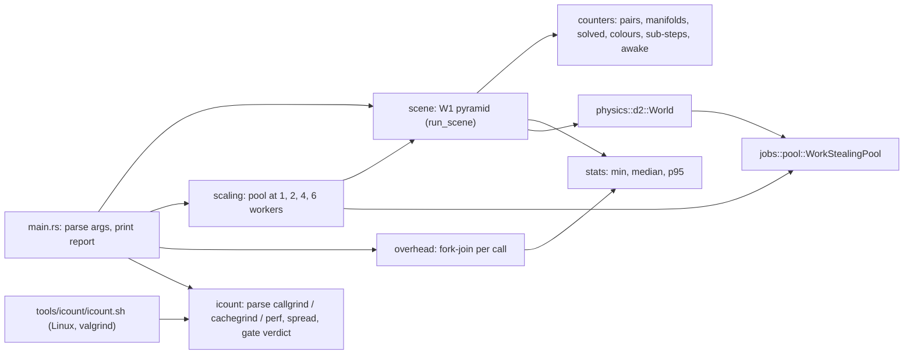

# Physics benchmark report (card 4-22)

Status: measured on 2026-11-06 by card 4-22. **Wall times are from the owner's development laptop only, under conditions that do not meet the reference-machine protocol (see section 1); nothing is measured on Linux, on a hosted runner, on ARM64 or on a quiet reference run (R-25).** The only hosted-runner measurements are the instruction counts of section 6. No time is judged against a budget here: [reference-machine-and-workloads](reference-machine-and-workloads.md) is not edited and its provisional W1 budget (2.0 ms median per step) is printed next to the median and compared with nothing.

The tool is `engine/tools_physics_bench`; the run command is

```text
cargo run --release -p tools_physics_bench
```

(about 4 minutes; `--iters`, `--steps`, `--rows`, `--scale-steps`, `--scale-iters`, `--calls` and `--reps` shrink it, and the report warns when a count is below the 30 iterations of the protocol). The text of section 2 to 5 is the tool's output (three full runs gave the same counters and hash, and wall times within a few percent of each other).



## 1. Conditions of the measurements

| Item | Value |
|---|---|
| Machine | the owner's development laptop (i7-12700H, 20 logical CPUs, Windows 11 build 26200), the machine named in the reference-machine file |
| Build | release, rustc 1.94.1 (pinned), `panic = abort` |
| Power | on mains power, but the power plan was **Balanced**, not High performance |
| Load | other applications open (an agent session, an editor); CPU load about 13% before the run |
| Pinning | **not** pinned to a performance core; threads were free to move between performance and efficiency cores |
| Protocol | one warm-up pass discarded; 30 timed iterations for every row; median and 95th percentile (nearest rank) over the pooled step times (30 x 300 = 9,000 samples for W1); the W1 median varied between 2.20 and 2.26 ms over three runs (2.6%) and the scaling medians by up to 4.6%, inside the band above which the reference-machine file asks for a repeat |
| Solver | the defaults: 4 sub-steps and 1 relax pass per step (the "4 sub-steps, 1 relax" equivalent of the W1 text's "10 velocity and 4 position iterations", O9 of the design note; the edit of the W1 text itself is still the owner's) |
| Sleeping | off for the timed rows (a sleeping pyramid stops costing); a second W1 row with sleeping on is printed |
| W1 size | **44 rows, 990 boxes**. A pyramid of n rows has n(n+1)/2 boxes, so 1,000 is not a pyramid; 44 rows is the nearest below (45 rows have 1,035). Boxes 0.5 m, density 1, friction 0.6, restitution 0 (the defaults), gravity 9.80665, step 1/60 s, 300 steps from the first step (the boxes start touching) |

## 2. W1 (one thread, serial scalar solver)

| scene | boxes | steps x iterations | min ms | median ms | p95 ms | budget ms (not judged) | max drift m | settled drift m | final speed m/s | standing (< 0.05 m, at rest) | replay hash |
|---|---|---|---|---|---|---|---|---|---|---|---|
| W1, sleeping off | 990 | 300 x 30 | 2.121 | 2.258 | 2.582 | 2.0 | 0.2473 | 0.1492 | 0.0370 | NO | ea83099e2f36813e |
| W1, sleeping on | 990 | 300 x 30 | 2.114 | 2.232 | 2.477 | 2.0 | 0.2473 | 0.1492 | 0.0370 | NO | ea83099e2f36813e |

The replay hash is the same in every run (D0) and the same with sleeping on (the pyramid never falls asleep, see the finding). It is the hash of this build on Windows; it is not stored in a gate.

**FINDING F-W1: the 990-box pyramid does not stay standing with the current solver.** The farthest any box ends from its start is 0.247 m (bound 0.05 m, five times it), and the boxes are still moving at the end of step 300 (fastest box 0.037 m/s against the rest speed of 0.02 m/s; between step 100 and step 300 the largest displacement is 0.149 m, so this is not only the initial compression of the soft contacts). Numbers by size, one run each, same 300 steps, sleeping off:

| rows | boxes | max drift m | settled drift m | final speed m/s | standing (< 0.05 m, at rest) |
|---|---|---|---|---|---|
| 10 | 55 | 0.0186 | 0.0002 | 0.0000 | yes |
| 20 | 210 | 0.0516 | 0.0049 | 0.0042 | NO |
| 30 | 465 | 0.1068 | 0.0438 | 0.0257 | NO |
| 44 | 990 | 0.2473 | 0.1492 | 0.0370 | NO |

This agrees with the earlier findings of [reviews/4-17.md](../../reviews/4-17.md) (F1: 20 rows 0.0527 m, 30 rows about 0.107 m) and extends them to the W1 scale: W1-scale stacking is **not** demonstrated and the drift grows faster than the number of rows. The solver, its parameters and the assertion were not touched. Whether the solver changes (for example a higher contact stiffness, which 4-17 measured on 20 rows, or relative position drift instead of drift from the start) is the owner's decision. The standing assertion lives in a test at 10 rows (55 boxes, 300 steps, because the test build is unoptimised and the full pyramid takes minutes there); the full-size result is only this report.

**The W1 time budget** is not judged. For orientation only: the median of 2.2 ms is above the provisional 2.0 ms, on a machine under the conditions of section 1, with a scene that does not stand.

## 3. Work counters (deterministic, pinned in tests)

Totals over the 300 steps, read from the world after each step; they do not vary with the machine or the run. `pairs tested` is the length of the broadphase pair list (every pair goes to the narrowphase); the difference to the manifolds is the pairs whose shapes are farther apart than the speculative margin.

| scene | steps | sub-steps | pairs tested | manifolds built | constraints solved | constraints frozen | colours max | colours mean | overflow | bodies awake (mean) |
|---|---|---|---|---|---|---|---|---|---|---|
| W1, sleeping off | 300 | 1200 | 868305 | 864600 | 864600 | 0 | 6 | 6.00 | 0 | 990.0 |
| W1, sleeping on | 300 | 1200 | 868305 | 864600 | 864600 | 0 | 6 | 6.00 | 0 | 990.0 |

Per step: about 2,894 pairs, 2,882 manifolds and constraints, 6 colours, no overflow. The tests pin the same counters for a 10-row pyramid (60 steps with sleeping off; 300 steps with sleeping on, where the pyramid falls asleep after 36 steps: 5,220 constraints solved and 38,280 frozen). They were measured on Windows; Linux was not run, and a platform whose `f32` results differ in the last bit could in principle change a pair count at a margin (the D2 golden job of card 4-20 shows the physics hashes equal on both platforms with the feature on, which makes this unlikely, not impossible).

## 4. Scaling: the pyramid on the real work-stealing pool

44 rows, 60 steps per iteration (the first second of the W1 run), 30 timed iterations per row, chunk size 32 (the default). Efficiency is the time at one worker over N times the time at N workers, within the same solver path. The "same hash" column checks D1 on every row: all ten rows end in the hash of the serial scalar reference.

| configuration | min ms | median ms | p95 ms | parallel efficiency | same hash as serial scalar |
|---|---|---|---|---|---|
| serial, scalar | 2.121 | 2.218 | 2.922 | n/a | yes |
| serial, lanes | 3.540 | 3.652 | 4.182 | n/a | yes |
| pool 1, scalar | 4.210 | 4.354 | 5.230 | 1.00 | yes |
| pool 2, scalar | 3.286 | 3.462 | 4.243 | 0.63 | yes |
| pool 4, scalar | 2.987 | 3.173 | 4.108 | 0.34 | yes |
| pool 6, scalar | 2.956 | 3.345 | 4.139 | 0.22 | yes |
| pool 1, lanes | 3.530 | 3.666 | 4.300 | 1.00 | yes |
| pool 2, lanes | 2.889 | 3.080 | 3.540 | 0.60 | yes |
| pool 4, lanes | 2.749 | 2.965 | 3.318 | 0.31 | yes |
| pool 6, lanes | 2.714 | 3.062 | 3.497 | 0.20 | yes |

**FINDING F-SCALE: at this scene size the parallel solver is slower than the serial one at every worker count.** The best pool row (4 workers, lanes, 2.97 ms) is 34% slower than the serial scalar reference (2.22 ms), and the efficiency at 4 workers is 0.31 to 0.34, which is far below any usable scaling target; the pool at one worker already costs twice the serial solver (4.35 ms against 2.22 ms), and the lane path is slower than the scalar one when serial (3.65 ms against 2.22 ms). The results are bit-identical throughout, so this is a speed problem, not a correctness one. The design note's own caveat ([physics-and-jobs-v0](../../wiki/architecture/physics-and-jobs-v0.md), card 4-15) predicted it: the staged path copies each constraint and both bodies out of and back into a locked slot for every pass and scatters serially. The fork-join call itself is not the cost (section 5: about 1 microsecond per call, and the solver makes about 80 calls per step, estimated as 6 colours x 3 passes x 4 sub-steps plus restitution, so about 0.1 ms of 3 ms); where the time goes was not profiled here **[K, not verified]**. Which part to optimise first is a question for the owner and a profile, not for this card. The efficiency figure is relative to the same path at one worker, so it flatters the pool; against the serial reference it is lower still. The target of the vision page (CPU scaling row) is not met by these numbers.

## 5. Scheduler overhead

One fork-join call (`parallel_for`), 1,000 calls per repetition, 30 timed repetitions, nanoseconds per call. The empty job is one index; the tiny job is 64 indices in 8 chunks of 8, each chunk adding its indices to a shared counter. Inline is the in-order scheduler on the calling thread (no threads: the floor).

| job | scheduler | min ns/call | median ns/call | p95 ns/call |
|---|---|---|---|---|
| empty (1 index) | inline | 10 | 10 | 10 |
| empty (1 index) | pool 1 | 92 | 92 | 102 |
| empty (1 index) | pool 2 | 63 | 67 | 98 |
| empty (1 index) | pool 4 | 75 | 75 | 112 |
| empty (1 index) | pool 6 | 99 | 100 | 148 |
| tiny (64 indices, 8 chunks) | inline | 47 | 47 | 50 |
| tiny (64 indices, 8 chunks) | pool 1 | 161 | 162 | 176 |
| tiny (64 indices, 8 chunks) | pool 2 | 644 | 657 | 702 |
| tiny (64 indices, 8 chunks) | pool 4 | 1075 | 1115 | 1183 |
| tiny (64 indices, 8 chunks) | pool 6 | 1329 | 1451 | 1708 |

An empty one-index call on the pool costs 60 to 100 ns (one chunk, run by the caller). A tiny call that does spread over workers costs 0.6 to 1.5 microseconds and grows with the worker count: hand-over and join, not work. The workers were busy-waiting between calls (the pool's wait policy), which is the best case for a tight loop of calls; a solver step has other work between calls, so these are lower bounds.

## 6. Instruction-count investigation (first question of the card)

Question: can instructions be counted deterministically so that the PR benchmark gate (warn 5%, fail 10%, `gates/gates.toml [benchmark]`) can use them? The design note marked this **[K, not verified]**.

| Where | Tool | Result |
|---|---|---|
| Local, Windows 11 (the dev laptop) | `valgrind`, `perf`, `xperf`, VTune, Pin, DynamoRIO | **not installed** (and nothing may be installed outside the repo folder) |
| Local, WSL2 Ubuntu on the same laptop | `perf stat -e instructions:u` | **not supported** ("No supported events found"): WSL2 is a virtual machine without a performance-monitoring unit. valgrind is not installed there |
| Local, Windows ETW | `wpr` lists `InstructionRetired` among its profile sources | not tried: it needs an elevated session, it is a sampling source (an interval of at least 4,096 events, not a count) and it changes the system trace state. **Not a deterministic count** |
| GitHub-hosted `ubuntu-latest` (image ubuntu-26.04, version 20261101.186.1, kernel 7.0.0-1019-azure, AMD EPYC 7763, 2 vCPUs, Hyper-V guest) | `perf stat -e instructions:u` | **not supported** ("The instructions:u event is not supported", `sudo`, `perf_event_paranoid` 4): the hosted VM exposes no hardware counter |
| same | `valgrind --tool=callgrind` 3.26.0 (apt) | **works, deterministic** |
| same | `valgrind --tool=cachegrind --cache-sim=no` 3.26.0 | **works, deterministic** |

How it was measured: a throw-away branch `agent/4-22-icount-probe` (deleted from the remote and locally; never a pull request) held one temporary workflow that built the bench from `agent/4-22-physics-bench` and ran `tools_physics_bench icount-workload` (serial, no timing, no threads) under each tool three times. `workflow_dispatch` could not be used (a workflow file must exist on the default branch to be dispatched; the API answered 404), so the workflow also had a `push` trigger on the probe branch, and the run was repeated once with `gh run rerun` (a second job on a fresh VM). The log is in run 42304246413 of the repository's Actions (attempts 1 and 2).

Instruction counts of the user-space program (`Ir`), all runs:

| Workload | Tool | Run 1 (attempt 1) | Run 2 | Run 3 | Attempt 2, runs 1 to 3 | Spread |
|---|---|---|---|---|---|---|
| 20 rows (210 boxes), 30 steps | callgrind | 162,566,311 | 162,566,311 | 162,566,311 | 162,566,311 (x3) | 0.0000% |
| 44 rows (990 boxes), 10 steps | callgrind | 282,690,644 | 282,690,644 | 282,690,644 | 282,690,644 (x3) | 0.0000% |
| 20 rows, 30 steps | cachegrind | 163,284,496 | 163,284,496 | 163,284,496 | 163,284,496 (x3) | 0.0000% |

The counts are bit-for-bit identical in all 18 readings across two separate jobs (separate builds, probably separate VMs, same image). The work-counter line printed by the workload (pairs 17,700; manifolds 17,700; hash 432dcc4c6b52004c; and for 44 rows 28,820 pairs, hash 5a13b72b268dee82) was the same in every run, so the workload is the same. Callgrind and cachegrind differ from each other by 0.44%, which is why a baseline must be taken with the same tool. A callgrind run of the 990-box scene for 10 steps took about 1.2 s of wall time, so a gate workload of a few hundred million instructions costs seconds, not minutes.

**Verdict: feasible.** With `valgrind --tool=callgrind` on a hosted Ubuntu runner the instruction count of the serial scalar W1 workload has a measured spread of 0.0%, which is under the 0.5% (one tenth of the warn band) that `gate_feasibility` requires, so both bands (warn 5%, fail 10%) are readable. Hardware counters (`perf`) are not available and must not be planned for.

What this does **not** show (state it, do not assume):

- Counts across **runner image updates** were not measured: both attempts used one image version. A different glibc or loader changes the instruction count of the process (the dynamic loader and `libc` calls are counted), so a stored baseline would drift when the image does. The robust design for the gate (card 4-23) is to build and count the base and the head **in the same job** and compare the two counts, which removes the image from the comparison. That design was not built or tried here.
- A **multi-threaded** workload is not covered: the counted workload is serial (one thread, the scalar solver). Under valgrind threads are serialised, but the amount of work a work-stealing pool does can depend on the schedule, so the pool and the lane path were not counted.
- Windows and ARM64 have no deterministic count; the gate would be Linux x86-64 only.
- Only 18 readings of two workloads were taken; this is evidence of determinism, not a proof.

What was built (no gate file, no workflow touched):

- `tools_physics_bench icount-workload [--rows N] [--steps N]`: the serial scalar pyramid, no timing, no threads, printing the work counters and the replay hash (so a run proves it did the same work).
- `tools_physics_bench icount-parse <callgrind|cachegrind|perf> <file>`: reads the instruction count from a tool's saved output, including the "not supported" answer of `perf` on a virtual machine. Tested against the exact lines of the probe log.
- `tools_physics_bench icount-spread <count> ...`: the spread (range over the smallest count) and the verdict against the warn band of the gate: feasible (noise at most one tenth of the band), marginal (inside the band), infeasible (above it).
- `tools/icount/icount.sh [runs] [rows] [steps]`: runs the workload under callgrind N times and prints the counts and the verdict (Linux). Its plumbing was checked here with a stand-in `valgrind` (no valgrind on this machine); the probe ran the same valgrind command line (`--tool=callgrind --callgrind-out-file=/dev/null`) on the hosted runner, but the script itself has not run on a real valgrind.

Registering the benchmark in `gates/gates.toml [benchmark]` and in CI is card 4-23 (governance); this report is its input.
