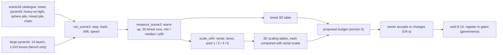

# 3D physics benchmark report and proposed budget (card 8-14)

Status: measured on 2026-11-19 by card 8-14. **Wall times are from the owner's development laptop only, under conditions that do not meet the reference-machine protocol (section 1); nothing here is measured on the reference machine or on a second machine, and every figure is one run of 30 iterations.** The budget in section 5 is a **proposal**: the owner accepts or changes it (choice O9 (a) of the phase 8 design note). Nothing in `gates/` or in `reference-machine-and-workloads.md` is changed by this card; registering the 3D benchmarks in the gates is card 8-13 (governance).

The tool is `engine/tools_physics_bench` (the 3D scenes are `scene3d`, the timing is `measure3d`); the run command is the same as for the 2D report:

```text
cargo run --release -p tools_physics_bench
```



## 1. Conditions of the measurements

| Item | Value |
|---|---|
| Machine | the owner's development laptop (i7-12700H, 20 logical CPUs, Windows 11 build 26300), the machine named in the reference-machine file |
| Build | release, rustc 1.94.1 (pinned), `panic = abort` |
| Power | on mains power, but the power plan was **Balanced**, not High performance |
| Load | about 1% CPU load before the run; an agent session and an editor were open |
| Pinning | **not** pinned to a performance core |
| Protocol | one warm-up run discarded; 30 timed iterations per row, each on a fresh world; median and 95th percentile over the pooled step times (30 x 300 = 9,000 samples for the scene table; 30 x 60 = 1,800 for the scaling rows) |
| Solver | the defaults: 4 sub-steps and 1 relax pass per step; fixed step 1/60 s; gravity 9.80665 m/s2 |
| Sleeping | off for every timed row (a sleeping scene stops costing) |
| Runs | two full reports were made the same day (the first before the large pyramid existed); the figures that appear in both agree within about 3% (pyramid 1.26 and 1.28 ms, mixed pile 0.50 and 0.51 ms) |

## 2. The scenes, timed (one thread, serial scalar solver)

| scene | bodies | steps x iterations | min ms | median ms | p95 ms | max drift m | settled drift m | final speed m/s | replay hash |
|---|---|---|---|---|---|---|---|---|---|
| tower | 10 | 300 x 30 | 0.024 | 0.025 | 0.026 | 0.0356 | 0.0019 | 0.0014 | 59e161a3468cd545 |
| pyramid | 91 | 300 x 30 | 1.252 | 1.284 | 1.454 | 0.0072 | 0.0012 | 0.0000 | cc5afdfad9ced7e8 |
| heavy-on-light | 5 | 300 x 30 | 0.012 | 0.012 | 0.013 | 0.0487 | 0.0039 | 0.0006 | 2a4d0d9a82f9f770 |
| sphere-pile | 60 | 300 x 30 | 0.009 | 0.098 | 0.114 | 3.6192 | 1.0855 | 0.9702 | 5f5f750ab7b4be75 |
| mixed-pile | 90 | 300 x 30 | 0.070 | 0.513 | 0.562 | 4.8868 | 0.8957 | 0.3113 | 87d15b7adae0a9c2 |
| chain | 12 | 300 x 30 | 0.010 | 0.012 | 0.013 | 5.1599 | 11.5187 | 10.9937 | 4e270c417edc2cdf |
| **large-pyramid** | **1,015** | 300 x 30 | 17.828 | **18.633** | 20.732 | 0.0197 | 0.0016 | 0.0000 | 0f6b0e77edb7def6 |

The hashes are the replay hashes of these builds on Windows with sleeping off; they are not stored in a gate. The piles and the chain are still moving at step 300 by design (they are dropped from a height and swing); the standing scenes end at rest.

**The large pyramid is the 3D counterpart of W1.** 14 layers of a square pyramid of 0.5 m boxes make 1,015 boxes (the 2D W1 pyramid has 990). It stands: no box moved more than 0.02 m and every box ends at rest. The 2D W1 pyramid of 990 boxes does **not** stand with the 2D solver (finding F-W1 of card 4-22: 0.247 m). That difference is not investigated here; the two scenes are not the same load (a box in a square pyramid rests on four boxes, not two).

## 3. Scaling on the work-stealing pool (large pyramid, 60 steps, chunk 32)

| configuration | min ms | median ms | p95 ms | parallel efficiency | same hash as serial scalar |
|---|---|---|---|---|---|
| serial, scalar | 17.523 | 18.072 | 20.226 | n/a | yes |
| serial, lanes | 18.730 | 19.590 | 21.719 | n/a | yes |
| pool 1, scalar | 18.828 | 19.772 | 22.302 | 1.00 | yes |
| pool 2, scalar | 13.270 | 13.737 | 14.582 | 0.72 | yes |
| pool 4, scalar | 11.162 | 11.630 | 12.718 | 0.43 | yes |
| pool 6, scalar | 11.406 | 11.839 | 12.805 | 0.28 | yes |
| pool 1, lanes | 18.768 | 19.711 | 21.521 | 1.00 | yes |
| pool 2, lanes | 13.278 | 13.742 | 14.719 | 0.72 | yes |
| pool 4, lanes | 11.182 | 11.644 | 12.679 | 0.42 | yes |
| pool 6, lanes | 11.497 | 11.821 | 12.553 | 0.28 | yes |

Efficiency is the time at one worker over N times the time at N workers, within the same solver path. Every row ends in the hash of the serial scalar row (D0 and D1 hold on the large pyramid at 1, 2, 4 and 6 workers, scalar and lanes).

- **The pool pays on a scene of a thousand boxes.** Four workers solve a step in 11.6 ms against 18.1 ms serial (1.55 times faster, 1.70 times faster than one pool worker). Six workers are no faster than four (11.8 ms): the reference machine has 6 performance cores, and this run was not pinned, so some of the six threads may have run on efficiency cores; this is not established.
- **The pool does not pay on small scenes.** (The figures in this bullet are from the 60-step scaling runs of the same report, which are not tabulated here; the 300-step medians of section 2 differ, for example 0.51 ms for the mixed pile.) The 91-box pyramid is 1.25 ms serial and 1.30 to 1.60 ms on the pool (efficiency 0.14 to 0.50); the 90-body mixed pile is 0.18 ms serial and 0.18 to 0.24 ms on the pool. This is the rule of thumb of the 2D report, confirmed for 3D: a pool pays from colours of a few hundred constraints. It closes the open point of card 8-19, whose review had no scaling figure.
- **The lane (SIMD) path gains nothing in 3D today** (19.6 ms against 18.1 ms serial; equal at every worker count). The 3D solver does not use the lane path where the 2D solver does, or the gain is lost in the copies; not investigated.

## 4. Cost per body against 2D

| scene | bodies | median ms per step | microseconds per body |
|---|---|---|---|
| 2D W1 pyramid (card 4-22, re-run the same day) | 990 | 2.220 | 2.2 |
| 3D large pyramid | 1,015 | 18.633 | 18.4 |

A 3D step costs about eight times a 2D step per body in this scene. Part of that is physics (6 degrees of freedom, up to 4 contact points per box pair, more neighbours); how much is not measured. At 60 Hz a frame is 16.7 ms, so one thread cannot solve the large pyramid inside one frame (18.6 ms) and four workers can (11.6 ms) with room for little else.

## 5. Proposed budget (for the owner to accept or change)

The method is the one of the 2D report: the proposal is the measured median plus a margin for noise on a non-reference machine (about 12 to 17% here, because two runs the same day agreed within 3% and the p95 is 11% above the median), rounded up. It ratchets: it may only get tighter after it is accepted.

| id | workload | proposed budget (median per step) | measured | note |
|---|---|---|---|---|
| W4 | 3D rigid-body stack: the large pyramid (14 layers, 1,015 boxes of 0.5 m), 300 steps, defaults, one thread | **<= 21 ms** | 18.6 ms | the headline figure; over one 60 Hz frame on one thread |
| W4p | the same on the work-stealing pool, 4 workers | **<= 13 ms** | 11.6 ms | inside one 60 Hz frame (16.7 ms) |
| W4s | the 91-box pyramid, one thread | <= 1.5 ms | 1.28 ms | small-scene guard |
| W4m | the 90-body mixed pile, one thread | <= 0.6 ms | 0.51 ms | contact-heavy guard (capsules, hulls of mixed shapes) |

Wall time is noisy on a laptop, so the proposal is also that the **gate is on instruction counts** on the hosted runner (warn 5%, fail 10%, as for the 2D benchmark and as the design note says); the wall times above are for the reference machine and for review. Which counts to gate, and the numbers of the first run on the runner, belong to card 8-13 and are not made here. The first run on the reference machine, pinned and on High performance, should confirm or change these figures before they become binding.

What the budget does **not** cover: the render side of the sandbox (no frame budget is asked for), joints (the chain is a correctness scene), convex hulls in bulk, and any scene above about 1,000 bodies.

## 6. Coverage and mutation of the phase

### Line coverage (`cargo llvm-cov --summary-only`, the phase 8 crates, run by this card)

The seven crates together: 19,176 lines, 1,372 missed, **92.85%** (gate: 90% for L0-L2). Every phase 8 file of `physics/src/d3` is above the 90% gate; per file (`solver/stage.rs` 96.95%, `solver/mod.rs` 98.03%, `gjk.rs` 98.00%, `hull.rs` 98.73%, `face_clip.rs` 99.43%, `narrowphase.rs` 98.63%, the joint solver 99.42%); `core/colouring.rs` 100%; `render/lit.rs` 98.21%; `render/mesh_scene.rs` 100%; `sync_render/d3.rs` 97.67%. The weakest files are glue: `sync_physics/d3.rs` 91.26%, `sync_physics/attach.rs` 90.16%, `sync_physics/error.rs` 78.57%, `sync_render/error.rs` 57.14% (error types). **Branch coverage was not measured** (it needs nightly options), so the 80% branch gate is not evidenced here.

### Mutation (`cargo mutants`, gate: 80% of viable mutants caught on changed L0-L2 code)

Recorded by the cards (from `reviews/8-*.md`, not re-run here): 8-3 aabb, shape, mod: all caught after fixes. 8-4 `manifold.rs`: 0 missed; `box_box.rs`: survivors judged. 8-6 `constraint.rs`: 109 mutants, 7 missed then killed, one equivalent survivor. 8-7 `solver/joint.rs`: survivors killed. 8-9 `render` lit and shapes: 207 of 207 viable. 8-10 transform, hierarchy, sync: all viable caught. 8-11 orbit, controls, spawn, mesh, session, lit: all caught; sandbox all but 3, renderer all but 4 (equivalent or glue). 8-18 `face_clip.rs`: 84.5% of viable (186 caught, 34 missed); `clip.rs` 89%.

**Run by this card for card 8-19**, whose review had no mutation score (the run was stopped for memory). One file at a time, one job, tests `--lib --test d3_parallel --test d3_solver`:

| file | mutants | caught | unviable | missed | caught of viable |
|---|---|---|---|---|---|
| `core/colouring.rs` | 78 | 66 | 12 | 0 | 100% |
| `d3/solver/constraint.rs` | 113 | 97 | 16 | 0 | 100% |
| `d3/solver/stage.rs` | 25 | 18 | 6 | 1 | 94.7% |
| `d3/solver/mod.rs` | 129 | 54 (58 after rerun with `d3_joints`) | 70 | 5 (1 after rerun) | 98.3% after rerun |

The five survivors in `solver/mod.rs` were first run without the joint tests (`d3_joints`). Rerun with them, four of the five are caught (`add_joint` to `()`, the `||` in `add_joint`, `/` to `%` and `/` to `*` in `joint_sweep`). That leaves one survivor in `mod.rs` (58 of 59 viable caught, 98.3%) and, with `stage.rs`, **two survivors in the four files: 239 of 241 viable caught (99.2%)**:

- `stage.rs:89` `has_room` to `true`: `has_room` is the guard for an output buffer too small for the chunks, which the solver never builds (it sizes the buffers itself); no test can reach the false branch without a hand-made job. Judged unreachable by construction; **not killed, not proven**.
- `mod.rs:553` `||` to `&&` in `write_back` (skip a static body or a sleeping body): with `&&` a static awake or a sleeping body would be written back, and no scene shows a difference. **Not judged equivalent; left open as a possible test gap.**

The per-card figures above are the recorded ones; **no run covers the whole phase in one piece.**


## 7. Not measured

- Nothing here is from the reference machine or a second machine; there is no noise figure beyond the two same-day runs.
- No Linux or ARM64 run; no stored golden hash (card 8-13, choice O6).
- Branch coverage (needs nightly options) and a whole-phase mutation run in one piece were not made.
- The cost per body against 2D (section 4) is a ratio of two different scenes, not a controlled comparison.
