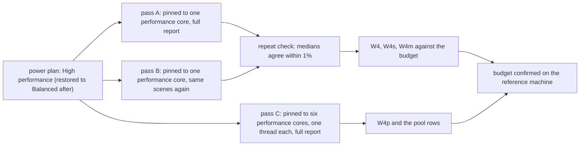

# 3D physics benchmark under the reference-machine protocol (card 8-85)

Status: measured on 2026-11-25 by card 8-85, on the owner's development laptop, the machine that [reference-machine-and-workloads](reference-machine-and-workloads.md) names. It repeats the report of [card 8-14](physics-benchmark-8-14.md) with the protocol steps that run left out (High performance plan, pinning) and on the code of `develop` at `07687b6`, which holds the 3D work of the phase 8 follow-up (cards 8-25 to 8-82). **The four figures of the accepted budget hold. Nothing in `gates/` changed.** Wall times are report only; the gate on instruction counts stays as it is.

## 1. Conditions

| Item | Value |
|---|---|
| Machine | i7-12700H, 20 logical CPUs, Windows 11 build 26300 (the reference-machine file) |
| Build | release, `cargo run --release -p tools_physics_bench`, rustc pinned, `panic = abort` |
| Power | on mains power; plan **High performance** for the runs (it was Balanced and was set back after, as agreed with the owner) |
| Load | about 9% CPU before the runs; Steam, the Task Manager, Intel graphics software and the agent session were open: **not an idle machine** |
| Pinning | single-thread rows: pass A and B pinned to logical CPU 0 (a performance core). Pool rows: pass C pinned to logical CPUs 0, 2, 4, 6, 8, 10, taken as six different performance cores (assumes the usual numbering, performance cores first, two threads each: not read from the machine) |
| Protocol | one warm-up discarded, 30 timed iterations per row, median and p95 (as 8-14) |
| Runs | A (full, 25 minutes), B (full scene table, scaling rows shortened to 10 steps x 3 iterations), C (full). Two more passes (a second pass C and one unpinned) were planned and not done: the system ran low on memory and the batch was stopped |

## 2. The four budget figures

| ID | What | Budget | 8-14 (Balanced, unpinned) | 8-85 pass A | 8-85 pass B | 8-85 pass C | Verdict |
|---|---|---|---|---|---|---|---|
| W4 | large pyramid, 1,015 boxes, one thread | <= 21 ms | 18.633 | 18.980 (p95 20.504) | 18.932 | 18.668 (not pinned to one core) | holds, 9.6% below the budget |
| W4p | the same on the pool, 4 workers | <= 13 ms | 11.6 | not meaningful (one core) | not meaningful | 12.101 (p95 13.132) | holds, 6.9% below; the p95 is just over 13 |
| W4s | 91-box pyramid, one thread | <= 1.5 ms | 1.28 | 1.288 | 1.290 | 1.259 | holds, 14% below |
| W4m | 90-body mixed pile, one thread | <= 0.6 ms | 0.51 | 0.517 | 0.519 | 0.506 | holds, 14% below |

- **Repeat check (protocol step 5):** passes A and B agree within 1% on every scene (largest difference 1.0%, the sphere pile; the four budget scenes within 0.4%). The protocol asks for 5%.
- **Against 8-14:** single-thread rows are 0.3% to 1.9% above it (W4 18.633 to 18.980): the phase 8 follow-up code costs a little, as the +1.86% of the instruction-count gate said, and the High performance plan and the pinning did not make a visible difference.
- **Same results:** every replay hash of the scene table is the same in the three passes and in 8-14 (for example the large pyramid `0f6b0e77edb7def6`), and the "same hash as serial scalar" column says yes in every pool row.

## 3. The pool on six performance cores (pass C, large pyramid, 60 steps)

| workers | scalar median ms | efficiency | lanes median ms |
|---|---|---|---|
| serial | 18.671 | n/a | 20.022 |
| 1 | 20.120 | 1.00 | 19.340 |
| 2 | 14.053 | 0.72 | 13.926 |
| 4 | 12.101 | 0.42 | 12.190 |
| 6 | 12.329 | 0.27 | 12.325 |

- **Six workers are still no faster than four** when every thread has a performance core of its own (12.329 against 12.101 ms). So the guess of 8-14, that the sixth thread landed on an efficiency core, is not what holds the pool back: the cause is something else (the shared work, the memory bandwidth, the chunk size of 32 and the cost of a pool step were not measured here).
- **The lane path does not pay in 3D** (serial lanes 20.022 against scalar 18.671; pool 4 lanes 12.190 against scalar 12.101): the finding of card 8-22 stands.
- The 90-body mixed pile gets slower on the pool (0.176 ms serial, 0.233 ms with 4 workers): a scene this small does not pay the pool.

## 4. Not verified

- **Not an idle machine** (see Conditions), and only one pass C: the pool rows (W4p) have no repeat. W4p has the thinnest margin (6.9%, and its p95 of 13.132 ms is above 13), so it is the figure most worth a second run before it binds.
- The mapping of logical CPUs 0, 2, 4, 6, 8, 10 to six distinct performance cores is an assumption.
- The unpinned run of this card was not made, so the effect of pinning alone is not separated from the effect of the power plan (both are against 8-14).
- One machine only; no second machine, no Linux or ARM64 wall times; the gate counts instructions on a hosted runner.
- Memory, allocation and the 2D figures were not measured.
- Mermaid read by the author, not rendered.

## 5. What this changes

- **H2 of the phase 9 note** (W4, W4p, W4s, W4m confirmed or changed on the reference machine under its protocol, machine named): confirmed, with the caveats above. The machine is the owner's laptop, as the reference-machine file says; the owner confirms or names another.
- **Cost cards of Wave 2** (8-22, 8-73, 8-78, 8-80) have a reference-machine baseline to measure against: W4 about 19.0 ms, W4p about 12.1 ms.
- No gate number moves. The budget is not tightened here (it ratchets only after the owner decides).
