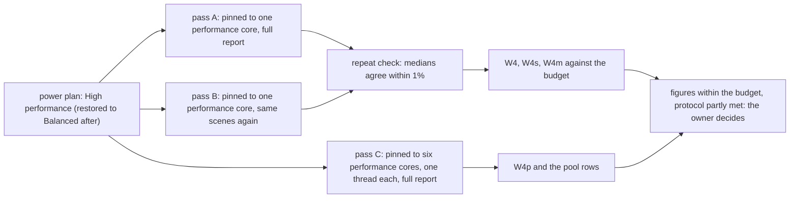

# 3D physics benchmark on the reference machine, protocol partly met (card 8-85)

Status: measured on 2026-11-25 by card 8-85, on the owner's development laptop, the machine that [reference-machine-and-workloads](reference-machine-and-workloads.md) names. It repeats the report of [card 8-14](physics-benchmark-8-14.md) with the two protocol steps that report left out (High performance plan, pinning), **but the machine was not idle and the pool rows have one run, so the protocol is only partly met (section 1)** and on the code of `develop` at `07687b6`, which holds the 3D work of the phase 8 follow-up (cards 8-25 to 8-82). **The four figures of the accepted budget are within it, with W4p the thinnest. The owner decides whether this closes H2. Nothing in `gates/` changed.** Wall times are report only; the gate on instruction counts stays as it is.

## 1. Conditions

| Item | Value |
|---|---|
| Machine | i7-12700H, 20 logical CPUs, Windows 11 build 26300 (the reference-machine file) |
| Build | release, `cargo run --release -p tools_physics_bench`, rustc pinned, `panic = abort` |
| Power | on mains power; plan **High performance** set before the runs (read back at the switch; not read again during the runs) and set back to Balanced by hand after the batch was stopped, as agreed with the owner |
| Load | about 9% CPU before the runs; Steam, the Task Manager, Intel graphics software and the agent session were open: **not an idle machine** (protocol steps 2 and 5 not met) |
| Pinning | single-thread rows: pass A and B pinned to logical CPU 0 (a performance core). Pool rows: pass C pinned to logical CPUs 0, 2, 4, 6, 8, 10, taken as six different performance cores (assumes the usual numbering, performance cores first, two threads each: not read from the machine) |
| Protocol | one warm-up discarded, 30 timed iterations per row, median and p95 (as 8-14) |
| Runs | A (full, 25 minutes), B (full scene table, scaling rows shortened to 10 steps x 3 iterations), C (full). Two more passes (a second pass C and one unpinned) were planned and not done: the harness stopped the batch for low memory after pass C finished; whether the memory pressure disturbed pass C itself is not known |

## 2. The four budget figures

| ID | What | Budget | 8-14 (Balanced, unpinned) | 8-85 pass A | 8-85 pass B | 8-85 pass C | Verdict |
|---|---|---|---|---|---|---|---|
| W4 | large pyramid, 1,015 boxes, one thread | <= 21 ms | 18.633 | 18.980 (p95 20.504) | 18.932 | 18.668 (six cores, not one) | within, 9.6% below the budget |
| W4p | the same on the pool, 4 workers | <= 13 ms | 11.6 | not meaningful (one core) | not meaningful | 12.101 (p95 13.132) | within, 6.9% below; the p95 is just over 13 |
| W4s | 91-box pyramid, one thread | <= 1.5 ms | 1.28 | 1.288 | 1.290 | 1.259 (six cores) | within, 14% below |
| W4m | 90-body mixed pile, one thread | <= 0.6 ms | 0.51 | 0.517 | 0.519 | 0.506 (six cores) | within, 14% below |

- **Repeat check (protocol step 5):** passes A and B agree within 1% on every scene (largest difference 1.0%, the sphere pile; the four budget scenes within 0.4%). The protocol asks for 5%.
- **Against 8-14** (its medians: pyramid 1.284, mixed pile 0.513, large pyramid 18.633, pool 4 workers 11.630): pass A and B are 0.3% to 1.9% above it (W4 +1.9% and +1.6%, W4s +0.3% and +0.5%, W4m +0.8% and +1.2%), pass C is between 1.9% below and 0.2% above (W4 +0.2%, W4s -1.9%, W4m -1.4%). The code, the power plan, the pinning and the load all differ from 8-14, so **this page does not say which of them moved a figure**; the +1.86% of the instruction-count gate on the hosted run is a different measure and the likeness is not evidence.
- **The pool rows are slower than in 8-14:** W4p 12.101 against 11.630 ms (+4.0%), pool 6 +4.1%, serial inside the scaling run +3.3%, although the plan was High performance and the cores were performance cores. That points to load or noise, or to a real cost of the phase 8 follow-up code; one run cannot say. It narrows the margin of W4p.
- **Same results:** every replay hash of the timed scene table is the same in the three passes and in 8-14 (for example the large pyramid `0f6b0e77edb7def6`), and the "same hash as serial scalar" column says yes in every pool row.

## 3. The pool on six performance cores (pass C, large pyramid, 60 steps)

| workers | scalar median ms | efficiency (scalar) | lanes median ms |
|---|---|---|---|
| serial | 18.671 | n/a | 20.022 |
| 1 | 20.120 | 1.00 | 19.340 |
| 2 | 14.053 | 0.72 | 13.926 |
| 4 | 12.101 | 0.42 | 12.190 |
| 6 | 12.329 | 0.27 | 12.325 |

- **Six workers are still no faster than four** (12.329 against 12.101 ms; the p95 is lower and the min higher: the two are the same within the noise of one run) when each worker is meant to have a performance core of its own. So the guess of 8-14, that the sixth thread landed on an efficiency core, **is not supported**; it is not refuted either, because the placement of the threads is an assumption (the mask is of the process) and there is one run. What does hold the pool back was not measured: the shared work, the memory bandwidth, the chunk size of 32, the cost of a pool step, hyper-threads sharing a core, or a power or frequency limit under a six-core load.
- **The lane path gains nothing in 3D** (serial lanes 20.022 against scalar 18.671; pool 4 lanes 12.190 against scalar 12.101; pool 1 lanes is 3.9% faster than scalar and pool 2 about equal): mixed, no gain, as 8-14 found; card 8-22 (open) is the place to decide on it.
- The 90-body mixed pile gets slower on the pool (0.176 ms serial, 0.233 ms with 4 workers): a scene this small does not pay the pool.

## 4. Not verified

- **The protocol is only partly met:** the machine was not idle (steps 2 and 5), pass B's scaling rows are 3 iterations (step 3), and pass C's single-thread rows run on six cores, not one (step 4).
- **The raw reports are not stored in the repository** (they were printed by `cargo run --release -p tools_physics_bench`, with the affinity masks of section 1, and kept in the session's scratch folder); the tables above are copied from them and were checked against them by the independent reviewer.
- **Not an idle machine** (see Conditions), and only one pass C: the pool rows (W4p) have no repeat. W4p has the thinnest margin (6.9%, and its p95 of 13.132 ms is above 13), so it is the figure most worth a second run before it binds.
- The mapping of logical CPUs 0, 2, 4, 6, 8, 10 to six distinct performance cores is an assumption.
- The unpinned run of this card was not made, so the effect of pinning alone is not separated from the effect of the power plan (both are against 8-14).
- The low-memory stop after pass C (section 1) may have disturbed pass C; unknown.
- One machine only; no second machine, no Linux or ARM64 wall times; the gate counts instructions on a hosted runner.
- Memory, allocation and the 2D figures were not measured.
- Mermaid read by the author, not rendered.

## 5. What this changes

- **H2 of the phase 9 note** asks that W4, W4p, W4s and W4m are confirmed or changed **by the owner** on the reference machine under its protocol, with the machine named. The figures are within the budget; the protocol is only partly met (section 4); the machine is the owner's laptop, as the reference-machine file says. Whether this closes H2, or a second W4p run on an idle machine is wanted first, is the owner's call.
- **Cost cards of Wave 2** (8-22, 8-73, 8-78, 8-80) have a reference-machine baseline to measure against: W4 about 19.0 ms, W4p about 12.1 ms.
- No gate number moves. The budget is not tightened here (it ratchets only after the owner decides).
