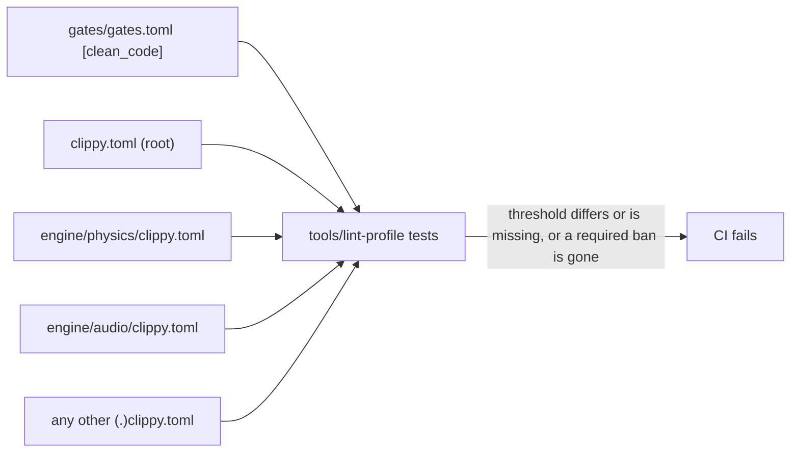

# Clean-code lint profile (card 0b-3)

What the repository enforces today for the measurable clean-code limits of
[rules-digest section 4](../../wiki/rules-digest.md), and what it cannot yet.
The numbers live in `gates/gates.toml` (`[clean_code]`); `clippy.toml` carries
the same numbers and `tools/lint-profile` fails CI when they differ or when a
seeded violation is not flagged.

## Enforced by Clippy

CI runs `cargo clippy --workspace --all-targets --locked -- -D warnings`, so a
lint at `warn` level also fails the build.

| Limit (gates.toml) | Clippy lint | Level | clippy.toml key | Value |
|---|---|---|---|---|
| `function_length_warn` 60 | `too_many_lines` | warn | `too-many-lines-threshold` | 60 |
| `cognitive_fail` 20 | `cognitive_complexity` (nursery) | deny | `cognitive-complexity-threshold` | 20 |
| `parameters_fail` 5 | `too_many_arguments` | deny | `too-many-arguments-threshold` | 5 |
| `nesting_max` 3 | `excessive_nesting` (nursery) | deny | `excessive-nesting-threshold` | 3 |
| dead code | rustc `dead_code` | warn | | `-D warnings` makes it fail |

Waivers (card 0c-12): `allow_attributes` and `allow_attributes_without_reason` are `deny`, so a lint is
turned off only with `#[expect(lint, reason = "...")]`, which also fails once the lint no longer fires.
The change classifier lists every added waiver for the owner.

How Clippy counts, measured with the seeded tests:

- Function length is the number of lines between the braces: 60 is clean, 61 is flagged.
- Nesting counts the function body as level 1, so a limit of 3 allows two nested
  control-flow blocks inside a function and flags the third. This is the
  reading of "nesting <= 3" taken here (the digest does not say whether the
  function body counts); it is the stricter one. A looser reading would need
  `excessive-nesting-threshold = 4` and a decision by the owner.
- Cognitive complexity is Clippy's own score, not the SonarSource definition
  exactly; the threshold is the gate number.

The lint table is in the workspace `Cargo.toml` and is repeated by hand in
`engine/skeleton-unsafe/Cargo.toml` (that crate cannot inherit it because it
allows `unsafe`). A test fails if the two drift apart.

## Crate-level configs (card 4-19)

Clippy reads one `clippy.toml` per crate (the nearest above its manifest, `.clippy.toml` is the hidden
alias) and a crate-level file replaces the root file: it does not merge. A crate that needs its own
settings, such as the `disallowed-methods` of `engine/physics/clippy.toml` or the bans of `engine/audio/clippy.toml` (card 5-10), must therefore repeat the four
thresholds. `tools/lint-profile` walks the tree (hidden folders and `target` skipped) and fails when any
`clippy.toml` or `.clippy.toml` has a threshold that differs from `gates.toml`, higher or lower, or lacks
one, or carries any other setting (`msrv`, `allow-*-in-tests`, `allow-invalid`; the physics and audio files may add only `disallowed-methods` and `disallowed-types`); it also fails when the physics file loses a required ban (one entry per class: libm functions for
`f32` and `f64`, `mul_add`, `Instant::now`, `SystemTime::now`, unstable slice sorts, `HashMap`, `HashSet`) or the audio file does not carry exactly its bans (card 5-10, the second line of the real-time rule of the audio callback: `Mutex`, `RwLock`, `Condvar`, the `mpsc` sender and receiver types, `mpsc::channel`, `mpsc::sync_channel`, `thread::sleep`). A seeded test shows that atomics and `Arc` stay allowed.
Seeded tests lint throwaway crates with the real physics file (a typo after a primitive root such as `f32::` or `slice::` is silent in Clippy, so every such entry is seeded): each ban is flagged, `sqrt` and
the other exact operations are not, and the length limit still applies. The bans themselves and their
reasons are described in [ports-and-adapters](../../wiki/architecture/ports-and-adapters.md).



## Not enforceable with Clippy yet

These limits are in `gates.toml` but no Clippy lint can express them. They stay
unenforced until the tool named here is added (a later phase-0 card). Nothing is
waived: the numbers are unchanged.

| Limit | Why Clippy cannot | Needs |
|---|---|---|
| cyclomatic warn > 10 / fail > 15 | no cyclomatic lint exists | rust-code-analysis |
| parameters warn > 3 | `too_many_arguments` has a single threshold, used for the fail tier (5) | rust-code-analysis |
| duplication <= 3% | no such lint | a duplication detector |
| magic numbers | no such lint exists (only `unreadable_literal` for formatting) | a scan or a custom lint |

## Verification

```
python -m unittest -q test_lint_profile    # in tools/lint-profile, needs cargo
```

The tests lint throwaway crates with the repository's own `clippy.toml` and lint
table: each limit is clean at the limit and flagged one step over it.
