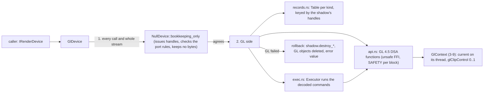

# Review 3-10: `adapter_render_gl` part 2, the OpenGL render device

Task: 3-10. Class 2 (public API of `render` grows by one constructor; new unsafe FFI in layer 3; no protected path touched: `gates/architecture.toml` maps `adapter_*` to layer 3 by name, and the adapter may depend on `render`, `platform`, `base`). Loops: 1 of 3 used (self review, then the independent review of PR #113: 2 majors, all addressed, see below). Open blocker/major: 0.

Delivers, in `engine/adapter_render_gl`: `GlDevice` (`create(NativeToken)`, `take_gl_error`, `context_info`, `impl IRenderDevice`), the OpenGL 4.5 Direct State Access function table (`api.rs`), the command-stream executor (`exec.rs`), the GL-side records (`records.rs`), the handle-keyed table (`table.rs`) and the format/enum tables (`mapping.rs`). In `engine/render`: `NullDevice::bookkeeping_only(capacity)`.

## Decisions and deviations

- **Shadow validator.** `GlDevice` holds a bookkeeping-only Null device that issues the handles and validates every call and every whole stream (a rejected stream changes nothing, by the Null device's own rule). The port's rules therefore exist once, and the GL device refuses exactly what the Null device refuses. The GL side stores only object names in `Table`s keyed by those handles. Deviation from "implement everything natively": the cost is a second handle table; the gain is no divergence between devices. Needed a small public addition to `render`: `NullDevice::bookkeeping_only(capacity)` (checks, issues handles, drops bytes, clears change nothing, `read_back` is `Unsupported`). Three tests, red first.
- **Shader blob = GLSL 450 source text (UTF-8), entry `main`.** The port says the blob's format is the backend's. ADR-0009's chain (GLSL 450 -> glslang -> SPIR-V -> SPIRV-Cross -> GLSL) needs the shader tool of card 3-11, so this card compiles the text with `glCreateShader`/`glCompileShader`; a compile failure, a link failure or an entry other than `main` is `ShaderRejected`. The tests embed GLSL 450 sources. When 3-11 lands, its GL output is this format.
- **One window per device in v0.** The context is made when the device is made, from the window's token (resource calls need a current context before any surface exists, and Windows allows `SetPixelFormat` once per window). `create_surface` accepts only that token (`Unsupported` for another).
- **Texture rows are in OpenGL order**: row 0 is the bottom row of the picture, for `write_texture`, `read_back` and the viewport (`SetViewport` is passed to `glViewport` as given, origin lower left). Consistent inside the device (upload and read-back round-trip, the contract suite passes); the image-comparison test of card 3-13 must account for it. Not yet recorded in the port page.
- **Barrier is a no-op**: a pass that draws into a texture followed by a pass that samples it needs no barrier in OpenGL.
- **Sampler minification** uses the mipmapped filter modes (a sampler does not know its texture; one level is safe).
- **Vertex and index buffers** are attached to the pipeline's vertex array at each draw (`glVertexArrayVertexBuffer` with the bind offset, `glVertexArrayElementBuffer`): two cheap calls per draw, no state cache yet (PERF: measure with the sprite batcher in a later card).
- **Errors are values.** After each call the device drains `glGetError` (at most 8 flags): `GL_OUT_OF_MEMORY` is `OutOfMemory`, any other flag `Unsupported`; a failed creation deletes its GL objects and gives the handle back. No panics, no `unwrap`/`expect`.
- **Caps**: `max_texture_size` = min(driver, 4096 = the Null device's limit), `uniform_buffer_alignment` from `GL_UNIFORM_BUFFER_OFFSET_ALIGNMENT` (16 on this GPU), both index types, `depth_zero_to_one` true, name "OpenGL 4.5".
- **`unsafe`**: denied crate-wide, `#![expect(unsafe_code)]` only in the FFI modules `api` (new), `gl`, `lookup`, `dynlib`, `wgl`, `glx`. New in this card: `api.rs` has 37 `unsafe {` blocks (each with a `// SAFETY:` comment) and 54 `unsafe extern "system" fn` pointer types in the function table (after fix loop 1); `gl.rs` gained a `Probe` table (1 pointer type) and moved its `glGetString` unsafe blocks into a shared function (2 blocks, unchanged count); no other module gained unsafe. Pointer-taking wrappers derive the size from the slice they take (`texture_sub_image` refuses a length that is not exactly the region), and the index offset is passed as an integer-valued pointer (`core::ptr::without_provenance`, valid in a core profile where the argument is a byte offset). `context.rs` gained two accessors, no unsafe.
- The Windows `glfw3.dll` for the local run was downloaded into the git-ignored `target/glfw` of this worktree from the pinned release; the zip (`54efa829...`) and the DLL (`4429adff...`) SHA-256 equal the values in `THIRD_PARTY.md`. Run with `DUCK_GLFW_LIB=<path>` and `DUCK_REQUIRE_GL=1`.

## Evidence

- TDD: `NullDevice::bookkeeping_only` red first (`error[E0599]: no function or associated item named bookkeeping_only`), green: `render` 130 tests. `tests/device.rs` red first (`error[E0432]: unresolved import adapter_render_gl::GlDevice`). Pure units: `table` 6 tests, `mapping` 6 tests, `exec` 1.
- `DUCK_REQUIRE_GL=1`, GPU strings: GL_VENDOR "Intel", GL_RENDERER "Intel(R) Iris(R) Xe Graphics", GL_VERSION "4.5.0 - Build 30.0.101.2079". `tests/device.rs` (6 tests) all pass: **the render contract suite passes on GL** (`render_device_contract`, then no GL error flag), a red triangle drawn into a texture over a blue clear has the right pixels, an indexed draw honours the vertex-buffer offset and the index-buffer offset, a bound texture and sampler reach the fragment shader (the texel, not the vertex colour), a non-compiling shader and a wrong entry are `ShaderRejected`, the null token makes no device. The picture tests are the GL-only read-back tests the contract suite does not cover.
- `cargo test --workspace --all-features` with the DLL and `DUCK_REQUIRE_GL=1`: all pass, 0 failed.
- Clippy `--workspace --all-targets --all-features -D warnings` clean on Windows; `cargo clippy --target x86_64-unknown-linux-gnu -p adapter_render_gl -p render --all-targets` clean; rustfmt clean.
- Mutation (cargo-mutants 27.1.0): `table.rs` + `mapping.rs`: 44 mutants, 36 caught, 6 unviable, 2 missed (both in `Table::grow_to`: `index + 1 - len` as a `try_reserve` size hint; a wrong hint changes capacity, not behaviour: equivalent). `null.rs` changed lines (`--in-diff`): 12 mutants, 10 caught, 2 unviable, 0 missed. `device.rs`, `exec.rs`, `api.rs`, `records.rs` need a driver and were not mutated; the device tests exercise them on the GPU.
- Local gates: see the PR description.

## Independent review and fix loop 1 of 3

The independent review of PR #113 found no blocker and 2 majors, plus minors. Open blocker/major after the loop: 0.

| Item | Finding | Fix |
|---|---|---|
| Major 1 | `attach_vertices` demanded a bound vertex buffer, but the validator accepts attribute-less draws (`gl_VertexID`) | the vertex-buffer step is skipped when none is bound (draw and draw_indexed). Red first (`InvalidDescription` from `submit`), then green; test `a_draw_without_a_vertex_buffer_runs_and_both_devices_accept_it` draws a full-screen triangle on GL and submits the same stream to a plain `NullDevice` (parity) |
| Major 2 | indexed draws are not bounds-checked against the vertex buffer (indices live on the GPU) | decided deliberately: documented, not fixed. Robust buffer access needs a context-creation flag in `wgl.rs`/`glx.rs` (`WGL_CONTEXT_ROBUST_ACCESS_BIT_ARB` / `GLX_CONTEXT_ROBUST_ACCESS_BIT_ARB`, extension `GL_ARB_robustness` or 4.5 `KHR_robustness`), driver support differs, and it would add a field to `RenderCaps` (a port change, Class 2). Recorded in the `device.rs` module doc and below; follow-up card suggested |
| Minor 3 | no shader info log; blob not checked | `Api::compile_shader`/`link_program` return the info log (1024 bytes, lossy UTF-8) and `GlDevice::last_shader_log()` exposes it (the port's error value carries no text); a non-UTF-8 blob and a wrong entry set the log too |
| Minor 4 | stale GL error flags | flags are drained after every `destroy_*`, `begin_frame`, `end_frame` and in the shader/pipeline refusal path |
| Minor 5 | destroyed buffer stays attached to VAOs | documented (module doc): a draw re-attaches the buffer it binds, and a pipeline without attributes reads none |
| Minor 6 | version checked after the 4.5 table | a one-function `Probe` (`glGetString`) reads and checks the version first; an older context now reports its version |
| Minor 7 | backbuffer viewport size | documented: it is the size given to `create_surface` or the last `resize_surface`; a caller must call `resize_surface` on a framebuffer change. No device test: the port has no way to read the backbuffer |
| Minor 10 | mip levels | `GL_TEXTURE_MAX_LEVEL = mip_count - 1` is set explicitly; the min filter stays mipmapped (a sampler does not know its texture; with the max level set a one-level texture is complete). Test: 2x2 textures with one and with two levels sampled with a linear filter. The port writes level 0 only, so content of level 1 is not testable |
| Tests | gaps | added: 32-bit index draw, uniform buffer read by a shader, attribute-less draw, refused-shader log, and the pixel checks now scan the whole 64x64 picture (every pixel is a drawn colour; the triangle covers 1900 to 2300 pixels) |
| 8, 9 | sRGB; wiki follow-ups | sRGB is unaddressed (no sRGB format in the port; framebuffer and textures are linear 8-bit, `GL_FRAMEBUFFER_SRGB` is not enabled); wiki follow-ups are listed below, including GL row order and the shader blob format |

Evidence after the loop: `tests/device.rs` 11 tests pass with `DUCK_REQUIRE_GL=1` on the Intel Iris Xe; Clippy `--workspace --all-targets --all-features -D warnings` clean on Windows and `x86_64-unknown-linux-gnu` (`-p adapter_render_gl -p render`); rustfmt clean. Mutation: no pure-logic file changed in the loop (`table.rs`, `mapping.rs`, `null.rs` as before). Unrelated: `adapter_window_glfw` test `the_framebuffer_matches_the_size_times_the_scale` (a real-window DPI check in a crate this card does not touch) failed in two later runs on this machine after passing earlier the same day; it depends on the display, not on this change. The `gl_linux` CI job of card 3-12 sets `DUCK_REQUIRE_GL`.

## Not verified

- The GLX/Linux path still never ran: `adapter_render_gl` for Linux compiles and passes Clippy for `x86_64-unknown-linux-gnu`, but neither `glx.rs` nor the device on X11/Mesa has executed (card 3-12 runs it on a hosted runner).
- Out-of-range index values in an indexed draw (undefined in OpenGL without robust buffer access; Mesa vs Intel behaviour unknown), and the effect of an unwritten mip level 1.
- Other drivers (NVIDIA, AMD, Mesa), context loss, multiple windows or contexts, a resized window, a depth-tested draw (`glClipControl` effect on depth; no depth-buffer draw test yet), uniform buffer binding to a shader block (bound, never read by a test shader), alpha blending, a depth-texture render target (code path written, no test), mip chains beyond level 0 (only level 0 is writable by the port).
- `cargo test` without a device (the gated "not run" path) was run only for the 3-9 tests; the new tests use the same gating helper.
- Coverage by tool (not measured for this crate).

## Wiki follow-up owed (no wiki edits in this card)

- `render-port-v0` section 6: the as-built GL device (shadow validator, GLSL 450 source as the GL shader blob with entry `main`, texture rows in GL order, one window per device, `NullDevice::bookkeeping_only`).
- `architecture/ports-and-adapters` and `README` index/changelog rows for `adapter_render_gl` part 2; the Null device section for `bookkeeping_only`.
- Card 3-11 (shader tool) must emit GLSL 450 text for the GL backend; card 3-13 (image test) must read rows bottom-up.
