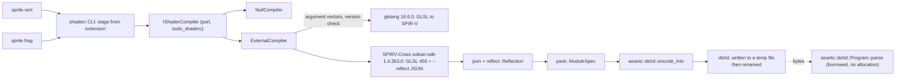

# Review 3-11 (part 1): `tools_shaderc`, the `dshd` v0 format and the first shader asset

Task: 3-11 part 1 (the triangle/sprite sample is part 2, after 3-10 merges). Class 2 (new public API in layer 2 `assets`, a new layer 4 tool crate that runs external programs; no protected path touched). Loops: 2 of 3 (self-review, then the independent review's fix loop). Open blocker/major: 0, with one major owed to a governance card (CI sets `DUCK_REQUIRE_SHADER_TOOLS`).

Delivers: `assets::dshd` (header, `encoded_len`, `encode_into`, `Program::parse`, `DshdError`); crate `engine/tools_shaderc` (library `tools`, `process`, `json`, `reflect`, `compiler` with the `IShaderCompiler` port, `null`, `external`, `contract`, `pack`, `cli`; binary `shaderc`); shaders `sprite.vert`, `sprite.frag`, `broken.frag`; golden asset `golden/sprite.dshd` (674 bytes).

`dshd` v0 (little-endian): header 8 bytes (magic `DSHD`, version u16 = 0, backend u8 = 0 for GLSL 450, module count u8 = 1 or 2); per module a 16-byte record (stage, input count, uniform binding, texture binding, uniform size u32, code length u32, 4 reserved zero bytes), then 2 bytes per vertex input (location, components), then the code text. Binding 255 means none. Limits: 16 inputs, code 1 to 1 MiB, one module per stage, file length must match exactly.

## Decisions and deviations

- **Where the port lives.** `IShaderCompiler` is declared in `tools_shaderc` (layer 4): its only consumer is the build-time tool, and the runtime never links a compiler. `assets` is layer 2 and may not depend on `render`, so `dshd` carries its own small `Stage`/`VertexInput`/`UniformBlock` types. A wiki note on `ports-and-adapters` is owed.
- **Combined sampler, not separate texture and sampler (deviates from the 3-6 spike page and ADR-0009 wording).** SPIRV-Cross keeps `layout(binding = N)` for uniform blocks, but for a separate `texture2D` plus `sampler` it emits `uniform sampler2D SPIRV_Cross_Combinedtexsamp;` with no binding, so the texture unit would silently be 0. `sprite.frag` therefore uses `layout(set = 0, binding = 0) uniform sampler2D tex;`, whose binding survives (reflection key `textures`). Reflection refuses separate images/samplers with a message that says to use a combined `sampler2D`.
- **No third-party JSON crate.** SPIRV-Cross reflection is read by a small hand-written parser (`json.rs`: input limit 1 MiB, depth 32). The input is untrusted tool output.
- **Reflection is strict.** At most one uniform block (set 0), one combined sampler (set 0), vertex inputs float to vec4 only, bindings below 255. Push constants, storage buffers, storage images, subpass inputs, atomic counters are refused, not ignored.
- **Tools** are found by `--tools DIR`, then `DUCK_GLSLANG` / `DUCK_SPIRV_CROSS` / `DUCK_SHADER_TOOLS`, then the git-ignored default `target/shader-spike`; nothing absolute is compiled in. Versions are checked before use (`--version`, `--revision`). Programs and arguments are separate values (no shell); child output goes to files, not pipes; every run has a 60 s limit and is killed on timeout; each compile has its own scratch directory removed on drop; the output file is written beside the target and renamed.
- Output text is normalised to `\n` so the golden file is the same on every platform.
- **Gated tests.** Tests that need the real tools print `not run: tool not set up` and pass when the tools are missing; `DUCK_REQUIRE_SHADER_TOOLS=1` makes them fail instead.
- No governance file, wiki page or Trello card was touched. The workspace `Cargo.toml` gained the member `engine/tools_shaderc`, and `Cargo.lock` one entry.

## Evidence

- TDD, red first for each module: `dshd` 125 compile errors then green; `tools_shaderc` modules `reflect` 106, `tools` 66, `process` 29 compile errors, then green. Real-tool run caught one wrong assumption (the reflection key for a combined sampler is `textures`, not `sampled_images`): the contract test failed with `left: None, right: Some(0)`, then the code and tests were corrected.
- Tests: `assets` 42, `tools_shaderc` 66 unit plus 5 binary tests, with the real tools required (`DUCK_REQUIRE_SHADER_TOOLS=1`); also run with the tools absent (the gated tests report `not run`).
- `cargo clippy --workspace --all-targets` clean; clippy for `x86_64-unknown-linux-gnu` (`tools_shaderc`, `assets`) clean; rustfmt clean; local gates all pass (see the PR text).
- Mutation (cargo-mutants 27.1.0): `dshd.rs` first run 9 missed, closed with 6 tests, rerun 0 missed (126 caught, 10 unviable). `tools_shaderc` first run 229 mutants: 15 missed, 5 timeouts (loop-advance mutants, detected by the time limit); the 15 were closed with tests (escapes, exponents, mismatched closers, exact input limit, flag guard) and by removing a redundant guard in `Json::as_u64`; contract-suite self tests added. Rerun on `json.rs`, `cli.rs`, `contract.rs`: 3 still missed (all in `hex4`/`escape`; my `\u` test had been silently rewritten to a literal letter, so it did not test the escape). Fixed by building the text with `format!`; rerun of the `hex4`/`escape` mutants: 0 missed, 18 caught, 2 timeouts (`+=` to `-=` loop mutants, detected by the time limit). Remaining timeouts overall are the same kind (position-advance mutants that loop forever).
- Fix loop 1: mutation on the changed files `tools.rs`, `reflect.rs`, `process.rs`, `cli.rs`, `external.rs`: 103 mutants, 1 missed (`inputs`: `>` to `>=` at the 16-input limit), closed with a test for exactly 16 and 17 inputs; rerun of the `inputs` mutants: 0 missed. Local gates after the loop: all `pass` lines, and exactly the 4 deliberate FAILs appear (`mutation.score_min`, `CLAUDE.md does not import`, `G1: well-tested score 0.0`, `cannot write the report`). (My first run's output was cut by `tail -60`, which is why the FAIL lines were not visible then; they were there.)
- Hostile cases covered: file names with shell characters stay one argument, empty and oversize input, nesting limit, truncated and mutated reflection, wrong tool version, missing tool, hung tool (killed), broken shader (diagnostics returned as a value, nothing written).

## Independent review (coordinator, read-only) and fix loop 1 of 3

No blocker, 2 majors, several minors. What was done:

| Finding | Resolution |
|---|---|
| **Major 1**: a relative tool path breaks, because the child runs with `current_dir(work)` | `tools::absolutize` (`std::path::absolute`, no file access) is applied in `ToolPaths::from_root`, to the `DUCK_GLSLANG`/`DUCK_SPIRV_CROSS` overrides, and again in `ExternalCompiler::new`. Red first: `every_tool_path_is_absolute_...` failed; also unit test of a relative path in `new` (the error shows the absolute path) and a gated binary test that runs `shaderc --tools <relative>` from another directory. |
| **Major 2**: no workflow sets `DUCK_REQUIRE_SHADER_TOOLS`, so CI proves nothing about the golden file | **Not fixed here, on purpose: workflows are governance.** Stated plainly: **in CI today the tool-gated tests print `not run: tool not set up` and pass, so the comparison of `golden/sprite.dshd` with what glslang and SPIRV-Cross make is never done there.** The ungated tests still run in CI (the golden file is parsed and its reflection asserted; the shared contract on the Null compiler; all pure logic). Owed: a governance card to install the pinned tools in CI and set `DUCK_REQUIRE_SHADER_TOOLS=1`. The golden test now prints `not run: tool not set up. golden/sprite.dshd was NOT compared with the tool output`. |
| Minor: a missing or wrongly typed `ubos`/`textures`/... key must be an error, and arrays rejected | A key that is present but not an array is `Malformed`; an `array` field on an input, uniform block or sampler is `Unsupported`. **Reconciled with a fact:** SPIRV-Cross omits a category that has no entries (the fragment JSON has no `ubos` or `inputs`), so an *absent* key is none, not an error; the test `an_absent_resource_key_means_none_...` pins this. Red first for both new behaviours. |
| Minor: bound the reads of tool output | `process::read_bounded` (`File::take(limit + 1)`): captured output at most 1 MiB, result files (GLSL, JSON) at most 1 MiB, else `ToolError::TooLarge`. Tests at limit and limit plus one. |
| Minor: say that tool trust is not a hash check | Module docs of `process` and `external`, and here: the version check catches a wrong build but does not prove origin; tools run with the caller's rights; keep them in a folder only the owner can write. |
| Minor: scratch directory mode 0700 on Unix | `DirBuilderExt::mode(0o700)` under `cfg(unix)` (no unsafe). The test for it is `cfg(unix)` and was **compiled and linted for Linux, not run**. |
| Minor: stale `.tmp` on failure paths, keep the I/O cause | `write_atomic` already removed its temporary on a failed write; a new test covers a failed rename (target is a directory). `CliError::Read` and `Write` now carry the cause text. |
| Minor: uppercase extensions or a clear message | `.VERT`/`.Frag` accepted; any other extension is `CliError::BadExtension` with a message naming `.vert` and `.frag`. |
| Note: clip space / Y flip | **Not set in the SPIRV-Cross arguments** (no `--flip-vert-y`, no `--fixup-clipspace`). The generated GLSL keeps its conventions and depth 0..1 relies on `glClipControl` in the GL device (3-10 reports `depth_zero_to_one`). Only the colour path was drawn on the GPU; the Y direction and depth range of the generated vertex shader are **unverified on a GPU**. |
| Note: the correction of the combined-sampler finding | **Owed, governance or wiki:** ADR-0009 section 2.1, the spike page and `render-port-v0` still say bindings carry over for separate texture and sampler; they must say: use a combined `sampler2D` (SPIRV-Cross drops the binding of a separate pair in OpenGL GLSL). ADRs are governance files, so the fork did not edit them. |
| Request: run the shader through the merged `GlDevice` | Done, `engine/adapter_render_gl/tests/sprite_shader.rs` (dev-dependency of `adapter_render_gl` on `assets` only; it reads `engine/tools_shaderc/golden/sprite.dshd` as data with `include_bytes!`; no crate depends on the tool and the tool depends on no adapter). It first lived in `tools_shaderc/tests` with adapter dev-dependencies, which broke the hand-run CI job `headless-only build and test (no adapters)` (its graph check found `adapter_*` crates); moved, and checked with the job's own `cargo tree ... --exclude 'adapter_*' --exclude 'app_*'` command: no `adapter_` or `app_` crate appears. It reads the golden asset with `assets::dshd`, creates both shaders from the stored code, builds the vertex layout from the stored reflection, binds the camera block and the texture at the stored bindings, and draws a triangle over a blue clear into a texture: all pixels are the sampled green, no GL error. Ran on the GPU (Intel Iris Xe) with `DUCK_REQUIRE_GL=1`. Without a device it prints `not run: device not set up` and passes. |

Merged `origin/develop` into the branch (3-10 and 3-12 had landed; no conflicts).

## Not verified

- On the GPU only the colour path was checked (uv zero-point, texel times vertex colour, camera block binding, no GL error); Y direction, depth range and blending of the generated shaders were not.
- The Linux path of the tool (file names, `build-spirv-cross/spirv-cross` layout, the 0700 test) was compiled and linted, never run. The tools ran on Windows only.
- The licence reading of glslang and SPIRV-Cross covers shipped files only; downloaded tools are treated as untrusted and run only as child processes; they are not hash-checked.
- A hung tool is bounded by the 60 s limit only.
- CI never compares the golden file with tool output (see major 2).
- `cargo test --workspace` with the GLFW library present fails `adapter_window_glfw` test `the_framebuffer_matches_the_size_times_the_scale` on this machine (untouched crate, depends on the display scale); without the library the workspace is clean.

## Owed (not done here)

- **Governance:** `THIRD_PARTY.md` rows for glslang and SPIRV-Cross from planned to in tree; **a new card: install the pinned tools in CI and set `DUCK_REQUIRE_SHADER_TOOLS=1`** (card 3-12 turned out to be the OpenGL-on-llvmpipe job, so the shader-tool job is not done); correct ADR-0009 section 2.1 (combined `sampler2D`).
- **Wiki:** `render-port-v0` sections 7 and 8 as built (`dshd`, `tools_shaderc`) and its separate-sampler wording; the 3-6 spike page; `IShaderCompiler` placement note in `ports-and-adapters`; README rows and changelog.
- Part 2 of 3-11: the triangle/sprite sample (the GL device has now merged).
