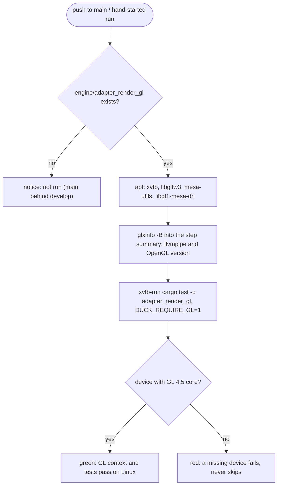

# Review 3-12: CI job for the OpenGL adapter on Linux

Task: 3-12. Class 3 (CI workflow; governance task declared by the owner on 2026-11-02). Goes to `main` first. Loops: 1 of 3. Open blocker/major: 0.

Delivers: job `gl_linux` in `.github/workflows/ci.yml`; two tests in `tools/release/test_workflows.py` (red first: the job did not exist); the existing GLFW job test now stops at the end of its own job (it read to the end of the file, so a job added after it broke its count; a fix of the test, not a weaker assertion); `wiki/workflow/ci-diagrams.md`; `wiki/README.md` changelog v0.73.

## Decisions and deviations

- "Null-only build proof for `render`": the existing `headless` job already builds and tests the whole workspace without `adapter_*` and `app_*` and fails if one is in the dependency graph, so `render` is covered; no new job was added for it.
- The GL job is one Ubuntu job (billed 1x), on `main` and by hand, like `glfw_linux`. It reports the real GL version first, so open question O7 (does llvmpipe give 4.5 core?) is answered by a run.
- `adapter_render_gl` exists on `develop`, not on `main` yet: until `develop` is released the job reports "not run". The real proof is one hand-started `ci` run on `develop` after `main` is merged into it.
- `DUCK_REQUIRE_GL=1` makes a missing device fail. If llvmpipe turns out not to offer 4.5 core, the job will be red and the owner decides (older Mesa override, or a non-gating job); nothing is weakened to get green.

## Not verified

The job has never run: the first run of the GLX path on Linux is this job. Mesa version on the runner image and its GL level are unknown until then.
