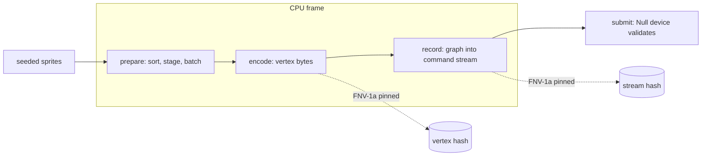

# Review 3-13 (part 1): CPU frame benchmark

Scope: new dev-time crate `engine/tools_render_bench` (library: the scene; binary: the report). Class 1 (new
workspace member, no engine code, no dependency outside the repo). The image test (part 2) is split off: it needs
the GL device (3-10) and the shader compiler (3-11).

## What was built

One deterministic 2D frame: 4096 sprites (seeded `Pcg32`), 8 textures, 8 layers, 1280x720 Null surface. Stages,
each callable on its own: `prepare` (sort, stage vertices, batch), `encode` (vertex bytes), `record` (render graph
with one cleared pass, recorded into the command stream), `submit` (upload and submit to the Null device).

## Numbers (release, Windows x86-64, Intel Family 6 Model 154, rustc 1.94.1, one process run)

| item | value |
|---|---|
| sprites per frame | 4096 |
| batches (draw calls) | 64 |
| command stream bytes | 3722 |
| vertex bytes uploaded | 327680 |

| stage | min ns | median ns | p90 ns | allocator calls |
|---|---|---|---|---|
| prepare | 211564 | 218668 | 232884 | 0 |
| encode | 7678 | 8174 | 8258 | 0 |
| record | 1074 | 1078 | 1102 | 0 |
| cpu frame (composed) | 223928 | 234486 | 244469 | 0 |
| submit (Null) | 7455 | 7626 | 8196 | 0 |

Each row is 15 repetitions of 200 frames after one warm-up repetition. These are one process run on a shared dev
machine: an earlier run of the same binary gave a prepare median of 353904 ns, so run-to-run variation between
processes is large (more than the 5 / 10 percent of the benchmark gate); only compare numbers taken in the same
session. Stages are timed in isolation, so their sum (about 228 us) differs from the composed cpu frame row
(about 234 us): the composed row also carries the cache effects of running the stages back to back.

Method: wall time, not instruction counts: the repo has no instruction-count tooling for benchmarks; the existing
benches are report-only wall time as well. GPU time is not measured (Null device). Linux not run locally (check
only). The report prints the build profile, rustc version and CPU, and warns loudly in a debug build; it exits
non-zero when a stage fails or an argument is bad (`--frames` above 1,000,000 is refused).

## Tests (TDD)

Red: with an empty `lib.rs`, `cargo test -p tools_render_bench` failed to compile (E0432, E0282). Fix loop: the
pinned-hash test was first run with a wrong constant (`1`) and failed with the real hash; the real values were then
pinned. Green: 12 unit tests in the library (median, min/median/p90 summary, FNV-1a vectors, empty texture set and
zero bound are errors), 12 in the binary (arguments and limit, warm-up not sampled, failed stage gives a failing
run, row format, debug warning), 6 frame tests (zero allocator calls per warm CPU frame, size and batch floor,
pinned FNV-1a hashes of the vertex bytes and of the command stream, same seed same bytes, different seed different
vertex bytes, Null device accepts the stream with one draw per batch).

Cross-platform fix: a hand-started `ci` run showed the pinned vertex hash differing on Linux x86-64 and AArch64
(`f32::sin_cos` is not bit-identical across platforms). The vertex hash is now pinned on an unrotated scene
(`FrameScene::with_options(seed, false)`, every angle 0, so no sin or cos is evaluated; the rest is plain strict
IEEE `f32` arithmetic, which Rust does not contract into FMA), and the stream hash on the default scene (the
stream does not depend on the angles). One set of constants for all platforms. A third test checks that rotation
changes the vertex bytes but not the stream. Red first: the unrotated test failed against the old rotated constant.

Mutation (cargo-mutants on all four changed source files, before the last two tests): 97 caught, 15 missed, 8
unviable. Four missed (`stream_bytes`, `vertex_upload_bytes`, `text`) were then killed by new tests. Still missed,
accepted: printing and environment code (`report`, `main`, `print_environment`, `rustc_version`, `cpu_name`), two
`rep > 0` variants (warm-up in the median changes a timing value only) and the `16.0 / 9.0` aspect constant (the
camera aspect does not change the pinned bytes). Not re-run after the last tests.

## Independent review (coordinator, PR #115)

0 blocker, 1 major, 6 minors. Fixed in the fix loop:

- Major 1: the determinism test compared lengths only. Now pinned FNV-1a hashes of the vertex bytes and the stream
  bytes, plus a different-seed test.
- Minor 2: ENV lines for profile, rustc and CPU; loud warning in a debug build.
- Minor 3: the stage-sum versus composed-row sentence above.
- Minor 4: non-zero exit when a stage failed (tested through the row logic).
- Minor 5: `make_sprites` and `below` return errors for an empty texture set or a zero bound (tested).
- Minor 6: `--frames` (and `--reps`) above 1,000,000 are refused (tested).
- Minor 7: min and p90 next to the median; this is one process run (stated above).

R1-R8 self-review after the fix loop: 0 blocker, 0 major. No `unsafe`, no `unwrap`, no new dependency. Clippy
(Windows and the `x86_64-unknown-linux-gnu` check) and rustfmt clean.

## Owed (not done here)

- Register the benchmark in `gates/gates.toml` (`[benchmark]` warn 5 / fail 10) and CI: governance edit, and given
  the run-to-run variation above an instruction-count measure is needed first.
- Part 2: image test; wiki page for the benchmark (as-built).
