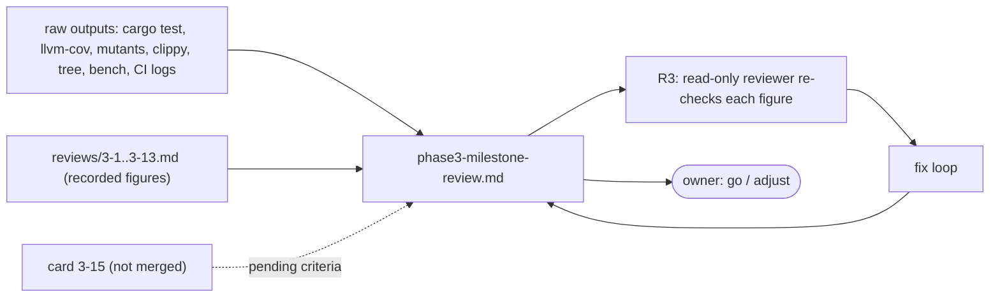

# Review 3-14: phase 3 milestone review (documentation)

Task: 3-14. Class 1 (wiki and review files only; no protected path, no governance file). Loops: 1 of 3.
TDD: documentation change (TDD exception); the "tests" are the raw measurements and the independent check of every number against them.

## What changes

- New page `wiki/spikes/phase3-milestone-review.md`: exit criteria checked item by item (the visible triangle and sprites, the image test and the early visible result are **pending on card 3-15**, not met), hand-measured test counts, coverage, mutation re-run on the phase 3 L0-L2 files, complexity top 5, dependency graph, first benchmark data point (three runs), ADR status, risk review, go/adjust with thirteen adjustment candidates (none started, no card created).
- `wiki/open-questions-and-risks.md`: R-4, R-7, R-8, R-12, R-21, R-23 got a dated note with evidence; R-25 added.
- `wiki/README.md`: v0.76 changelog entry and an index row.
- Mermaid views covering the documentation change: evidence flow and phase 3 dependency layers, both in the page.

## Evidence

- Measured by hand (the release metric report is a placeholder): `cargo test --workspace --locked` twice (without the GLFW library and the shader tools: 968 passed, 0 failed, 1 ignored; with the GLFW library, `DUCK_REQUIRE_GL=1` and the shader tools: 967 passed, 1 failed, 1 ignored, no `not run` line), `cargo llvm-cov` for seven crates, `cargo mutants` per file on nine files (570 viable mutants, 563 caught or timed out, 7 missed, all explained), Clippy cognitive complexity at threshold 0 through a scratch `CLIPPY_CONF_DIR`, `cargo tree`, the unsafe-budget tool (71 of 15,226 code lines, 0 violations), three release runs of `tools_render_bench`, and the logs of two by-hand `ci` runs.
- Figures taken from `reviews/3-*.md` are labelled as recorded, not re-run (section 3.3 of the page).
- Wiki lint: see the PR text.

## Independent review (R3)

A read-only reviewer checked every figure against the raw outputs (test logs, llvm-cov JSON, cargo-mutants log, Clippy output, benchmark runs, two CI logs, `cargo tree`, the recorded reviews): 0 blocker, 2 major, 10 minor. All applied in loop 1:

- Major: the arithmetic explaining the `base` line total (3,960 plus 4) was unsupported (the diff of `base` is +123 / -1); replaced by "close to, not broken down".
- Major: the failing `adapter_window_glfw` test was described as new; it was first recorded in review 3-11. Reworded.
- Minor: R-8 row and section 6 spreads made exact (prepare medians span 3.3%, composed frame 0.9%, encode p90 22%); "0 skipped, 1 ignored" row; ADR-0020 row lists 3-7 and 3-12; the phases of ADR-0003 and ADR-0004 swapped back; "decided by owner" wording note; mimalloc statement limited to normal edges; recommendation sentence made consistent with the caveats; O7 statement says the design-note row is not edited; this file's loop count filled in.
- Verified OK by the reviewer: test counts, file and line counts, unsafe budget, coverage, mutation tables, complexity top 5 and count, benchmark figures, CI log claims, dependency graph, cross-references, the pending-on-3-15 discipline. One item the reviewer could not confirm from the logs: that run 41508615478 was at `111dad5` (the log names the ref `develop`; the page says `111dad5` from the run list, which showed that head SHA).

## Checklist (R1-R8)

| Step | Result |
|---|---|
| R1 self | numbers traced to raw outputs; estimates and heuristics labelled (line classification, complexity filter by hand, the DPI guess for the failing GLFW test) |
| R2 automated | wiki lint OK; local gates: see the PR text |
| R3 independent | done, findings applied |
| R4 QA | workspace tests run twice as above; the one failure is `adapter_window_glfw` `the_framebuffer_matches_the_size_times_the_scale`, in a crate this card does not touch, reported and not skipped |
| R5 architecture | no code change; dependency graph checked with `cargo tree`, headless graph has 0 `adapter_*` or `app_*` crates |
| R6 security | no secret; no tool was installed (cargo-mutants and cargo-llvm-cov were already present); only files inside the repository folder were read, apart from a GLFW DLL in a sibling worktree of the same repository (SHA-256 equal to the value in `THIRD_PARTY.md`) |
| R7 performance | benchmark run three times and reported as wall time; not a gate; GPU time not measured |
| R8 product fit | answers the roadmap's milestone-review list; the go/adjust decision stays with the owner; criteria that need card 3-15 are pending, not met |

## For the owner to read

- Section 1 (summary), section 2 (exit criteria), section 8 (risks) and section 9 (go/adjust) of `wiki/spikes/phase3-milestone-review.md`.
