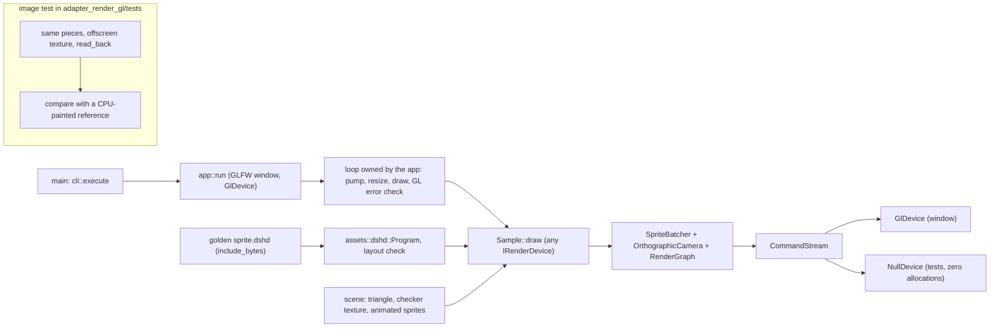

# Review 3-15: the triangle and sprite sample app and the GL image test

Task: 3-15 (ordinary card, PR into `develop`). Class 2 (new layer 4 application crate that links the GLFW and OpenGL adapters; new test of the GL adapter). No protected path touched: `app_*` is already layer 4 in `gates/architecture.toml`. No new third-party dependency. Loops: 2 of 3 (self-review, then the independent review's fix loop). Open blocker/major: 0.

Delivers: crate `engine/app_sprite_sample` (library `args`, `scene`, `sample`, `cli`, `app`; binary `app_sprite_sample [--frames N]`) and the image test `engine/adapter_render_gl/tests/sprite_image.rs`.

## What was built

- **Sample.** `Sample` is built over `&mut dyn IRenderDevice`, so the same code draws on the GL device in the window and on the Null device in tests. The golden `engine/tools_shaderc/golden/sprite.dshd` is included as data (no compiler is linked). `new` refuses an asset whose reflection does not fit the sprite vertex (inputs 0..2 as vec2, vec2, vec4), the camera block (binding 0, at least 64 bytes) and the texture unit (binding 0). The first frames draw a triangle through the same pipeline (white texture, one primary colour per corner); then sprites: a rotating generated 8x8 checker texture and three tinted, half-transparent squares orbiting it (two batches). A resize follows the framebuffer size (surface and camera).
- **Loop.** `app::run` is the only code that touches GLFW and GL: pump events, follow the framebuffer, draw, treat a GL error flag as a failure, sleep 16 ms. `--frames N` (1 to 1,000,000) bounds the run; the triangle gets a third of a short run (at most 60 frames).
- **No device.** GLFW, window or OpenGL 4.5 missing gives `not run: device not set up (...)` on stderr and exit code 3 (0 done, 1 failed, 2 bad arguments). The test of the binary reports `not run` for code 3 and fails when `DUCK_REQUIRE_GL` or `DUCK_REQUIRE_GLFW` is set.
- **Image test.** A 64x64 offscreen texture, six sprites given out of drawing order, rendered through the batcher, the camera (one unit per pixel, origin in the middle), the render graph and the golden shader, read back (rows bottom-up) and compared with a reference painted from a list of rectangles. Flat opaque areas (including the four quadrants of a 2x2 texture, which pins the texture orientation: data row 0 is the top of the sprite) must match exactly; tinted and half-transparent areas may differ by 2 per channel. The reference painter and the comparison have their own tests that run on every machine; the GL part is gated by `DUCK_REQUIRE_GL`.

## Evidence

- TDD: `tests/sample.rs` was written before `sample.rs` existed and failed to compile (E0432: `Sample`, `SampleError`, `GOLDEN_SHADER` unresolved); one test then failed for a wrong test input (a vertex location list that is not increasing is refused by the encoder) and was corrected. `args`, `scene`, `cli` and the image test helpers were written with their tests in the same step (no separate red run); their tests were validated by mutation instead.
- Tests: 24 unit, 3 binary, 1 no-allocation (a warm triangle frame and a warm sprite frame make 0 allocator calls on the Null device), 11 sample tests; image test 2 CPU tests plus the GL test. The GL test could not run on the development machine (no `glfw3.dll`); it runs in the `gl_linux` job (`cargo test -p adapter_render_gl` with `DUCK_REQUIRE_GL=1` under xvfb and llvmpipe).
- Mutation (cargo-mutants on `args`, `scene`, `cli`, `sample`): first run 83 mutants, 60 caught, 12 unviable, 11 missed (arithmetic in the orbit, the triangle corners, the byte count of the staged vertices). Closed with exact-position tests, a helper `encode_staged` with its own tests and a size pin: second run 85 mutants, 73 caught, 12 unviable, 0 missed. `app.rs` and `main.rs` (device and process code) are not mutation-tested.
- Clippy `--workspace --all-targets` clean on Windows; `-p app_sprite_sample -p adapter_render_gl --all-targets --target x86_64-unknown-linux-gnu` clean; `cargo check -p app_sprite_sample --all-targets --target aarch64-unknown-linux-gnu` clean; rustfmt clean. Headless graph (`cargo tree --exclude 'adapter_*' --exclude 'app_*'`) contains no `adapter_` or `app_` crate. Local gates: exactly the four known FAIL lines.

## Review phase R1-R8

- R1 self: fixed the drop order (the device is dropped before the window system in the app and in the image test rig); one fn was above the length limit and one block too nested, both split.
- R2 automated: clippy, rustfmt, gates, mutation as above.
- R3 independent: not done by a separate reviewer in this loop; the coordinator's review of the PR is the independent step.
- R4 QA: error paths covered (bad asset layouts, lost surface, zero size, bad arguments, no device).
- R5 architecture: layer 4 depends on layers 0 to 3 only; nothing depends on it; `Sample` uses the port, not the adapter; the image test depends on `render` and `assets` already allowed for that crate's tests.
- R6 security: no `unsafe`, no `unwrap`/`expect`, no `#[allow]`; the shader asset is parsed by the bounded `assets::dshd` reader; arguments are range-checked; no environment or file is read beyond the adapters' own library lookup.
- R7 performance: a warm frame allocates nothing; the sleep keeps the sample near 60 frames a second and no performance claim is made.
- R8 product fit: delivers the card (window, GL device, golden shader, triangle, sprites, `--frames`, gated device tests, image test).

## Independent review (PR #116)

R3 independent: 0 blocker, 0 major, 4 minor, all applied in fix loop 1:

1. The "Not verified" text now says what CI does not reach (below).
2. `run` no longer fails on a window that reports a zero framebuffer at the start: `first_size` pumps events and polls (every 16 ms, at most 125 times, about 2 s) until the size is non-zero; it fails with a clear message when the window is closed first or the size stays zero. The polling is the pure `looping::poll`, tested without a window (first value, gives up after the attempts, stops at an error).
3. `--frames N` counts drawn frames only: a minimised window (zero size) is `Step::Skipped` and does not advance the counter or the animation. The counting is the pure `looping::count_frames`, tested with skipped turns (frame index seen by the step, limit, close, error).
4. `the_triangle_has_one_primary_colour_per_corner` asserts a positive signed area (counter-clockwise), as its comment says; it passes.

Mutation after the fix loop (`looping.rs`, `scene.rs`): 41 mutants, 38 caught, 2 unviable, 1 timeout (`drawn += 1` replaced by `*= 1` makes the loop endless, which the time limit detects). Clippy (Windows, `x86_64-unknown-linux-gnu`), rustfmt and local gates (the four known FAIL lines only) re-run clean.

## Not verified / owed

- The GL image test ran on the Linux job (`gl_linux`, llvmpipe, `DUCK_REQUIRE_GL=1`) and passed in the hand-started `ci` run of the first push. The sample itself has not run with a device anywhere: `gl_linux` runs only `adapter_render_gl` tests, so `app::run`, the real loop, `resize` and the GL error check never run with a device in CI, and `tests/binary.rs` reaches only the `not run` exit 3 there (Windows and ARM64 jobs the same). The real window run is therefore unverified until it is run on a machine with GLFW and a driver.
- Owed, a governance card: a CI step `DUCK_REQUIRE_GL=1 xvfb-run cargo test -p app_sprite_sample --test binary` in `gl_linux` (this PR does not edit `ci.yml`).
- `app.rs` and `main.rs` (device and process code) are not mutation-tested; their decisions live in `looping`, `cli`, `args`, `sample`, which are.
- Known limit: a minimised window with `--frames N` draws nothing and keeps waiting (it ends when the window is closed).
- A wiki as-built page for the sample is owed.
