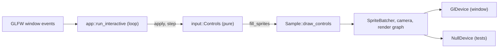

# Review 3-16: the interactive sprite example

Task: 3-16 (ordinary card, PR into `develop`). Class 1 expected (new code in a layer 4 crate, no public API of an engine crate, no dependency, no `unsafe`, no protected path). The classifier decides.

Delivers: second binary `app_input_sample [--frames N]` in `engine/app_sprite_sample`, pure module `input` (`Controls`, key table), `Sample::draw_controls`, `app::run_interactive`, wiki page `architecture/examples`.

## Decision against the card text

The card said "new crate". It is a second binary of `app_sprite_sample` instead: the window, loop, command line and tests of 3-15 are reused and not copied (duplication gate 3%), and no architecture row is needed. Stated on the card in a comment.

## Evidence

- TDD: two tests first, red against a stub (start position, held key); eight more added red, then the implementation (10 unit tests). The integration test (`tests/interactive.rs`) failed to compile (E0599 `draw_controls`) before the method existed.
- Tests: `cargo test -p app_sprite_sample --locked` all green: 42 unit, 3 + 2 binary, 2 interactive (two draws on the Null device; a warm frame with input makes 0 allocator calls), 11 sample, 1 no-allocation. `cargo test --workspace --locked` exit 0 on a rerun; one run inside `local_gates.py` reported `test` as failed and could not be reproduced (three further full runs passed), cause unknown.
- Clippy `-D warnings` on `-p app_sprite_sample --all-targets` clean (it found a nested block, four bools in a struct, `as f32` casts and float comparisons in tests; all fixed, none allowed). `cargo fmt` clean.
- Architecture check and its unit tests: pass on a clean checkout of the commit (20 crates, 0 violations). In the working tree they fail because 26 leftover agent worktrees under `.claude/worktrees/` (untracked, ignored by git) are scanned as unlisted crates; not caused by this card, not removed.
- Wiki lint, digest check, diff hash and all Python tool tests pass. Diff hash against `origin/develop`: `d157d115cf10e075` (before the last two edits of this file and the wiki note; recomputed for the PR).
- Run on Windows: `app_input_sample --frames 300` opened a window and drew 300 frames (exit 0). Keyboard and mouse were not exercised by a person; the Windows scancodes (letters, Escape, arrows with the GLFW extended bit) are from the GLFW rules and not yet confirmed on the keyboard.
- Not run: Linux build and test, mutation testing, coverage, Miri (no `unsafe`), benchmarks (no hot-path change).

## Review phase R1-R8

- R1 self: fixed the clippy findings above; the test helper `replay` replaces a nested loop.
- R2 automated: fmt, Clippy, tests, wiki lint, digest, arch-check (clean tree) green.
- R3 independent: read the diff again for the resize and clamp logic; found no defect. Not done by a separate agent.
- R4 QA: edge cases tested: opposite keys, edge clamp, shrinking view, non-primary button, release and repeat. Missing: a test with a window of another id (events of any window are accepted on purpose, the example has one).
- R5 architecture: layer 4 only, no new dependency, no port change; the pure part knows no device.
- R6 security: no new input parsing beyond the existing arguments; no `unsafe`; no file or network access.
- R7 performance: zero allocations per warm frame (test); no change to the batcher.
- R8 product fit: matches the card (move, place, tint, quit, `--frames`, wiki page with UML).

## Open findings

- Minor: mouse positions are in screen units and sprites in framebuffer pixels; equal at 100% display scaling, offset otherwise. Written in the wiki page. Follow-up: use the framebuffer scale from `window_info`.
- Minor: Linux key table untested.
- Minor: the unreproduced `test` failure inside the local gates run.
- 0 open blocker, 0 open major.
