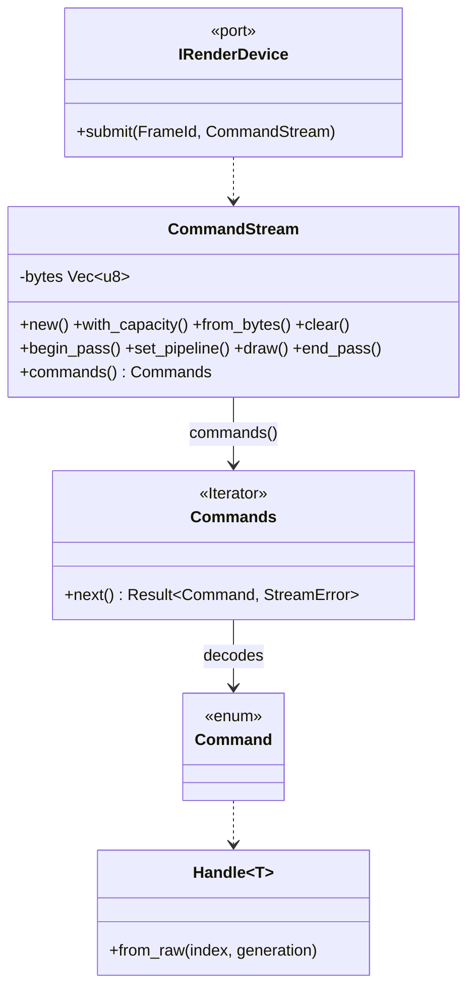

# Review 3-2: the `render` crate (port v0, handles, descriptions, command stream)

Task: 3-2. Class 2 (new port; `Handle::from_raw` is new public API in `base`). Loops: 1 of 3. Open blocker/major: 0.

Delivers `engine/render` (layer 2, depends on `base` only): resource handles (`Handle<Marker>` per resource), plain-data descriptions, `RenderCaps`, `RenderError`, the object-safe `IRenderDevice` trait, and the POD `CommandStream` with encoder and decoder. No device implementation yet (the Null device is card 3-3).

## Design deviations from the accepted note (all additive, listed for the owner)

- `create_surface`, `resize_surface`, `destroy_surface` added: `begin_frame` needs a surface and the note names `SurfaceId` without a creation call. `SurfaceDesc.native_token` is a `u64` so `render` needs no `platform` dependency.
- `destroy_shader`, `destroy_sampler`, `destroy_pipeline` added (independent review M1: fixed-capacity pools could never reclaim these).
- `RenderCaps.device_name` kept as in the note.
- `Handle::from_raw` added to `base`: a stream decoder must rebuild handles from bytes. It grants nothing, a pool still checks the generation; a handle equal to a live one can now be minted within a type (accepted, documented as for decoding only).
- v0 limits stated in the docs: triangle lists, no culling, vertex slot 0 only, uniform buffers bind whole.
- Stream decoding accepts the canonical form only (unused pass fields zero), so decode then encode reproduces the bytes.

## Evidence

- TDD: stream tests written first against a stub: 11 failed (red), then green; `from_raw` test red (compile error), then green.
- `cargo test -p render -p base`: render 25 tests, base 388 plus the new one, all pass. `cargo clippy --workspace --all-targets`: no warnings. `cargo fmt` clean.
- Local gates (`local_gates.py --base origin/develop`): exactly the 4 deliberate FAIL lines, architecture check passes with no new row in `gates/architecture.toml` (`render = 2` already mapped), so no governance step.
- Mutation (cargo-mutants 27.1.0, `-p render`): 103 mutants in `stream.rs`: 90 caught, 12 unviable, 1 missed. The missed one replaces `|` by `^` in `FLAG_COLOR | FLAG_DEPTH`, which are disjoint bits, so it is an equivalent mutant. `from_raw`: its only mutant is unviable. Coverage was not measured by tool for this card.
- No `unsafe`, no `unwrap`/`expect`. Zero-allocation refill is checked by a capacity-stability test, not by the counting allocator (to be added with the Null device in 3-3).

## Independent review (read-only agent)

No blocker, no major. Seven minor points: M1 (destroy calls) applied; M2 (single vertex slot, implicit topology) documented; M3 (non-canonical encoding) fixed with tests; M4 (missing tests: NaN/-0.0 bits, i32 extremes, reserved opcodes, long and truncated payloads, commands before an error) added; M5 (u16 saturation unreachable) commented and pinned by a test on the largest payload; M6 (`from_raw` doc, test fallback) doc updated; M7 (docs) partly applied. Not done: byte offsets in `StreamError` (deferred, not needed for v0).

## Not verified

Behaviour on a real device (none exists yet); the contract suite (3-3); coverage by tool.
