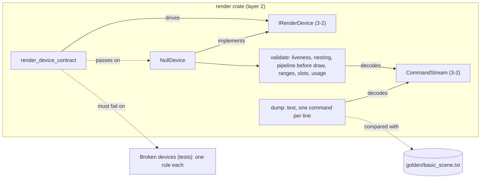

# Review 3-3: Null render device, golden stream dump, contract suite

Task: 3-3. Class 2 (new device implementing a new port; no protected path touched). Loops: 1 of 3. Open blocker/major: 0.

Delivers, all in `engine/render`: the `NullDevice` (whole `IRenderDevice`, fixed-capacity pools, keeps buffer and texture bytes, applies clears to textures, validates every stream before touching anything), a text dump of command streams with a checked-in golden file, and the generic contract suite `render_device_contract` (behind the `contract-tests` feature, also run by this crate's own tests) with deliberately broken devices as self-tests.

## What the Null device checks

Handles live and of the right generation; `begin_pass` not nested and every other command inside a pass; the pass closed at the end of the stream; a draw needs a pipeline, and a vertex buffer when the pipeline reads attributes; an indexed draw needs an index buffer; vertex and index ranges stay inside their buffers (u64 arithmetic); index offsets are multiples of the index size; uniform and texture slots below 8, vertex slot 0 only; buffers bound for their usage; a colour clear into a depth texture is refused. Bindings reset at each pass. `submit` validates the whole stream first and only then applies clears, so a rejected stream changes nothing (tested). Allocation of buffer and texture storage uses `try_reserve_exact`, so a huge request is `OutOfMemory`, not an abort.

## Decisions and deviations (additive)

- Sampler records carry no state; the Null device only checks the handle.
- `read_back` requires an output slice of exactly the texture size, tightly packed, RGBA byte order for `Rgba8`; written into the contract doc.
- Contract checks stay device-neutral (slot `u32::MAX`, zero sizes, stale generations, one frame at a time). The raster checks (a triangle's pixels) are not in the suite: the Null device cannot pass them, they belong to the GL image test (3-10/3-13).
- `Commands::new` is now public (the dump reads raw buffers); `CommandStream::from_bytes_unchecked` exists for tests only.
- The golden file is compared after removing CR, and `.gitattributes` already forces LF.

## Evidence

- TDD: dump tests red against a stub (4 failed), then green; Null device tests red as a compile failure against a stub type, then green; the contract suite is checked by 7 broken-device tests that must panic with a given message.
- `cargo test -p render`: 68 tests pass (workspace tests all pass). `cargo clippy --workspace --all-targets`: no warnings. `cargo fmt` clean.
- Local gates (`local_gates.py --base origin/develop`): exactly the 4 deliberate FAIL lines; architecture check passes (no new rule, no governance step).
- Mutation (cargo-mutants 27.1.0): full `-p render` run found 9 missed mutants; 8 got new tests (device caps, fragment-stage check, empty regions, region edge, buffer end offset, no-attribute draws) and the reruns of `null.rs`, `null/validate.rs` and `contract.rs` after the later changes show 0 missed. The only survivor in the crate is the equivalent `|` versus `^` on disjoint flag constants in `stream.rs` (carried over from 3-2). The last full-crate run was before the review fixes; the three changed files were rerun separately, `dump.rs`, `error.rs`, `caps.rs`, `desc.rs` were not changed since the full run.
- Coverage was not measured by tool. No `unsafe`, no `unwrap`/`expect` in non-test code (the contract module, which is test-support code, uses `unwrap_or_else(|_| unreachable!())` after an assert).

## Independent review (read-only agent)

No blocker, no major. Applied: allocation failure becomes `OutOfMemory` (M1); index offset alignment (M2); contract additions for slot reuse generation, a rejected stream leaving textures unchanged, a second `begin_frame` while a frame is open, and a doc line that `read_back` must wait for submitted work (M6). Not applied, recorded as known limits of the Null device: the pipeline colour format is not compared with the pass target format, a texture bound for sampling and drawn into in the same stream is accepted, `SetViewport` is not range checked, depth clears are accepted but not stored (v0 has no depth storage), `submit` does not look at whether the surface is still alive (`end_frame` reports `SurfaceLost`), the error for a second `begin_frame` is `InvalidDescription`.

## Not verified

Behaviour on a real GPU device (the same suite runs on GL in 3-10); coverage by tool; the `contract-tests` feature build was compiled by clippy but not used by another crate yet.
