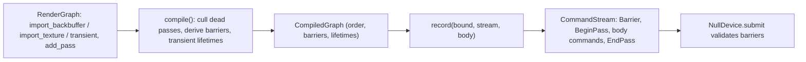

# Review 3-4: render graph v0 and the Barrier stream command

Task: 3-4. Class 2 (new public API in the render crate, new stream opcode; no protected path touched). Loops: 1 of 3. Open blocker/major: 0.

Delivers, all in `engine/render`: `graph` (declare passes, compile, record) and the stream command `Barrier` (opcode 11, reserved in 3-2) with `ResourceState`, its text dump line and Null-device validation.

## Decisions and deviations

- The design note says the graph "orders" passes. v0 validates the declaration and keeps declaration order; reordering is reserved. Culling and barrier derivation are done as designed. Transient lifetimes are computed so a later version can alias memory.
- A pass writes one colour target and reads at most 4 resources. Capacities: 32 passes, 32 resources, 192 barriers (a proven upper bound).
- Everything is fixed-size and heap-free; a compiled graph is about 10 KB passed by value (stack cost, noted in the module docs).
- Barrier payload: u32 target tag, 8-byte handle (zero for the backbuffer), u32 from, u32 to; decoding is canonical (unknown tag/state or non-zero backbuffer handle is `BadValue`). Opcode 12 and up stay reserved.
- Null device: a barrier must sit outside a pass and name a live texture.

## Evidence

- TDD: barrier tests red (30 compile errors) then green; graph tests red (75 compile errors) then green.
- `cargo test -p render`: 98 unit tests plus 1 allocation test pass; workspace tests pass. Clippy workspace: no warnings. rustfmt clean.
- The no-allocation test (declare, compile, record a two-pass frame: 0 allocator calls) passed on its first run (the design is heap-free), so it has no red evidence.
- Mutation (cargo-mutants 27.1.0) on graph.rs, stream.rs, dump.rs, null/validate.rs: 11 missed at first; tests added for pass ids, culling with several resources, late unbound transient and the barrier capacity; rerun of graph.rs: 0 missed. Remaining survivor: the known equivalent `|` versus `^` in `decode_pass` (carried over from 3-2). The other files were not rerun after the new tests, which only touch graph.rs.
- Local gates: exactly the 4 deliberate FAIL lines.

## Independent review (read-only agent)

No blocker, no major. Applied: doc line on stack size; `Present` doc no longer says it is enforced. Not applied, recorded as known limits: importing one `TextureId` twice gives two independently tracked resources; `bound` is not validated (duplicates, aliasing, format or size mismatch); a `ResourceId` from another graph with an in-range index is accepted; zero-size transients are rejected only by the device; the Null device does not check that a barrier's `from` matches the real state, nor `from == to`, nor `Present` on a texture.

## Not verified

Behaviour on a real GPU (barriers are no-ops until the GL adapter, 3-9/3-10); coverage by tool.
