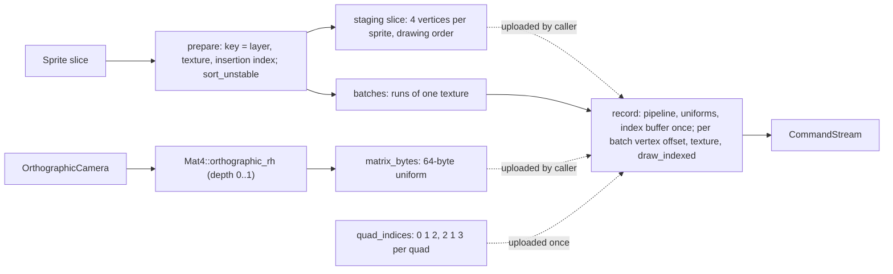

# Review 3-5: sprite batcher, orthographic camera, `Mat4::orthographic_rh`

Task: 3-5. Class 2 (public API in `base` layer 0 and in `render`; no protected path touched). Loops: 1 of 3. Open blocker/major: 0.

Delivers: `Mat4::orthographic_rh` in `base::math`; in `engine/render` the `camera` module (`OrthographicCamera`, pixel-perfect option, `matrix_bytes` for the uniform buffer) and the `sprite` module (`Sprite`, `SpriteBatcher`, `quad_indices`, `encode_vertices`, `SpriteBindings`).

## Decisions and deviations

- `Mat4::orthographic_rh(min, max, near, far) -> Option<Mat4>` takes two `Vec2` plus the depth range (four parameters, the lint limit is five). `None` for a non-finite value or an extent that is zero or so small the matrix overflows. The camera looks down -Z; `z = -near` maps to 0.
- The camera is `position`, `height`, `aspect`; depth range -1 to 1, so sprites at z = 0 are inside. `pixel_perfect` snaps the position to whole pixels and sets height from the viewport; with an odd viewport size the view edges fall on half pixels (documented).
- The batcher owns its sort and batch scratch (allocated once in `new`); the caller supplies the vertex staging slice. Sort key (layer biased to unsigned, texture index, texture generation, insertion index) is total, so `sort_unstable` is deterministic.
- Each batch draws from a vertex-buffer byte offset (`first_sprite * 80`) with the one shared 16-bit index buffer, because `draw_indexed` has no first-index parameter in port v0. This relies on adapters honouring the bound vertex offset (the GL adapter in 3-9 will use a base vertex).
- 16-bit indices limit a batcher to 16384 sprites (`MAX_SPRITES`).
- Corner order: bottom-left, bottom-right, top-left, top-right; `UvRect.min` is the top-left of the image; rotation is counter-clockwise; triangles are counter-clockwise for positive sizes.

## Evidence

- TDD: base tests red (missing function), then green; render tests red (65 compile errors), then green.
- `cargo test -p render`: 127 unit tests plus 2 allocation tests (graph from 3-4 and sprite frame: 0 allocator calls for prepare plus record of 512 sprites on 3 textures after warm-up) pass; `base` 393 tests pass; workspace tests pass. Clippy workspace: no warnings. rustfmt clean. The allocation test passed on its first run (the design is heap-free), so it has no red evidence.
- Mutation (cargo-mutants 27.1.0): `camera.rs` and `sprite.rs` first run 2 missed (Display, `batches()`), both closed with a test; final reruns: `sprite.rs` 0 missed, `Mat4::orthographic_rh` 0 missed (a redundant zero-extent check found by mutation was removed, the finiteness check covers it). `camera.rs` was not rerun after the doc-only edit.
- Local gates: exactly the 4 deliberate FAIL lines.

## Independent review (read-only agent)

No blocker, no major. Applied: a failed `prepare` clears the batches so `record` does nothing; `quad_indices` is capped at `MAX_SPRITES`; the ortho matrix is rejected when not finite; sprite lookup no longer indexes; docs for odd viewports and for positive sprite sizes. Not applied: negative sizes are not rejected at run time (documented only).

## Not verified

Behaviour on a real GPU (the same vertex-offset draws run through GL in 3-9/3-10); sprite pixels (image test in 3-13); coverage by tool.
