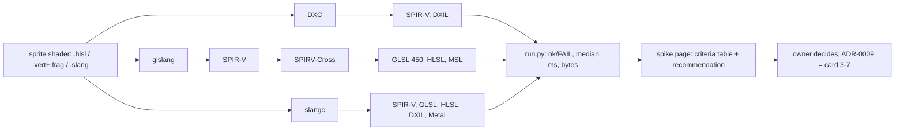

# Review 3-6: shader toolchain spike

Task: 3-6. Class: spike (TDD exception, dev-time harness and a wiki page; no engine code, no protected path). Loops: 1 of 3. Open blocker/major: 0.

Delivers: `wiki/spikes/shader-toolchain-spike.md` (results, criteria table, recommendation for the owner, not-verified list), `tools/shader-spike/` (sprite shader in HLSL, GLSL and Slang, broken variants, `run.py`), `wiki/README.md` index row and changelog v0.73.

## Decisions and deviations

- Tools were downloaded into the git-ignored `target/shader-spike` (owner decision O8); release assets were verified against GitHub's SHA-256 digests. Nothing outside the repository was changed.
- SPIRV-Cross has no binary release, so it was built from the tagged source. shaderc was not tested (no binaries, wraps glslang).
- The Linux run used WSL2 and the prebuilt Linux archives; the Slang archive's symbolic links were replaced by copies because the Windows `tar` cannot create them.
- Nothing is adopted: the page recommends pipeline B and leaves the choice to the owner.

## Evidence

- Harness: 23 compile steps, 23 ok; DXIL from DXC, SPIRV-Cross-generated HLSL and Slang pass `dxv`.
- Windows and Linux outputs byte-identical for the four files compared.
- Local gates: see the PR (expected only the 4 deliberate FAIL lines).

## Not verified

No GPU or driver run; correctness of generated GLSL at run time; shaderc; one machine; Linux in WSL2 only; coverage by tool (not applicable to a spike).
