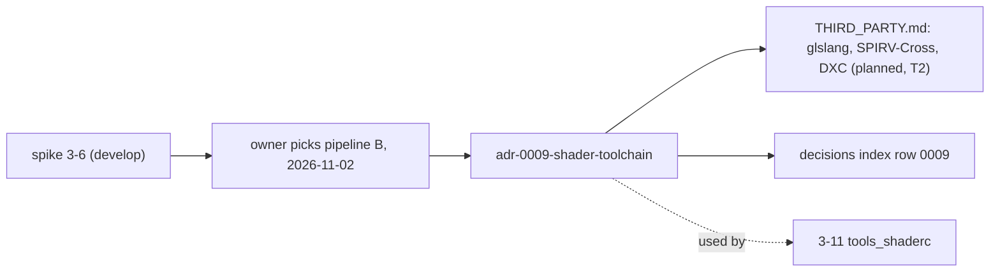

# Review 3-7: ADR-0009 shader toolchain, THIRD_PARTY rows

Task: 3-7. Class 3 (governance task declared by the owner on 2026-11-02: ADR and `THIRD_PARTY.md`). Goes to `main` first. Loops: 1 of 3. Open blocker/major: 0.

Delivers: `wiki/decisions/adr-0009-shader-toolchain.md`; the ADR-0009 row in `wiki/decisions/README.md`; three planned T2 rows (glslang, SPIRV-Cross, DXC) in `THIRD_PARTY.md`; `wiki/README.md` index row and changelog v0.72.

## Decisions and deviations

- The owner chose pipeline B and asked that Slang be re-evaluated at D3D12 or Metal; both are in the ADR.
- The ADR names the spike page by path in code font, not by link, because the page exists only on `develop` until the next release (a link would break on `main`).
- The three rows are `planned`, not `in tree`: nothing is added to the repository yet (card 3-11 adds `tools_shaderc`). Licences come from the shipped files and are marked for re-check when the rows move to `in tree`.
- Merging `main` into `develop` will conflict on the `wiki/README.md` changelog and version line (both branches add v0.72); resolve by keeping both entries, renumbering the ADR entry.

## Not verified

Licences read from shipped files only, not legal advice; no shader run on a GPU.
