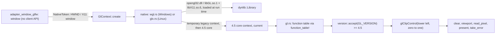

# Review 3-9: `adapter_render_gl` part 1, OpenGL 4.5 context and clear colour

Task: 3-9. Class 2 (new adapter crate, `unsafe` in layer 3, FFI; no protected path touched: `gates/architecture.toml` maps the crate by its `adapter_*` name and the unsafe-budget tool covers layers 0 to 2 only). Loops: 1 of 3 used (self review, then the independent review of PR #111: 2 majors, all fixed, see below). Open blocker/major: 0.

Delivers: crate `engine/adapter_render_gl` (workspace member): run-time loader (`dynlib`), function tables (`lookup`, `gl`), WGL context for Windows (`wgl`), GLX context for Linux (`glx`), `GlContext` (create from a `NativeToken`, version check, `glClipControl` to depth 0..1, viewport, clear, read a pixel, present, error flag), `version` (parse and accept), the device test `tests/clear_colour.rs` and the example `examples/clear_colour.rs`.

## Decisions and deviations

- Owner decisions followed: O1 (a) hand-written declarations loaded at run time, no binding crate; O6 GLX, X11 only; O7 left to card 3-12.
- The function table is a macro (`function_table!`) that checks the whole table at once and names the first missing function. Eight GL functions are declared for this card (plus `glGetIntegerv`); card 3-10 adds lines to the declaration.
- `GlContext` is not `Send` and is made current on creation, so the safe wrappers in `gl.rs` can rely on "the context is current on this thread". The wrappers are crate-private.
- `unsafe` is denied crate-wide and allowed (`#![expect(unsafe_code)]`) only in `dynlib`, `gl`, `wgl`, `glx`. Count of `unsafe {` block lines: `gl.rs` 10, `wgl.rs` 13, `dynlib.rs` 7, `glx.rs` 16 (46 in all; on a given OS only one of `wgl`/`glx` is built). Every block has a `// SAFETY:` comment.
- Errors are `platform::error::PlatformError` values: `NotFound` (null token, no library), `Unsupported` (no 4.5 core context, missing function, version below 4.5, no X display), `Io` (the OS refused a step). No panics, no `unwrap`/`expect`.
- The dependency on `render` is not added yet: this card uses no render type. `platform` is the only dependency; `adapter_window_glfw` is a dev-dependency (dev edges are exempt in arch-check).
- GLX picks the framebuffer configuration whose visual is the window's (so the drawable is compatible), else the first one. The `XWindowAttributes` layout is declared for LP64 and pinned by a size test (136 bytes); the crate refuses to build on non-64-bit Linux.
- GLFW test library: the Windows `glfw3.dll` was downloaded into the git-ignored `target/glfw` of the worktree; the zip and the DLL SHA-256 match the values pinned in `THIRD_PARTY.md`.

## Evidence

- TDD: pure logic red first (stubs and missing functions: 2 failures, then compile errors for `accept` and `index_of_visual`), then green. `lookup`: 6 tests, `version`: 7, `dynlib`: 3, `wgl`: 4, `context`: 1.
- Device tests have no red evidence of their own: they passed on the first run on a real device (the FFI parts are only testable with a driver).
- `cargo test -p adapter_render_gl`: 21 unit tests, 2 integration tests (one needs no device), all pass. With `DUCK_REQUIRE_GL=1` and the GLFW DLL the device test runs and passes on this machine: GL_VENDOR "Intel", GL_RENDERER "Intel(R) Iris(R) Xe Graphics", GL_VERSION "4.5.0 - Build 30.0.101.2079". It clears to (0.25, 0.5, 0.75) and reads back within one level, clears to red and reads back exactly, queries the viewport, presents and sees no GL error.
- Example `cargo run -p adapter_render_gl --example clear_colour` opens a window and cycles a colour for three seconds on the same GPU.
- Clippy (workspace lints) clean for the Windows build and for `--target x86_64-unknown-linux-gnu` (`cargo clippy --all-targets`); rustfmt clean.
- Mutation (cargo-mutants 27.1.0, `-f version.rs -f lookup.rs -f context.rs`): `version.rs` and `lookup.rs` 0 missed. `context.rs` 2 missed with the device test running: `present -> true` (equivalent when the OS succeeds; the `false` mutant is caught) and `take_error -> 0` (no public call of this card can raise a GL error, so only a later card can kill it). Without a device, the 8 device-only methods of `context.rs` are missed, as expected.

## Independent review and fix loop 1 of 3

The independent review of PR #111 found no blocker and 2 majors, plus minors. All are fixed in loop 1; 0 open blocker/major.

| Item | Finding | Fix |
|---|---|---|
| Major 1 | GLX framebuffer configuration: alpha demanded, and `index_of_visual` fell back to index 0 | `ALPHA_SIZE` is no longer asked for; `index_of_visual` returns `Option<usize>`, `None` becomes `PlatformError::Unsupported` (two unit tests, red first: compile error on the new return type) |
| Major 2 | X errors end the process; `swap_buffers` always true | `ErrorScope`: a mutex-serialised, scoped `XSetErrorHandler` that records the error as a value and restores the previous handler, around create, swap and delete; `XSync` makes the error visible; `swap_buffers`/`present` is false on an X error; window id validated (`window_id`, 29-bit X ids) and by `XGetWindowAttributes`. Handlers are process-global: documented in the module doc |
| Minor 3 | `SetPixelFormat` once per window | documented on `wgl::Native::create` |
| Minor 4 | Drop released a context it did not own | Drop releases only if `wglGetCurrentContext`/`glXGetCurrentContext` is this context; documented that a new context replaces the current one |
| Minor 5 | `cast` was a safe function | `dynlib::cast`, `lookup::resolve` and the generated `load` are `unsafe fn` with a `# Safety` section; `Gl::load_current` is the one safe wrapper, with its SAFETY reason |
| Minor 6 | libGL/libX11 closed on drop; `XInitThreads` | `Library::leak` (never `dlclose`), documented; second display connection and `XInitThreads` documented |
| Minor 8 | Test gaps | the device test reads `GL_CLIP_ORIGIN`/`GL_CLIP_DEPTH_MODE` (new `GlContext::clip_control_state`) and asserts `LOWER_LEFT`/`ZERO_TO_ONE`; `DUCK_REQUIRE_GL` empty or `0` is "not required"; the vacuous `at_least` assert is gone; a compile-time `!Send` check |

Evidence after the loop: 22 unit tests and 2 integration tests pass with `DUCK_REQUIRE_GL=1` on the Intel Iris Xe (the clip state is now asserted); Clippy clean (`--all-targets`) for the Windows build and for `x86_64-unknown-linux-gnu`; rustfmt clean. Mutation (`lookup.rs`, `context.rs`, `gl.rs`, device test on): 49 mutants, 42 caught, 3 unviable, 4 missed: `present -> true` (equivalent while the OS succeeds), `take_error -> 0` and `Gl::error -> 0` (no call of this card can raise a GL error), `finish_all -> ()` (the read-back that follows is synchronous anyway, so the result cannot tell). `lookup.rs`: 0 missed. The new GLX pure logic (`window_id`, the error recording) is built only on Linux, so cargo-mutants on this machine did not mutate it; its tests have not run either.

## Not verified

- The GLX path (`glx.rs`) compiles and passes Clippy for `x86_64-unknown-linux-gnu`, but it has never run, including after the fix loop (the error scope, the visual choice, the swap check are all untested on a real X server): WSL has no Rust toolchain, no Xvfb and no GLFW, and the Windows host cannot link a Linux binary. Its unit tests (structure sizes, attribute lists, `window_id`, the error recording) have not been executed either.
- Whether `llvmpipe` under `xvfb` offers OpenGL 4.5 core on the hosted Linux runner (card 3-12). Commands for 3-12 are in the PR description.
- `glClipControl` effect on depth (no depth test in this card); the Intel driver accepted the call without error.
- Other drivers (NVIDIA, AMD), multiple contexts, context loss, DPI changes, a resized window.
- Wayland is unsupported by design (`NativeToken` is `Unsupported` there).
- Coverage by tool (not measured for this crate).

## Wiki follow-up owed (not done here, no wiki edits in this card)

`render-port-v0` section 6 and the README changelog/index: record the as-built adapter (function table macro, `GlContext` API, device-test gating with `DUCK_REQUIRE_GL`, GLFW DLL location for local runs, GLX configuration choice), and the llvmpipe finding once 3-12 has run it.
