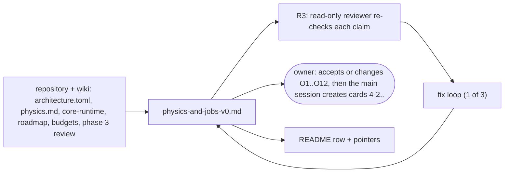

# Review 4-1: Phase 4 design note, physics and the job system v0

Task: 4-1. Class 1, documentation only (wiki and review files; no code, no protected path, no governance file). Loops: 1 of 3.
TDD: documentation change (TDD exception); the "tests" are the checks of every claim against the repository and the wiki, done by the author and then by an independent read-only reviewer.

## What changes

- New page [architecture/physics-and-jobs-v0](../wiki/architecture/physics-and-jobs-v0.md): where the `jobs` and `physics` crates live (one `physics` crate with modules, because the layer table and every scan row name it), the sketch of `IScheduler` and the 2D world API (class view), the algorithm choices for v0, the job system and the scheduler spike (ADR-0004), how it relates to D0 and D1, the determinism harness (D0/D1 tests, D2 facade and feature, Clippy `disallowed-methods`, golden file and job, with the governance parts named), TSan and Miri expectations, test levels, allocation rules and `unsafe` expectations, the lessons of the phase 3 review that touch this phase, a proposed card breakdown 4-2 to 4-25 with a dependency view, twelve owner choices O1 to O12 each with a recommendation, and the risks.
- `wiki/README.md`: v0.77 changelog entry, status line, index row 33. One-line pointers from `wiki/architecture/physics.md` and `wiki/architecture/core-runtime.md` (the 3-1 precedent was a pointer from `rendering.md`).
- Mermaid views covering the documentation change, all in the page: crate and layer view, class view, step flowchart, scheduling sequence, determinism flow, card dependency view.

## Evidence

- Facts that the note builds on were read in the repository on 2026-11-03: the crate list and `Cargo.toml` of the workspace, `gates/architecture.toml` (layers, edges, scan rules), `gates/protected-paths.txt`, `gates/unsafe-budget.toml`, `.github/workflows/ci.yml` (job list, no Miri or TSan job, benchmark step is the skeleton only), `engine/base` (math, pool, map, sparse, rng, arena, alloc, simd), `engine/platform/src/threads.rs`, `engine/frame/src/fixed_step.rs`, `docs/budgets/reference-machine-and-workloads.md`, `THIRD_PARTY.md`.
- Absences were searched, not assumed: no `cross-platform-determinism` in any `*.toml`, `*.rs` or `*.yml`; no `gates/golden/`; no `mxcsr`/`fpcr`/`FTZ` in `engine/`; no `jobs` or `physics` crate.
- Statements that could not be verified are marked `[K]` in the page (Box2D details beyond the linked sources, `cfg(target_feature)` with `target-cpu=native`, `MXCSR` through stable `std::arch`, TSan with `-Zbuild-std`, instruction counting on a hosted runner, lock-free deque `unsafe`, broadphase split).
- Nothing was built; no gate, threshold, waiver or protected path was touched.

## Independent review (R3)

A read-only reviewer checked every claim against the repository: 0 blocker, 0 major, 8 minor. All applied in loop 1:

- Wrong cross-reference ("section 9, O9" for a row in section 10); wrong type name (`RingBuffer` is `Ring`).
- Scan-rule statement too broad (the estimate-intrinsic row covers `physics` and `base`; thread and `std::arch` rows use `allow_in`); reworded.
- Dependency view: the scheduler spike uses the scene of the ADR-0018 spike (edge 4-2 to 4-5 added), `tools_physics_spike` edge to `jobs` marked "4-5 only"; a sentence says why 4-19, 4-23 and 4-24 have no edge into 4-25.
- The owner go-ahead date has no source in the repository: the page now says it was given in the session.
- Two statements marked `[K]` (Miri run by hand in earlier phases; benchmark noise between sessions comes from recorded figures).
- The reviewer did not run wiki lint or a Mermaid renderer; the lint was run by the author (below), no renderer is available offline, so Mermaid blocks were read for syntax only. The reviewer flagged generic `World~D~` in the class view as valid in current Mermaid but unrendered here.
- Verified OK by the reviewer: existence and absence table, `architecture.toml` statements, protected paths, numbers (71 of 15,226 unsafe lines, W1 definition and budget, reference machine, Windows billing, 70% target location), all relative links, section references, internal card/choice numbering, the README and pointer edits, and that nothing is decided on the owner's behalf.

## Checklist (R1-R8)

| Step | Result |
|---|---|
| R1 self | every claim traced to a file; unverified statements marked `[K]`; the note ends with a list of what it does not verify |
| R2 automated | wiki lint: 50 pages, 0 violations (after rewording two threshold-like numbers that no gate rule covers); local gates: see the PR text |
| R3 independent | done, 0 blocker, 0 major, 8 minor, all applied |
| R4 QA | documentation only: card ids, O numbers and links cross-checked (internal consistency verified by the reviewer); no code, so no coverage or mutation applies |
| R5 architecture | placement checked against `gates/architecture.toml` (layer map, edges, `forbidden_edges`, scan rows by crate name); the one-crate-with-modules choice follows from it; no architecture row is proposed |
| R6 security | no secret, no external code; no tool installed; only files inside the repository were read |
| R7 performance | no code; the note sets the benchmark and allocation expectations, names W1 and the scaling target, and states that an instruction-count measure does not exist yet |
| R8 product fit | answers the phase 4 row of the roadmap (jobs, physics, determinism harness, D2, TSan, benchmarks), carries the owed items of the phase 3 review that touch this phase, and states that the CI shader-tool work is not part of phase 4; decides nothing for the owner |

## Not verified

- Mermaid rendering (no renderer offline); syntax read by author and reviewer.
- That arch-check passes with new `jobs` and `physics` crates (rules read, not run on a new crate).
- All `[K]` items in the page; the Soft-Step details, FP control register access, TSan setup and instruction counting are to be checked in the cards that need them.

## For the owner to read

- Section 10 (O1 to O12 with recommendations), section 9 (cards and which are governance), section 11 (risks) of `wiki/architecture/physics-and-jobs-v0.md`.
