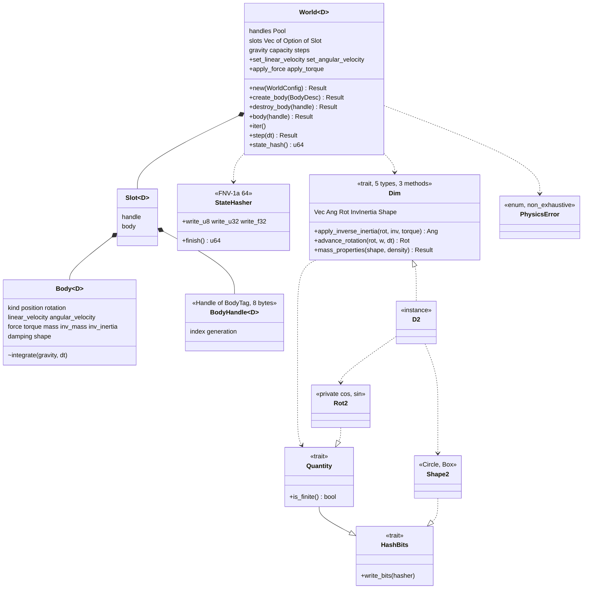

# Review 4-10: `physics` crate v0, world, handles, bodies, shapes, integration, state hash

Task: 4-10. Class 2 (new module, public API, determinism; no protected path touched, no architecture row needed). One PR into `develop`. Loops: see the end. Open blocker/major: see the end.

Delivers: crate `engine/physics` (workspace member line in `Cargo.toml`, matching `Cargo.lock` entry; depends on `base` only; feature `cross-platform-determinism` forwards to `base`; workspace lints, no `unsafe`): `core::hash` (`StateHasher`, FNV-1a 64, `HashBits`), `core::error` (`PhysicsError`), `core::dim` (`Dim`, `Quantity`, `MassProperties`), `core::body` (`Body<D>`, `BodyDesc<D>`, `BodyKind`, `BodyHandle<D>`, the integrator), `core::world` (`World<D>`, `WorldConfig<D>`), `d2` (`D2`, `Rot2`, `Shape2`, aliases `World`, `Body`, `BodyDesc`, `BodyHandle`, `WorldConfig`, `STANDARD_GRAVITY`), integration tests `no_allocation`, `generic_core`, `replay`; wiki: as-built paragraph and class view in `architecture/physics-and-jobs-v0` section 2, pointer in `architecture/physics`, `README` changelog v0.86 and index row.

Test list (written first, one red step per group; see Evidence): state hash (FNV-1a vectors, byte order, float bits, signed zero, order); error messages; `Rot2` (identity, from angle, from (cos, sin), refusal of a pair without direction, non-finite angle, first-order advance by atan, stays unit); shape mass properties (circle and box closed forms, invalid sizes and densities, underflow and overflow); world creation (capacity limit, non-finite gravity, zero capacity, handle order, capacity exhaustion as a value, a refused description uses no slot, non-finite fields, negative damping, inverse-mass overflow, accessors, static body); destruction (stale handle, slot reuse with the next generation, forged handles, last freed first, iteration order); setters (static refused, non-finite refused); the step (invalid dt, free fall closed form and continuous error bound, mass independence, static does not fall, momentum conserved, one-step force and torque, damping, rotation normalised and turning at the expected rate); hash (replay, one field changed, pending force, handle and live set, order); zero allocation (steady-state step, churn); a second dimension instance; D0 replay through the public API.



```mermaid
sequenceDiagram
  participant App as application
  participant W as World::step
  participant B as Body (each slot, index order)
  participant D as D2 (Dim)
  App->>W: step(dt)
  W->>W: dt finite and above zero? else Err(InvalidTimeStep)
  loop every live slot in index order
    W->>B: integrate(gravity, dt)
    alt static
      B-->>W: unchanged
    else dynamic
      B->>B: v = (v + (g + F/m) dt) / (1 + dt c); x = x + v dt
      B->>D: apply_inverse_inertia(rot, inv, torque)
      B->>B: w = (w + a dt) / (1 + dt c_ang)
      B->>D: advance_rotation(rot, w, dt)
      D-->>B: (cos - sin w dt, sin + cos w dt) normalised
      B->>B: force = 0, torque = 0
    end
  end
  W->>W: steps += 1
  W-->>App: Ok
  App->>W: state_hash()
  W-->>App: FNV-1a over capacity, gravity, then (index, generation, state) per live body
```

## Decisions

- **`Dim` trait surface (ADR-0018 point 2, trigger "about 30 methods").** Five associated types (`Vec`, `Ang`, `Rot`, `InvInertia`, `Shape`) and three methods (`apply_inverse_inertia`, `advance_rotation`, `mass_properties`); vector arithmetic comes from operator bounds (`Add`, `Mul<f32>`) on the associated types, not from methods, and two small helper traits (`Quantity`: default, finite check, hash; `HashBits`) carry what the world needs from every value. No `if D == 2` anywhere in the core. Shapes stay data (`Shape2`); only the mass computation goes behind the trait. Joints, contacts and the narrowphase are not in `Dim` yet (cards 4-11 to 4-16 add what they need and the ADR checkpoint after 4-13 counts the methods).
- **Per-instance data (ADR-0018 point 3).** Nothing in this card is a fixed array sized by an associated constant: the world stores `D::Vec`, `D::Ang`, `D::Rot`, `D::InvInertia`, `D::Shape` as they are, so the 16-byte contact penalty of the spike does not arise here. The decision is carried forward to the contact card (4-12/4-13), which must not reserve `MAX_TANGENTS` slots in a shared struct without saying so.
- **Rust frictions met.** (1) `#[derive(Clone, Copy)]` on `Body<D>`, `BodyDesc<D>`, `WorldConfig<D>` and `MassProperties<D>` would add `D: Clone`/`D: Copy` (a marker type `D2` is `Copy` here but a generic `D` would be demanded); the impls are written by hand (4 impls of 3 lines). (2) An associated constant cannot size an array, so nothing is sized that way (above). (3) `Handle<T>` from `base` is generic over `T`, so `BodyHandle<D> = Handle<BodyTag<D>>` with a zero-sized tag carrying the dimension (`PhantomData<fn() -> D>`), and no per-dimension handle type has to be written. (4) The module is called `core` as ADR-0018 says; inside the crate root `core::` would be ambiguous with the standard `core` crate, so the root file uses only `pub mod` lines and nothing refers to `core::` paths there (child modules are not affected).
- **Capacity design.** `WorldConfig { max_bodies, gravity }` is the only capacity so far (shapes, joints, contacts, tree nodes get theirs with their cards). `World::new` allocates everything (a `Pool` of handles and a vector of `Option<Slot>` of the same length, filled with `None`) and is the only call that allocates; creation past the capacity returns `CapacityExhausted` and uses no slot; a capacity above `MAX_BODIES` (2^20, constant in `core`) is an error value, so a huge request cannot make the allocator abort (`Pool::with_capacity` documents that it aborts). A capacity of zero is allowed (every create is refused).
- **Handle layout.** `base::pool::Handle`: index and generation, 8 bytes (asserted in a test), issued by a `Pool<BodyTag<D>>` in index order, last freed first, generation checked; a slot whose generation cannot advance is retired. The bodies live in a separate vector indexed by the handle index, so iteration is in slot-index order (the pool has no iterator; adding one to `base` was not needed). A handle is valid when the slot holds a body whose stored handle equals it; a forged handle (any index or generation) is `StaleHandle`, never a panic. A handle of another world with the same index and generation is not detected (same as `Pool`).
- **Integrator.** Semi-implicit (symplectic) Euler: `v += (g + F / m) dt`, damping `v *= 1 / (1 + dt c)` (Box2D form, always stable), `x += v dt`; the same for angular velocity with `inverse_inertia * torque`; gravity is an acceleration, independent of mass; force and torque act for one step and are cleared. Documented error for free fall: the scheme gives `y_n = y_0 + g dt^2 n (n + 1) / 2`, which differs from `y_0 + g t^2 / 2` by `g t dt / 2` (first order in `dt`); both are tested.
- **Rotation.** `Rot2` holds a private `(cos, sin)` pair that is unit length to rounding by construction (`from_angle` through `base::dmath::sin_cos`, `from_cos_sin` normalises, `advanced` normalises); a pair from a non-finite angle is not finite and creation refuses it. The step advances it by `(cos - sin w dt, sin + cos w dt)` and one normalisation (`sqrt` and a division, no `sin`, `cos`, `atan2`); the pair therefore turns by `atan(w dt)` per step, not `w dt` (second-order difference, tested against an independent f64 computation of the same recurrence). `angle()` reads back with `dmath::atan2`.
- **State hash.** FNV-1a 64 over bytes (own implementation, 20 lines; `base` has none): capacity, gravity, then for every live slot in index order the handle (index, generation), the kind tag, position, rotation, velocities, pending force and torque, inverse mass, inverse inertia, both dampings and the shape (tag and numbers); floats by bit pattern, little-endian. Changing any one of those changes the hash (a test per field); `mass` is not written (it is `1 / inv_mass`). Nothing is stored; the golden hash is card 4-20.
- **Kinematic bodies, polygons, a `d3` module: not built.** Kinematic is not in the design note's card list for 4-10; polygons come with the narrowphase (4-12); `d3` is phase 8 (ADR-0018). `Shape2` and `BodyKind` are `#[non_exhaustive]`, so adding variants is not a breaking change. A planar-3D test instance in `tests/generic_core.rs` (`Vec3` position, rotation about Z) steps with the same `World` code.
- **`step(dt)`** takes the time step per call, as the design sketch does; the caller passes the same `dt` every step. No scheduler or scratch arena yet (nothing to parallelise). A step is atomic: it first integrates a copy of every body to check that position, rotation and velocities stay finite, then integrates for real; an overflow returns `NotFinite` and changes nothing. The price is two integrations per step; this is a first version and the cost is not measured (a later card can replace the check by clamping if a benchmark asks for it). `apply_force` and `apply_torque` refuse a sum that is not finite. `Rot2` has no `cos()`/`sin()` accessors (`direction()` returns the pair) because the arch-check ban on libm names matches the method names by text.
- **Arch-check.** `physics = 2` and its scan rows exist; the crate needed no new row (checked by the local gates, see Evidence). The scan covers test code of `physics` too, so tests use `base::dmath` and an f64 recurrence instead of `sin`/`atan`.

## Evidence

- TDD: each test group was written first and run red (compile error or failing assertion) before the code that made it green; the allocation test was shown red with a deliberately allocating step first.
- Tests (Windows, MSVC): 71 unit + 2 `generic_core` + 3 `no_allocation` + 2 `replay` = 78, all pass, with the feature `cross-platform-determinism` on and off. Linux (WSL Ubuntu, rustc 1.94.1): the same 78 pass, feature on and off (after the review fixes).
- Zero allocation: the steady-state step (1000 steps) and the churn test (create to capacity, set, force, step, hash, iterate, refuse, destroy; 20 rounds) make 0 allocator calls on the calling thread; a guard test shows `World::new` is counted.
- Coverage (line, llvm-cov, measured before the review fixes): 99.16% lines, 100% functions. Branch coverage not measured (needs nightly).
- Mutation (cargo-mutants, per file, `-j 1`): first full run 278 mutants, 205 caught, 73 unviable, 0 missed (after adding tests for 21 first-run survivors). After the review fixes the changed files were rerun: `rot.rs` 52 caught, 0 missed (one equivalent survivor was removed by simplifying the code); `body.rs` 56 caught, 31 unviable, 0 missed; `world.rs` 28 caught, 33 unviable, 0 missed. Score 100% on viable mutants.
- fmt clean; clippy `-D warnings` clean for the workspace and for `physics` with the feature.
- arch-check (`gates/architecture.toml`): `OK 20 crates checked, 0 violations` after the fixes; before them the local gates run showed 11 `banned-use` violations (`.powi(` in a test and the `cos()`/`sin()` accessors of `Rot2` in tests), found by the reviewer and by the gate, fixed. No row had to be added for `physics`. The headless `cargo tree` shows no `adapter_*` or `app_*` crate.
- Local gates (`tools/local-gates`): see the PR; the only failing lines are the deliberate ones, plus the arch-check line above that was fixed afterwards.

## Review result (R1-R8)

One independent read-only reviewer (fresh context) and the local gates. Loop 1: 2 blockers (banned names in test code, both real, confirmed by arch-check), 3 majors (rotation overflow to NaN, force/torque/step overflow reaching the state, hash doc overstating coverage), 6 minors and 2 nits. Fixed in loop 1: both blockers; the three majors (`Rot2::advanced` returns a non-finite pair on overflow, `apply_force`/`apply_torque` refuse an overflowing sum, `step` is atomic and returns `NotFinite`; the `state_hash` doc now states what it does not cover); minors 7 (doc) and nit 11. Left open as recorded in "Not verified": minors 6, 8, 9 and nit 10. The fixes were checked by tests, mutation, clippy and the real arch-check run, not by a second reviewer agent. Loops used: 1 of 3. Open blocker/major: 0.

## Not verified

- No stored golden hash and no Windows/Linux hash comparison (card 4-20); the Linux runs (WSL, Ubuntu, 1.94.1) show the same tests passing, not equal hashes.
- No ARM64 run, no Miri (no `unsafe` in the crate), no TSan (no threads).
- No benchmark; the zero-allocation claim is for the calling thread only (there are no workers yet).
- Branch coverage: the tool's branch mode needs nightly; only line and function coverage were measured.
- The state hash covers the simulation state of the live bodies, not the order in which freed slots will be reused (documented on `state_hash`; a replay that repeats the same calls is not affected).
- `World::new` can still abort the process for a capacity near `MAX_BODIES` if the allocator fails: `base::pool::Pool::with_capacity` has no fallible variant (known gap, `base` is not changed in this card).
- A slot whose generation cannot advance is retired for good (documented on `destroy_body`); there is no world-level test of that case (it needs 2^32 reuses of one slot or a way to set the generation).
- `BodyDesc` and the world types do not implement `Debug`, and `BodyDesc` is not `#[non_exhaustive]` (reviewer minor findings 9, left open on purpose).
- `InvalidShape` is also returned for a negative damping (reviewer minor 8, left open on purpose; a separate variant can be added later because the enum is `non_exhaustive`).
- Memory per body was not measured (the slot holds the body, its handle and the pending force and torque; no size was measured or compared with the 44 bytes of the spike layout).
