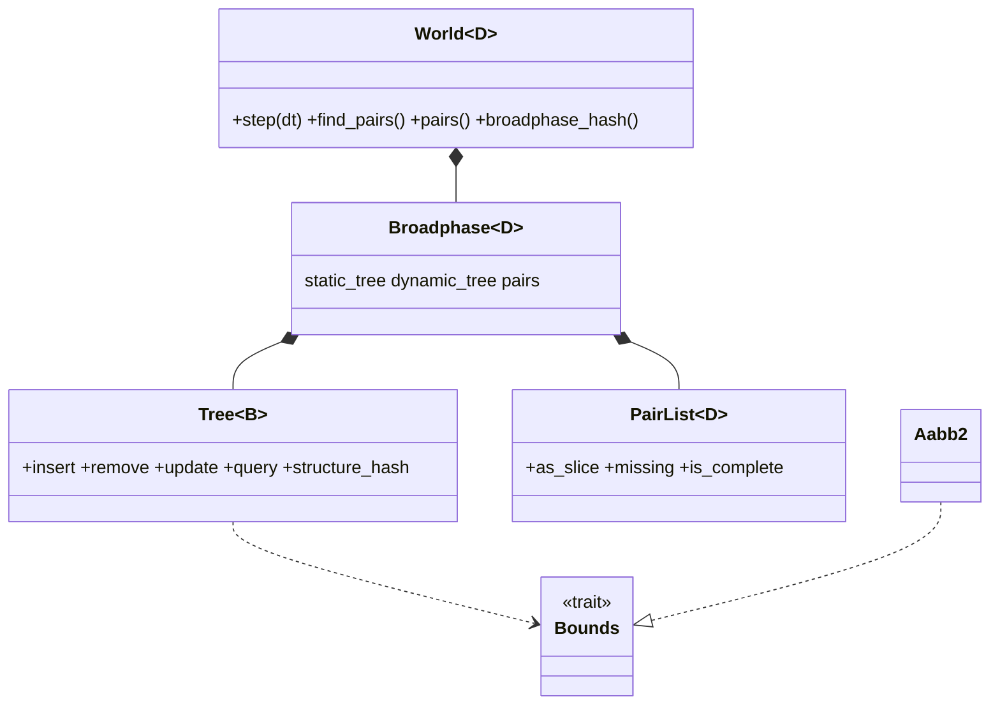

# Review 4-11: broadphase tree and deterministic pair list

Task: 4-11. Class 2 (public API of a module, determinism, hot-path data structure; no protected path touched). One PR into `develop`. Out of scope: narrowphase (4-12), solver (4-13), tree performance (4-22). Loops and open findings: see the end.

Delivers (crate `engine/physics`): `core::bounds` (`Bounds` trait: overlaps, union, contains, measure, fattened, is_valid), `Dim::Bounds` and `Dim::shape_bounds`, `d2::Aabb2`, `core::tree` (`Tree<B>`, `ProxyId`), `core::sort` (in-place heap sort), `core::pairs` (`PairList<D>`, `Pair<D>`), `core::broadphase` (private glue: static tree, dynamic tree, pair list), `World` additions (`pairs`, `find_pairs`, `broadphase_bounds`, `broadphase_hash`, `WorldConfig::max_pairs` and `broadphase_margin`), two new errors (`InvalidMargin`, `PairCapacityTooLarge`), `StateHasher::write_u64`. Wiki: as-built paragraph with class and sequence views in `architecture/physics-and-jobs-v0` section 2, pointer in `architecture/physics`, `README` v0.87 and index row.

## Decisions

- Tree: Box2D v2.4 style (surface-area heuristic, AVL rotations, fat box = tight + margin, re-insert only when the tight box leaves the fat box), arena of `2 * capacity - 1` nodes allocated once, LIFO free stack, leaf id = body slot index, stackless queries by parent links. Chosen over a flat grid (not dimension generic, poor with mixed sizes) and a sort-and-sweep (does not scale, design note section 3).
- Two trees: static with margin 0, dynamic with the configured margin (default 0.1 m). Pairs are searched from the dynamic side only; dynamic-dynamic only towards a higher slot index, so each pair is found once; static-static is never asked.
- Canonical order (lower slot index, higher slot index) by an in-place heap sort: the stable std sort allocates, the unstable one is banned by arch-check.
- Overflow of the pair list is a documented flag, not an error: pairs are counted in `missing()`, `is_complete()` is false, the step is `Ok`. Reason: a step cannot be half done; the caller sizes `max_pairs` and checks the flag.
- Touching boxes overlap (closed intervals). No collision filtering: the design note defines none.
- `Clone/Copy/PartialEq` of the new types are written by hand so that no bound lands on `D` (ADR-0018 friction 3).
- The state hash is unchanged: a pinned test (`tests/hash_pin.rs`) holds the values of card 4-10 for 1, 100 and 300 steps. The tree has its own hash (`broadphase_hash`).

## Evidence

- Tests (Windows, feature off and on, and Linux/WSL, feature off and on): 140 library tests, `broadphase` 8, `generic_core` 4, `hash_pin` 1, `no_allocation` 4, `replay` 2: all pass; `cargo test --workspace` passes on Windows (the panic lines of `pool_abort_on_panic` are the expected abort tests).
- Oracle: random scenes (sizes 0 to 90, five densities and margins, 6 seeds), 60 steps of moving bodies, random create/destroy/step sequences and a grid of exactly touching boxes equal a brute-force O(n^2) test, pair for pair and in order.
- Tree validator (test only): parent links, heights, union boxes, AVL balance, free stack accounting, leaf count; eight kinds of deliberate damage are each detected; height bound 1.44 log2(n + 2) + 1 holds for rows, equal boxes, random operations and removals in random order.
- Determinism: same calls give the same tree hash; insertion order changes the structure but not the result set; the structure hashes of six fixed scenarios are pinned and equal on Windows and Linux, feature on and off.
- Zero allocation: counting allocator with per-thread counters, 500 steps with every body leaving its fat box about every other step, pair list overflowing on every step: 0 allocator calls.
- 3D: a test instance (`Box3`, planar) steps and finds pairs through the same generic code.
- Mutation (cargo-mutants, per file, tests filtered to the file): tree.rs 126 viable mutants, 5 missed, 21 timeouts counted as detected; sort.rs 20 viable, 1 missed; pairs.rs 32 viable, 2 missed; broadphase.rs 17 viable, 1 missed; aabb.rs 49 of 49; shape.rs `bounds` 15 of 15; world.rs changed functions 17 of 17 (and `create_body`/`step` again 11 of 11 after the loop-1 fix); hash.rs 8 of 8; error.rs 1 of 1; body.rs and d2/mod.rs `bounds` 2 of 2. Total 269 of 278 detected, 96.8% (timeouts counted as detected; with the 22 timeouts as misses 247 of 278, 88.8%). The first run of tree.rs had 31 missed (74 caught); the survivors led to a pinned-structure test, a distinct-index test, a capacity-boundary test and a skewed-box test.
  The 9 survivors: equivalent: `insert_leaf` height `+` to `*` and `rotate_up` height `+` to `*` (the refit recomputes both), `balance` `||` to `&&` (a leaf has height 0, an internal node of height 1 has equal children, so no rotation either way), `heap_sort_by_key` `len / 2` to `len * 2` (sift_down returns at once), `Pair::key` `|` to `^` (disjoint bit halves), `PairList::push` `<` to `<=` (equal slot indices never occur), `add_later_pair` `>` to `<` (the pair is then found by the other body and ends up identical after the sort). Not killed: two `<` to `<=` in `descend` (`2 * combined < cost`): an exact float tie between the cost of pairing here and of descending; no scene found where the tie occurs on purpose.
- Quality gates: `cargo fmt --check`; `cargo clippy --workspace --all-targets -- -D warnings` and `-p physics --features cross-platform-determinism`: clean; no `unsafe`, no `unwrap`/`expect` in the library code.

## Not verified

- Tree performance NOT benchmarked here: card 4-22. The AVL bound and the validator show the shape, not speed.
- Behaviour at the largest capacities (2^24 pairs) is not exercised.
- ARM64 not run. No Miri (no `unsafe`). No TSan (single-threaded).
- Two float-tie mutants in `descend` survive (see above).

## Follow-ups proposed

- Card 4-22: benchmark insert, update and query against a grid and a sweep on the W1 scenes; look at the descent cost with the real narrowphase load.
- Collision filtering (categories and masks) when a card asks for it; the pair list is the place.
- Use the scheduler for the per-body queries once the narrowphase (4-12) shows they matter; the output order is already independent of the order of the queries.

## Review phases and loops

R1 self, R2 automated (fmt, clippy, tests, mutation), R3 independent reviewer, R4 QA, R5 architecture, R6 security, R7 performance (not measured, stated), R8 product fit: see the end of this file for the reviewer result.

Loop 1 (independent read-only reviewer, fresh context): 0 blocker, 0 major, 4 minor, 5 nits. The reviewer could not run cargo, so test and mutation numbers above are the author's own. Fixed in loop 1:
- minor 1 and 2 (a huge margin could make a fat box overflow after the checks passed, so `step` could fail half way and `create_body` could use up a pool generation): new `Broadphase::can_hold` checks the box and the fat box; `create_body` and the step pre-check use it; regression test `a_margin_that_overflows_a_box_refuses_the_body_or_the_step_and_changes_nothing` (state hash, tree hash, step count and the generation of the next body unchanged). The regression test was written together with the fix; a red run before the fix was not recorded.
- minor 3: comment on the unreachable second allocation in `Tree::insert`.
- minor 4: `ProxyId` documented as crate-internal for now (generation or `pub(crate)` before another module holds proxies); not changed in code.
- nits: wording of the overflow subset in `pairs.rs`, `missing()` type in the wiki view, the one balance bound written the same everywhere, a test assertion that tested nothing removed.
Loop 2: not needed (no open finding). Open blocker/major: 0.
