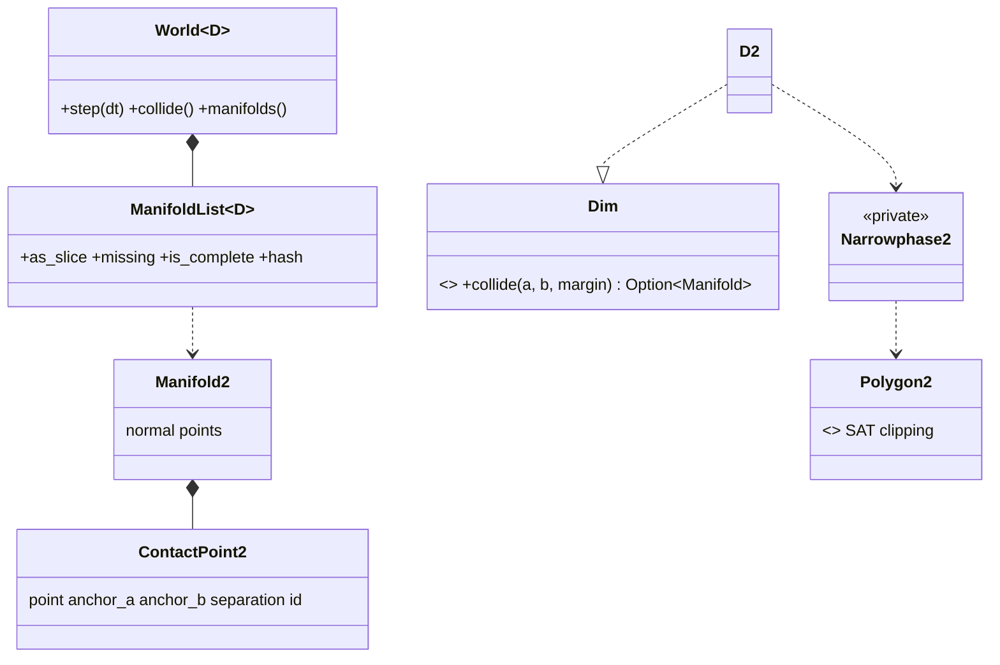
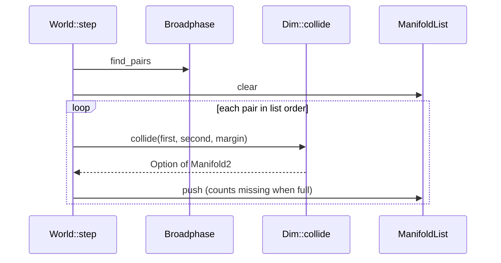

# Review 4-12: 2D narrowphase and contact manifolds, brute-force oracle

Task: 4-12. Class 2 (new module, determinism, geometry and numerics; no protected path touched). One PR into `develop`. Out of scope: solver (4-13), islands (4-14), polygon shapes, narrowphase performance (4-22).

Delivers (crate `engine/physics`): `Dim::Manifold` and `Dim::collide`, `core::Placed<D>`, `core::manifolds` (`ManifoldList<D>`, `ContactManifold<D>`), `d2::manifold` (`Manifold2`, `ContactPoint2`, `FeatureId`, `MAX_MANIFOLD_POINTS`), `d2::narrowphase` (dispatch and circle cases), `d2::polygon` (SAT, reference and incident face clipping, circle against polygon regions; private), `World` additions (`collide`, `manifolds`, `WorldConfig::max_manifolds` and `speculative_margin`, `DEFAULT_SPECULATIVE_MARGIN`), `Body::placed`, `PhysicsError::ManifoldCapacityTooLarge`, a test-only `Must` helper (`src/test_support.rs`, since the lints deny `expect`). Wiki: as-built paragraph with class and sequence views in `architecture/physics-and-jobs-v0` section 2, pointer in `architecture/physics`, `README` v0.88.

## Decisions

- Algorithm: SAT over the face normals of both boxes with reference and incident face clipping (Box2D v2.4 / v3 style, up to two points); circle-box by the face and vertex regions of the box; circle-circle in closed form. Chosen over GJK/EPA (not needed for the shapes that exist, harder to make exact) and a general convex-hull collider (no polygon shape yet).
- No polygon shape: the design note fixes no vertex limit, so none was invented. The clipping code is generic over up to 8 vertices and is unit-tested with a hexagon and a triangle.
- Reference face bias `REFERENCE_FACE_BIAS` = 0.0005 m: the first shape's face stays the reference when two faces are nearly equally good (stable feature ids and a stable normal under small motion). Ties go to the lowest index.
- Working frame with the origin at the first body's centre: translating both bodies by an exact power-of-two amount changes no relative bit (tested). A circle and a box give bit-identical results in either order (the polygon is always the first shape inside, the result is flipped).
- Manifold layout: unit normal from the first to the second body, up to two points, per point a world position (middle of the two surfaces), a separation (negative when overlapping), two anchors (point minus each centre, world axes) and a 16-bit `FeatureId` (kind in the high byte, two saturating nibbles for the vertex or face indices). Ids are lost (new ids) when the reference face flips between frames.
- Speculative margin: a pair within `speculative_margin` (default 0.02 m, `>= 0`, checked by `World::new`) gets a manifold even when the shapes do not overlap yet; further apart: `None`.
- Errors as values: invalid shapes, non-finite input and non-finite results give `None`; coincident centres use the x axis; no NaN can leave `collide` (final `is_finite` guard, tested with coordinates of 3e38).
- Fixed capacity: `max_manifolds` (at most 2^24); overflow is counted by `missing()` and `is_complete()` like the pair list, the step still returns `Ok`.
- No force is applied and the state hash is unchanged (pinned test at three checkpoints, plus the card 4-10 and 4-11 pins). The manifold list has its own hash.
- Only `+ - * /` and `sqrt`; no `sin`, `cos`, `atan2`, no libm; no `HashMap`, no sort. Pinned scenes are built from integers and rotations from integer (cos, sin) pairs, so the pinned hashes are platform independent.

## Evidence

- Tests (Windows and Linux/WSL, feature `cross-platform-determinism` off and on, same pinned values asserted by the tests in all four runs): physics library 190 tests, `broadphase` 8, `contacts` 9, `generic_core` 4, `hash_pin` 2, `narrowphase_oracle` 9, `no_allocation` 5, `replay` 2: all pass. `cargo test --workspace` passes on Windows.
- Oracle (`tests/narrowphase_oracle.rs`): an independent f64 reference (exhaustive SAT over all axes for box pairs, signed distance function of a box for the circle cases, closed form for two circles) on 4000 seeded Pcg32 scenes per shape pair and three margins: yes/no, normal, depth and contact points agree within 2e-4 (ties and the tolerance band excluded; minimum tallies of each outcome are asserted so the checks cannot go idle).
- Properties on seeded scenes: swapping the two bodies mirrors the manifold; a box and a circle swap bit for bit; translation by (1024, -2048) changes no relative bit; a quarter turn of the whole scene turns the manifold; feature ids stay the same while a slightly turned box slides on the ground (400 steps); determinism twice and a pinned manifold hash (`PINNED_HASH`, 2460 contacts in 3000 scenes x 3 margins) and three pinned world checkpoints in `hash_pin`.
- World: resting box on the ground (two points, -0.01), falling box (a manifold only within the margin, none applied), overflow prefix property (capacity 3 of 7 with 4 missing), destroyed body leaves no manifold, `collide()` leaves the state hash alone, huge coordinates, busy scene run twice.
- Zero allocation: counting allocator with per-thread counters, 300 steps of a scene whose manifold list overflows: 0 allocator calls.
- Mutation (cargo-mutants 27.1, `-j 1`, one file at a time with the library tests plus the oracle and contacts tests): manifolds.rs and manifold.rs 57 viable, 5 survivors in the first run (`PartialEq`, `Debug`, `flipped` sign), all caught after new tests; narrowphase.rs 34 viable, 1 survivor (the boundary of the minimum squared distance in `circles`), caught after a new test; polygon.rs 164 viable (`crossing` was rewritten in loop 1 and re-run), 4 survivors in the first run, 2 caught after a new test (`region`, centre exactly above the end of a face), 2 remain; changed lines of world.rs, body.rs, dim.rs, error.rs, d2/mod.rs, shape.rs 6 viable, 6 caught. Total 261 viable, 259 detected (99.2%). No timeouts occurred, so the question whether timeouts count as detected does not arise (the 2 survivors are not timeouts); 55 unviable mutants are not counted.
  The 2 survivors: `collide_polygons` `from_b > from_a + REFERENCE_FACE_BIAS` to `>=`: an exact float tie between two separations differing by exactly the bias; no scene found (not proven equivalent). `CircleQuery::collide` `face.value > 0.0` to `>=`: provably equivalent, because a value of exactly 0 means the centre lies on the polygon boundary, the projection onto the nearest edge then lies inside the edge, and the region is the face either way.
- Quality gates: `cargo fmt --check`; `cargo clippy --workspace --all-targets -- -D warnings` and `-p physics --all-targets --features cross-platform-determinism`: clean; no `unsafe`, no `unwrap` or `expect` in library code (test code uses `Must`).
- Red evidence: the tests were written together with the code in small steps; a recorded red run per test was not kept for every step. The mutation runs are the evidence that the tests can fail: 243 mutants were killed by them in the first runs, and each survivor above was closed by a test that fails on the mutant.

## Not verified

- Narrowphase performance NOT benchmarked here: card 4-22.
- ARM64 not run. No Miri (no `unsafe`). No TSan (single-threaded).
- The reference-bias tie and polygons with more than 4 vertices through the public API (no such shape yet).
- Behaviour at the largest capacity (2^24 manifolds) is not exercised.
- The 3D instance has no narrowphase (phase 8); the generic test instance uses a trivial `Manifold`.

## Follow-ups proposed

- Card 4-13 (solver): use the anchors and feature ids for warm starting; keep the manifold list read-only.
- Card 4-22: benchmark the narrowphase on stacked boxes and compare the cost of `collide` per pair.
- Polygon shape once the design note fixes a vertex limit; the clipping code is ready for up to 8.
- Persist ids across a reference flip (match by position) if warm starting shows jitter.

## Review phases and loops

R1 self, R2 automated (fmt, clippy, tests, mutation), R3 independent reviewer, R4 QA, R5 architecture, R6 security, R7 performance (not measured, stated), R8 product fit.

Loop 1 (independent read-only reviewer, fresh context; it could run tests and clippy but not mutation): 0 blocker, 0 major, 5 minor, 3 nits (and a few remarks). Fixed:
- minor 1 (`crossing` used the product of the two distances, which underflows for tiny opposite distances): now compares signs; regression test `two_tiny_distances_on_opposite_sides_still_cross_the_plane` (it also pins that a point exactly on the plane is not a crossing); mutation of `crossing` re-run: 23 of 23 viable caught.
- minor 3 (oracle did not check the deepest point): `check_points` now asserts, for overlapping shapes, that the deepest point is at the oracle depth. For separated boxes the axis gap can be smaller than the corner distance, so there the assertion is not made (the first attempt without that exception failed on a speculative scene, which also showed the minor 2 behaviour is real).
- minor 5 (the `placed()` insertion had split the doc line of `set_linear_velocity`): fixed.
- minor 2 (a box pair whose axis gaps are inside the margin but whose closest corners are not gets `None`): this is the intended answer, so documented in `WorldConfig::speculative_margin`; the oracle already accepts it because its yes/no check uses the axis gap with the tolerance band only for the other direction. No code change.
- Remark on `speculative_margin` above the broadphase margin: documented as not checked, not made an error (a larger value is harmless, only pairs not found by the broadphase are missed).
Not changed: minor 4 (oracle tolerance 2e-4 with 1e-3 for normals; it is at the scale of the f32 error of scenes a few metres wide and of the 0.0005 reference bias, tightening it would make ties flaky), the nits on tests that use `unwrap_or(Rot2::IDENTITY)` for integer (cos, sin) pairs that cannot fail, and the `-0.0` components of a flipped normal (equal by value, hashes are deterministic). Pre-existing, not from this card: `cargo doc -D warnings` reports an unresolved link `Tree::structure_hash` in `world.rs` (card 4-11).
Loop 2: not run (no open blocker or major; the fixes are small and covered by the tests above and a repeated full test, clippy and Linux run).
Open blocker/major: 0.
