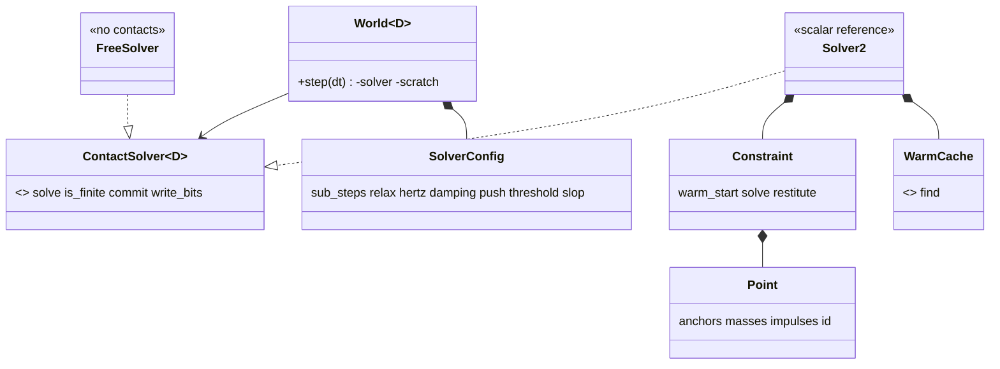

# Review 4-13: soft-step contact solver (friction, restitution, sub-stepping, scalar reference, pyramid)

Task: 4-13. Class 2 (numerics, determinism, hot-path design; no protected path touched). One PR into `develop`. Out of scope: islands and sleeping (4-14), the SIMD solver (4-15), continuous collision detection, joints, performance measurement (4-22), the cross-platform golden hash (4-20), the sequential-impulse fallback (not needed, see checkpoint).

Delivers (crate `engine/physics`): the solver seam (`core::solver`: `SolverConfig`, `ContactSolver`, `StepFrame`, `FreeSolver`; `Dim::Solver`), the 2D scalar solver `Solver2` (`d2::solver`: `constraint`, `warm`), body friction and restitution (`InvalidMaterial`), `InvalidSolverConfig`, `Rot2::turned_by` and `rotate`, the new `World::step`, tests, and the wiki pages. The as-built paragraph is in [physics-and-jobs-v0](../wiki/architecture/physics-and-jobs-v0.md) section 2.



```mermaid
sequenceDiagram
  participant W as World::step
  participant S as Solver2
  W->>S: solve(scratch bodies, manifolds, gravity, dt)
  loop n sub-steps
    S->>S: velocities, warm start, soft solve, positions, relax
  end
  S->>S: restitution; untouched bodies take one Euler step
  W->>S: finite and representable?
  alt yes
    W->>S: commit impulses, copy bodies back, broadphase, pairs, manifolds
  else no
    W-->>W: NotFinite, nothing changed
  end
```

## Summary verdict

Ready. The checkpoint is met: a 10-high pyramid (55 boxes) settles and stays, within the stated bounds, deterministically. 0 open blocker, 0 open major. The caveats are in "Not verified" and "Known limits".

## Decisions

- **Algorithm.** Soft step per owner choice O2 (`Box2D` v3 **[K]**, from background knowledge, not re-read from source): soft contacts (`bias_rate = w/a1`, `mass_scale = a2 a3`, `impulse_scale = a3`, `a1 = 2 zeta + h w`, `a2 = h w a1`, `a3 = 1/(1 + a2)`), sub-steps with a relax pass, restitution once after the last sub-step, speculative contacts for a positive separation.
- **Parameters and defaults (all in `SolverConfig::DEFAULT`, documented, validated):**

| Parameter | Default | Range | Reason |
|---|---|---|---|
| `sub_steps` | 4 | 1..=16 | `Box2D` default; the pyramid needs several, the cost is linear |
| `relax_iterations` | 1 | 0..=4 | removes the energy the soft push-out leaves in the velocities |
| `contact_hertz` | 30 | capped at 0.25 / h | `Box2D`; the cap keeps the soft constraint stable at any `dt` |
| `contact_damping_ratio` | 10 | | `Box2D`; heavily over-damped, no bounce from the constraint |
| `contact_push_speed` | 3 m/s | | `Box2D`; a deep overlap does not throw bodies away |
| `restitution_threshold` | 1 m/s | | `Box2D`; resting bodies do not jitter |
| `linear_slop` | 0.001 m | | **differs from `Box2D` (5 mm), see below** |

- **Linear slop 1 mm instead of 5 mm.** Each level of a stack rests about 1.5 slops into the one below. With 5 mm, the 10-high pyramid drifted 0.059 m (bound 0.05) and the analytic slope-friction test was 5.7% off the closed form; with 1 mm they are 0.0171 m and within 1%. Measured on this scene, not tuned on the bounds: the bounds were fixed before the measurement (drift 0.05 m is the "0.05 m" of the reference workload). Whether a 1 mm slop costs jitter on other scenes is for the 4-22 workloads.
- **Constraint order.** The manifold list order (pair order from the broadphase, deterministic). No sorting or colouring. Friction is solved before the normal point by point, and the points of a manifold in order, so the normal has the last word. Sequential (Gauss-Seidel) within a sweep, so the 2-point asymmetry is about 1 mm and is documented in the symmetric-drop test tolerance.
- **Warm starting.** Impulses are kept per (first handle, second handle, feature id) in a fixed-capacity cache that has the same order as the manifold list; a cursor that only moves forward matches them (no search, no hash map). A handle with another generation never matches. A new feature starts from zero.
- **Separation.** Not recomputed per sub-step: `s = dot(dp_b - dp_a + rot(dq_b, r_b) - rot(dq_a, r_a), n) + base_separation`, with `base_separation = sep - dot(r_b - r_a, n)`; `rot` is a (cos, sin) multiply, so no trig runs in the step.
- **Restitution.** Mixed by maximum, applied after the last sub-step to points whose approach speed before the solve exceeded the threshold and that pushed at all. Friction is mixed by the square root of the product.
- **Untouched bodies.** A body no manifold touches takes the old single Euler step. This keeps every world without contacts bit-identical to card 4-10 (pinned), at the price of a small, deterministic position jump when a contact first appears (documented in [physics](../wiki/architecture/physics.md)).
- **State hash.** The material is written only when it is not the default, the warm cache only when it is not empty. Existing no-contact pins are unchanged; new pins exist for contact scenes.
- **Atomic step.** The solver works on a scratch copy; the world commits only when every body is finite and representable in the broadphase and the impulses are finite. Otherwise `NotFinite` and nothing changed (tested, including the hash).
- **Scalar reference for 4-15.** Plain `f32`, fixed order, no `mul_add`, no `sin`, no `cos`, no `powi`, no `HashMap`; arch-check passes. An independent f64 oracle is used in the tests (below).
- **Sequential-impulse fallback:** not implemented, as instructed; it was not needed.

## Checklist

- Measurable rules: pass. `cargo clippy --workspace --all-targets -- -D warnings` clean, also `-p physics --features cross-platform-determinism`; `cargo fmt --check` clean; no function over 60 lines, nesting at most 3 (the lint limit shaped the helpers `visit_body`, `visit_constraint`, `add_constraint`, `write_back`), no `unwrap`, `expect`, `panic`; no `unsafe`; no dead code (the unused cache accessors were removed).
- TDD: pass. The scenario tests (28 at first) were written and seen to fail before the solver existed (commit `wip: red solver scenario tests`), then the solver was written; later tests were added where mutation testing found gaps. No test weakened or removed; the old `contacts.rs` tests whose premise was "no force is applied" were rewritten to the new behaviour (gravity with zero friction for sliding, `collide()` for the prefix test) and the 4-10 hash pins were split at the first contact (steps 1 to 45 unchanged, later steps re-pinned).
- Architecture: pass. `physics` still depends on `base` only; layer rules and the headless dependency graph unchanged; `Dim` gained one associated type; no governance file touched.
- Security: pass. No `unsafe`, no input from outside, all capacities fixed at creation, indices checked with `get`.
- Performance: not measured (card 4-22). Allocation: 0 allocator calls over 300 steps of a 18-box pile with contacts (per-thread counting allocator, with a sanity check that the counter is installed).
- Product fit: pass for the card's list; see the checkpoint.

## Evidence

- **Checkpoint (10-high pyramid, 55 boxes, 5 s at 60 Hz, default config):** settles at step 19 (0.32 s, every box below 0.02 m/s from then on), max drift of any box 0.0171 m (bound 0.05), max penetration 0.0026 m (bound 0.02), total energy 1887.780 at the start, never above it, 1883.750 at the end, identical hashes on two runs and pinned (1 s, 3 s, 5 s).
- Other scenes: single box and ball at rest (rest height within 3 mm), stacks of 2 to 5 (drift under 0.03 m), heavy on light and light on heavy (mass ratio 10), sliding stop distance `v^2/(2 mu g)`, frictionless slide, box on a slope (slides with the closed-form acceleration, stays under the friction angle), bouncing ball (leaves at `e` times its arrival speed, none below the threshold even for `e = 1`, none at rest for `e = 0.8`), restitution mixed by maximum, head-on collision against an f64 closed form, momentum conservation, elastic exchange, a fast ball against a thin wall (speculative contact, 0.5 m margins), damping and torque of a body in contact equal to a free one, destroyed body and reused slot do not inherit impulses.
- Robustness: manifold and pair overflow still reported (`is_complete`, `missing`) and the step succeeds; a non-finite step is refused and changes nothing; a stale (pre-existing) overlap is pushed out no faster than the push speed.
- Tests: Windows `cargo test --workspace` all pass; `cargo test -p physics` 215 lib tests, `broadphase` 8, `contacts` 9, `generic_core` 4, `hash_pin` 3, `narrowphase_oracle` 9, `no_allocation` 6, `replay` 2, `solver` 34, all pass. **Linux (WSL), feature off and on: all pass with the same pinned values** (state hashes at steps 1, 10, 30, 44, 45, 100, 300, three manifold-buffer hashes, three pyramid hashes), so the hashes are equal across Windows and Linux in all four runs. The pins do not depend on `mul_add`, so the feature does not change them in this scene set (the golden hash is card 4-20).
- **Mutation (cargo-mutants 27.1, `-j 1`, one file at a time, library tests plus the focused integration tests; timeouts: none occurred, so none is counted as detected):** `warm.rs` 25 of 25 viable caught (1 unviable); `constraint.rs` 150 viable, 144 caught at first and 6 survivors, all closed by new tests (damping and torque of a touched body, sub-threshold elastic approach, resting bouncy ball), re-run 31 mutants all caught; `d2/solver/mod.rs` and `core/solver.rs` 51 viable, 3 survivors (two `FreeSolver` mutants caught by `generic_core`, `Solver2::is_finite` closed by a unit test; re-run caught); the changed lines of `body.rs`, `world.rs`, `rot.rs`, `error.rs`, `dim.rs`, `d2/mod.rs`, `core/mod.rs` (`--in-diff`) 69 viable, 3 survivors in `body.rs` (material check, `force()`, material hash), closed by unit tests, re-run caught. Final: every viable mutant caught; score 100% on changed L2 code after the fixes (first-run score 96% for the largest file, 144 of 150).
- Equivalent mutants: none found; none claimed.
- Independent review (separate subagent, read-only; numerical correctness, Soft-Step semantics, determinism, test strength): 0 blocker, 0 major, 7 minor, 7 nit. Fixed in loop 1 (re-tested): F4 reused-slot test added, F6 stale comment and rest-height tolerance tightened to 3 mm, F7 damping tolerance tightened to 1%, F8 the constraint limit is the stored manifold capacity (not `Vec::capacity`), F11 position-jump note added to the physics page, F14 atomicity comment. Accepted as follow-ups, not blocking: F1 a direct warm-start test (the pinned contact hashes fail without warm starting, but a behavioural test is better), F2 off-centre hit and rolling oracle, F3 untested configurations (relax above 1, hertz cap at a large `dt`, a dynamic body between statics), F5, F9 (`touched.fill` is O(bodies) per step, a measurement for 4-22), F10, F12, F13.
- Local gates: see the PR (4 deliberate FAIL lines expected: `mutation.score_min`, `CLAUDE.md does not import`, `G1: well-tested score 0.0`, `cannot write the report`).

## Not verified

- Performance: not benchmarked (card 4-22). The slop and the cost of four sub-steps on large scenes are untested.
- The D2 golden hash across Windows and Linux (card 4-20); only the pinned hashes of this card's scenes were compared, and they are equal.
- Miri (no `unsafe`), ARM64, coverage percentage (the mutation result is the stronger signal here).
- `Box2D` parity: the formulas are from background knowledge; no source was compared.
- That a SIMD solver can reproduce the exact evaluation order (card 4-15 will test it).

## Known limits

- No continuous collision detection: the speculative margin (0.02 m) plus the broadphase margin (0.1 m) lets a very fast body embed before its first contact; a push-out then runs at the push speed. The thin-wall test passes with 0.5 m walls; a thinner wall at higher speed would tunnel. Follow-up: a velocity-aware margin or a conservative advance.
- A pushout leaves residual velocity in zero gravity (relax removes only part of it); a body whose manifold overflowed is not solved this step.
- Free fall of a body that gains a contact jumps by about 1 mm (see above).

## Follow-up proposals

- Warm-start behavioural test, off-centre and rolling oracles (F1, F2).
- Slop versus the workload-1 jitter rows in card 4-22; the choice 1 mm is a measured default, not a final one.
- Velocity-aware speculative margin (or CCD) before the character and projectile cards.
- Cards 4-14 (islands, sleeping) and 4-15 (SIMD, must equal this bit for bit) next.
