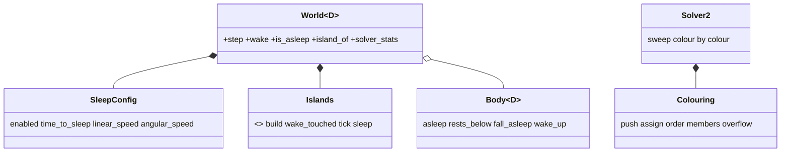
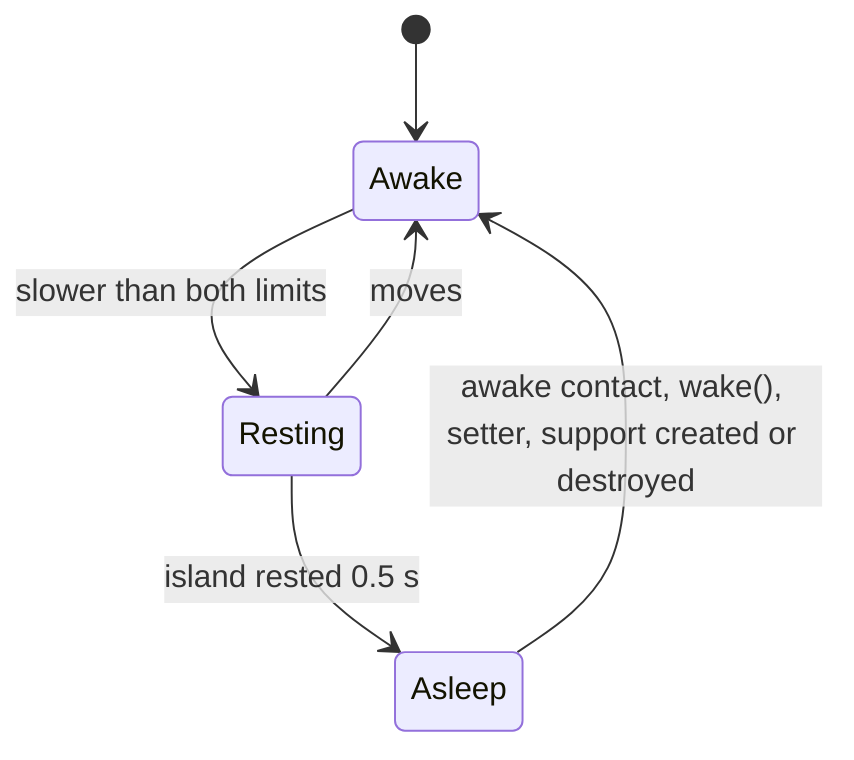

# Review 4-14: islands, sleeping and serial graph colouring

Task: 4-14. Class 2 (determinism, solver order, state hash; no protected path touched). One PR into `develop`. Out of scope: the parallel and SIMD solve of the colours (4-15), the performance measurement (4-22), the cross-platform golden hash (4-20), sleeping for joints (none exist), continuous collision detection, a body type that moves without being simulated (there is no kinematic kind).

Delivers (crate `engine/physics`): `core::islands` (private, union-find), `core::sleep` (`SleepConfig` and the named constants), `core::colouring` (`Colouring`, `ConstraintEnds`, `Colour`, `MAX_COLOURS`), `core::cells` (three table helpers), the body sleep flag and the `Magnitude` trait, `SolverStats`, the sleep API of the world (`wake`, `is_asleep`, `island_of`, `island_count`, `sleeping_count`, `rest_time`, `solver_stats`), the colour-by-colour sweep of `Solver2`, tests and the wiki as-built paragraph (physics-and-jobs-v0 section 2, physics, README v0.90).

## Summary verdict

Ready. 0 open blocker, 0 open major. The independent reviewer found no blocker and no major; its minor findings are fixed or documented (see Review loop). The serial colouring is valid and canonical, the order inside a colour changes no bit (tested), sleeping is deterministic, a world with sleeping off equals the world with sleeping on until the first island sleeps, and no allocator call happens in a step. Caveats are in "Not verified" and "Known limits".

## Decisions and parameters

| Decision | Choice | Reason |
|---|---|---|
| Island id | lowest body slot, union-find with the lower root winning | independent of manifold order and of thread count; the root after `flatten` is the label |
| Static bodies | never join an island | two piles on one floor must be two islands; a static body is never solved |
| Sleep limits | 0.5 s, 0.05 m/s, 2 degrees per second (0.0349 rad/s) | Box2D v3 and v2 values **[K, from memory, not re-read]**; a settled soft-step stack moves far less (measured: the 10-high pyramid sleeps from step 36 in the stacking test, the default hash scene has 7 sleepers at step 300) |
| Island sleeps when | every body awake and the smallest rest timer at least the time | a part-asleep island holds back (a sleeper counts as zero rest) |
| Sleep clears velocity | yes | a sleeper is at rest; hash and wake behave the same everywhere |
| Wake | awake contact (on the solver copies), `World::wake`, the four setters, static body created (all wake), any body destroyed (its island and its neighbours) | covers every way support or motion can change |
| Sleep flag in the hash | one tag byte after the body, only when set | non-sleeping worlds add nothing; `enabled = false` is bit-identical until the first sleep |
| Rest timers | not hashed | they only decide the time of falling asleep, which the flag then shows |
| Colouring | greedy, canonical order, lowest free colour, 24 colours, `u32` mask per body | deterministic and cheap; 24 is the Box2D v3 bound **[K]**; the mask fits a word |
| Overflow | a serial set solved after the colours, `SolverStats::overflow`, never an error | the step always solves every constraint |
| Static end of a constraint | not coloured and not written back by the solver | makes the order inside a colour irrelevant (two constraints of one colour may share a static body) |
| Frozen constraints | stay in the constraint list so the warm cache keeps its manifold order | the cache cursor moves forward only |
| Helpers | `core::cells::{put, change, read, index_u32}` | the workspace lints ban indexing and deep nesting; one place for the checked table access |

Colour counts (reported by `tests/colouring.rs`): 10-high pyramid, first step: 145 constraints in 6 colours, overflow 0. Hub of 30 touching balls: 24 colours and 6 in the overflow set; exactly 24 touching: 24 colours, no overflow. A sleeping scene solves 0 constraints and freezes all of them.

Hash pins changed (reasons in the test files): `CONTACT_CHECKPOINTS` (steps 100 and 300: solve order, and 7 sleepers at step 300), `MANIFOLD_CHECKPOINTS` step 75 (solve order; steps 50 and 60 unchanged), the stacking pyramid pins (solve order; sleeping on and off kept apart). New pins: `NO_SLEEP_CHECKPOINTS`, `PYRAMID_SLEEPING_PINS`. Pins of worlds without contacts are unchanged.

## Checklist

| Item | Result |
|---|---|
| Separate piles are separate islands, touching merges, ground does not merge piles | tests in `tests/islands.rs` |
| Settled pyramid sleeps, a bump wakes it, no drift while asleep | tests |
| Sleep and wake determinism, equal hash until first sleep, sleeping off | tests (`tests/islands.rs`, `hash_pin.rs`, `stacking.rs`) |
| Colouring valid over seeded random scenes and random graphs | unit tests in `colouring.rs` and `d2/solver/mod.rs`, 40 + 6 seeds |
| Order inside a colour does not change the hash | reverse, shuffle(1), shuffle(99) over 3 scenes, 120 steps |
| Zero allocator calls per step with sleep, wake, churn and overflow | `tests/no_allocation.rs`, per-thread counters |
| 4-13 stacking and pyramid behaviour tests | pass unchanged, with sleeping on and off |
| No unwrap, expect, HashMap, unstable sort, clock, powi, sin, cos | clippy and the reviewer's grep |
| Function length, nesting, parameters | clippy `-D warnings` clean (nesting 3, too_many_lines 60) |

## Evidence

- `cargo fmt --check`: clean. `cargo clippy --workspace --all-targets -- -D warnings`: clean; also `-p physics --features cross-platform-determinism`.
- `cargo test --workspace`: all pass. Physics: 246 unit tests plus the integration tests (islands 35, colouring 6, no_allocation, hash_pin, replay, contacts, broadphase, generic_core, solver).
- Windows and Linux (WSL, Linux target dir): the physics tests pass with the feature off and on; the pinned hashes in the tests are the same constants on both, so they are equal on Windows and Linux with the feature off and with it on.
- Mutation (cargo-mutants 27.1, `-j 1`, `CARGO_BUILD_JOBS=1`, focused test filters, timeouts counted as detected): `colouring.rs` 78 mutants, 12 unviable, 66 viable, 66 caught (first pass missed 2, closed with assertions); `islands.rs`, `sleep.rs`, `cells.rs` 90 mutants, 10 unviable, 80 viable: 79 caught including 1 timeout (`find` with `==` turned to `!=` loops forever), 1 equivalent; changed lines of `body.rs`, `world.rs`, `dim.rs`, `solver.rs`, `error.rs`, `d2/solver/mod.rs` 97 mutants, 14 unviable, 83 viable: 82 caught, 1 equivalent; two more survivors (`reset_slot`, `partner`) and one dead return value (`Islands::sleep`, removed) were closed with new tests or code. Overall about 227 of 229 viable mutants caught (99%), the two survivors are provably equivalent: `unite` with `<` turned to `<=` (when both roots are equal the two branches write the same value) and `FreeSolver::stats` replaced by `Default::default()` (its body is exactly that).

## Review loop

Reviewer (independent, read-only): no blocker, no major. Minor findings fixed: wiki claims about unchanged hashes and a wrong return type in the class diagram, rest timers outside the hash (documented), the timer restart in a refused step (documented, not observable), stale island label after destroying the lowest body (`island_of` now answers with the body's own handle, test added), duplicate `index_u32` (removed), review file (this file). Left as they are: `Colour::None` naming (nit), pyramid sleeping pins repeat one value (correct, the pyramid sleeps from step 36), O(capacity) work per step (noted for 4-22).

## Not verified

- Performance: nothing measured (card 4-22). The islands, tick and sleep passes scan the whole capacity each step.
- The Box2D values (24 colours, 0.5 s, 0.05 m/s, 2 degrees per second) are from memory **[K]**.
- Linux x86-64 only through WSL on one machine; no ARM64 run, no CI run (CI runs only on `main` and by hand).
- Miri and thread sanitiser: not relevant (no `unsafe`, no threads in this card).
- Tests were written together with the code in several places (the colouring and islands units), not strictly red first; the red evidence that exists: a deliberately broken `pick` was caught by the validity test, and the mutation survivors listed above were turned into failing tests before the fixes. This is a deviation from the TDD workflow and is stated here.
- A parallel solve of the colours does not exist yet; the claim that it can equal the serial result rests on the reorder test (reverse and shuffle inside a colour), not on a threaded run.

## Known limits

- A sleeping island wakes whole; there is no partial wake of one body.
- Between `destroy_body` and the next step `island_of` of a survivor can answer with its own handle instead of the true island.
- Colours are not balanced and static-end preferences of Box2D are not used.

## Follow-up proposals

- Card 4-15 can rely on: `Colouring::order`, `members(colour)` and `overflow()` (canonical, stable), constraints inside a colour touch disjoint dynamic bodies, static bodies are not written back, `finish` and `touch` stay serial, the overflow set must be solved serially after the colours.
- Measure the per-step cost of islands and sleeping in card 4-22; if it matters, skip the passes while no body is awake or build islands only when the manifold set changed.
