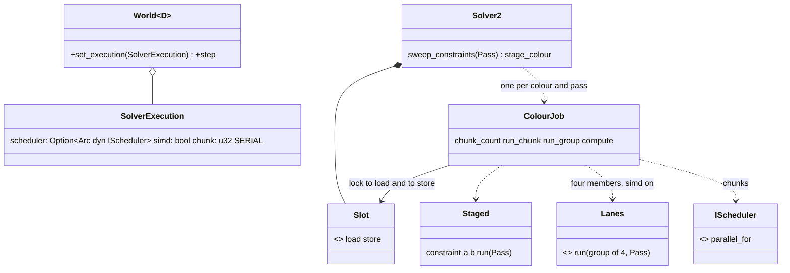
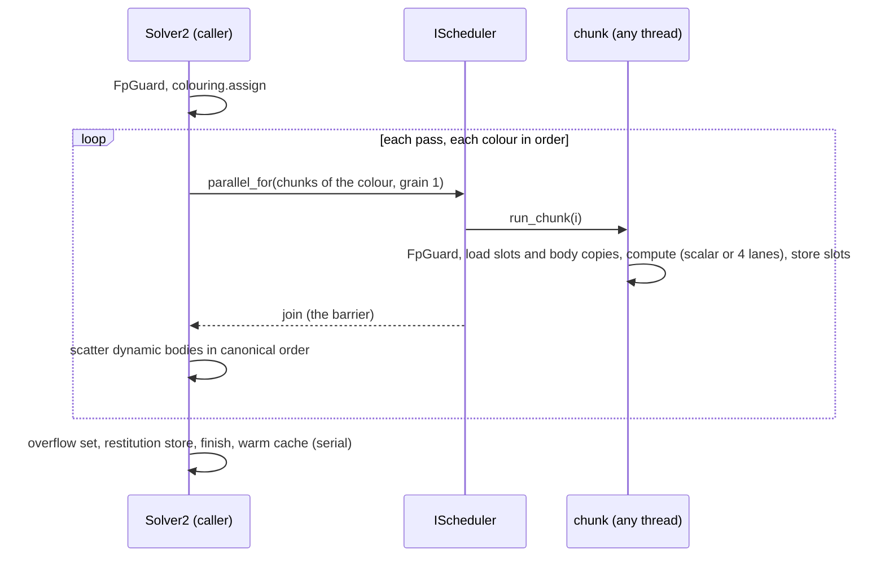

# Review 4-15: parallel colour solve and SIMD solver path

Task: 4-15. Class 2 (concurrency and SIMD; no protected path touched). One PR into `develop`. Out of scope: parallel integration of the bodies, a hand-written intrinsic path, scaling numbers (card 4-22), TSan (card 4-21), the cross-platform golden hash (card 4-20).

Delivers (crate `engine/physics`): `core::execution` (`SolverExecution`, `DEFAULT_CHUNK`), `World::set_execution` and the default method `ContactSolver::set_execution`, `d2::solver::stage` (the staged colour solve), `d2::solver::constraint::lanes` (four constraints per group on `base::simd::F32x4`), the edge `physics` to `jobs` (allowed by `gates/architecture.toml` already), tests `tests/parallel.rs` and `tests/parallel_allocation.rs`, the lane unit tests, and the wiki pages [physics-and-jobs-v0](../wiki/architecture/physics-and-jobs-v0.md) and [physics](../wiki/architecture/physics.md).

## Summary verdict

Ready for the owner. 0 open blocker, 0 open major after review loop 1 (see below). The result of the parallel and of the SIMD path equals the serial scalar result bit for bit in every configuration tested; the 4-14 hash pins did not change; no `unsafe`, no protected path.

## Decisions and reasons

| Decision | Choice | Reason |
|---|---|---|
| How to share the bodies between threads | gather, compute, scatter through per-constraint `Mutex` slots and a read-only body array; the bodies are stored back serially after the join | no `unsafe` (the crate forbids it, the allowlist and budget are protected paths); no thread writes what another reads; the locks are never contended because a member is in exactly one chunk |
| Chunk partition | colour size and a constant (`chunk`, default 32); the worker count is never read | a result that depends on the worker count would break D1 |
| Barrier | the join of `parallel_for`, one call per colour per pass | colours must be solved in order; the next colour reads what the scatter wrote |
| What stays serial | overflow set, `touch`, `finish`, restitution store, warm-start cache, position integration | the order of stores is canonical and the work is small; parallel integration is a later card |
| Refusal or one chunk | run the same code on the caller | `Busy` and `TooManyChunks` are values, not failures; no deadlock when workers are fewer than chunks (a scheduler runs chunks in turn) |
| SIMD | safe `base::simd::F32x4`; the same operations in the same order as the scalar code; branches, clamps and `max` per lane through the scalar functions; a one-point manifold selects the old lane; no FMA, no reciprocal estimate | bit-identical by construction and checked by 400 random groups per pass, signed zeros, infinities and NaN; a hand-written intrinsic path would need `unsafe` (governance step), proposed as a follow-up |
| Restitution | staged like the other passes, scalar body per group | its branches (threshold, `max`) gain little from lanes; the scalar function is the reference |
| Default | `SolverExecution::SERIAL`: scalar, calling thread | nothing changes for existing users; the owner decides when to switch |
| Floating-point state | one `FpGuard::deterministic()` for the whole solve and one per chunk (opaque boundary, `#[inline(never)]`) | covers the caller and the pool workers without a change to `jobs`; the guard restores what it found |

## Evidence

- Hash after every step equal for: scalar serial (reference), lanes serial, staged scalar without a scheduler, scalar and lanes through a pool of 1, 2, 4 and 6 workers; scenes: pyramid of 10, pile, hub with colour overflow (asserted: `overflow > 0` and several colours), pile asleep (asserted: sleepers), islands that sleep and wake. Chunk sizes 1 to 1000; reversed, shuffled and single-range schedulers; a refusing scheduler; one pool serving several worlds.
- Pins of `tests/hash_pin.rs` unchanged.
- Zero allocator calls per step on the caller and on every worker (per-thread counters), `tests/parallel_allocation.rs`.
- The lane path ran: a test-only counter shows groups of four with `simd` on and none with it off (the bits are equal either way, so only a counter proves it).
- Loop: `tests/parallel.rs` and `tests/parallel_allocation.rs` ran 20 times in a row on the final test code (Windows, debug): 20 passed, 0 failed.
- Mutation (cargo-mutants, `-j 1`, `CARGO_BUILD_JOBS=1`, one target at a time, timeout 120 s): `stage.rs` and `execution.rs` 27 mutants, 22 caught, 5 unviable, 0 missed, 0 timeouts; `lanes.rs` 110 mutants, 93 caught, 17 unviable, 0 missed, 0 timeouts; changed lines of `d2/solver/mod.rs`, `constraint.rs`, `core/world.rs`, `core/solver.rs` (`--in-diff`): 19 mutants, 17 caught, 2 missed. The two missed: (1) `ContactSolver::set_execution -> ()` is provably equivalent (the default body is already empty and `Solver2` overrides it, which the other tests cover); (2) `total - overflow.len()` to `+` in `sweep_constraints` was a real gap, "no scene found": the zero-velocity hub never made the overflow set compute an impulse. The hub spokes now move inward, and with the mutation applied by hand 9 of the parallel tests fail (caught); the mutation tool was not run again on that one line. Unviable mutants (do not compile) are not counted as survivors; a timeout would have been counted as detected (none occurred). The score is caught divided by caught plus missed.
- No `HashMap`, no unstable sort, no clock, no `.sin(`, `.cos(`, `.powi(` in the physics code or tests (arch-check and a search).

## Review loop

Loop 1 (independent read-only reviewer): 0 blocker, 2 major, about 9 minor. Fixed: the whole solve now runs under one `FpGuard` (major); the small chunk of the tests is 6 so a real colour has several chunks and some groups of four are complete (major: the lane branch was not reached), with the lane counter test; the wiki wording on locks and restitution; the hub and sleeper scenes are asserted to have their shape; the protected-ends invariant is documented in `stage.rs`; signed zeros are tested; the loose NaN comparison is documented; the performance caveat is in the wiki.

Loop 2 (independent read-only reviewer): 0 blocker, 0 major, 5 minor, 4 nits. Fixed: comment on the contract that makes the inline fallback right (a refusing scheduler ran no chunk), a doc line on `scatter`, the wiki wording on the scalar tail (per chunk). Accepted: the weak assertion in the floating-point state test (it cannot probe a worker's register state portably), direct indexing of the two-point arrays in `lanes.rs` (bounded by the constant `MAX_MANIFOLD_POINTS`), one guard per chunk costs a register read and write (measured in 4-22).

## Not verified

- Data races under a race detector: TSan is card 4-21. The design has no `unsafe` and shares only `&` data and `Mutex`, so the compiler's checks apply; this is not a substitute for the TSan run.
- The cross-platform golden hash (D2): card 4-20. Pinned hashes were compared on Windows and Linux (WSL) with the feature on and off, and are equal.
- Performance and scaling: card 4-22. The staged path copies the constraint and two bodies per pass and scatters serially, so with few constraints per colour it can be slower than the serial path. No speed-up is claimed.
- A hostile floating-point state (a driver that changed the control register) cannot be provoked portably in a test; the guard is checked on the caller (state set and restored). The pool does not call `fpenv` itself.
- A hand-written intrinsic path: not built; it needs `unsafe` and a budget row (governance).
- The default stays scalar serial; wiring the parallel path into an application is a later decision.
