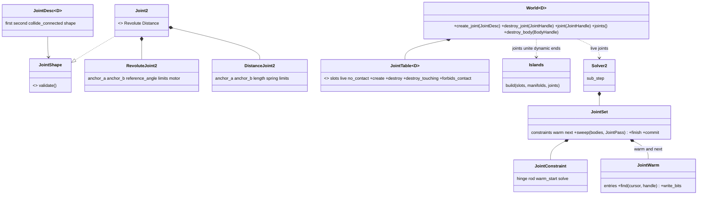
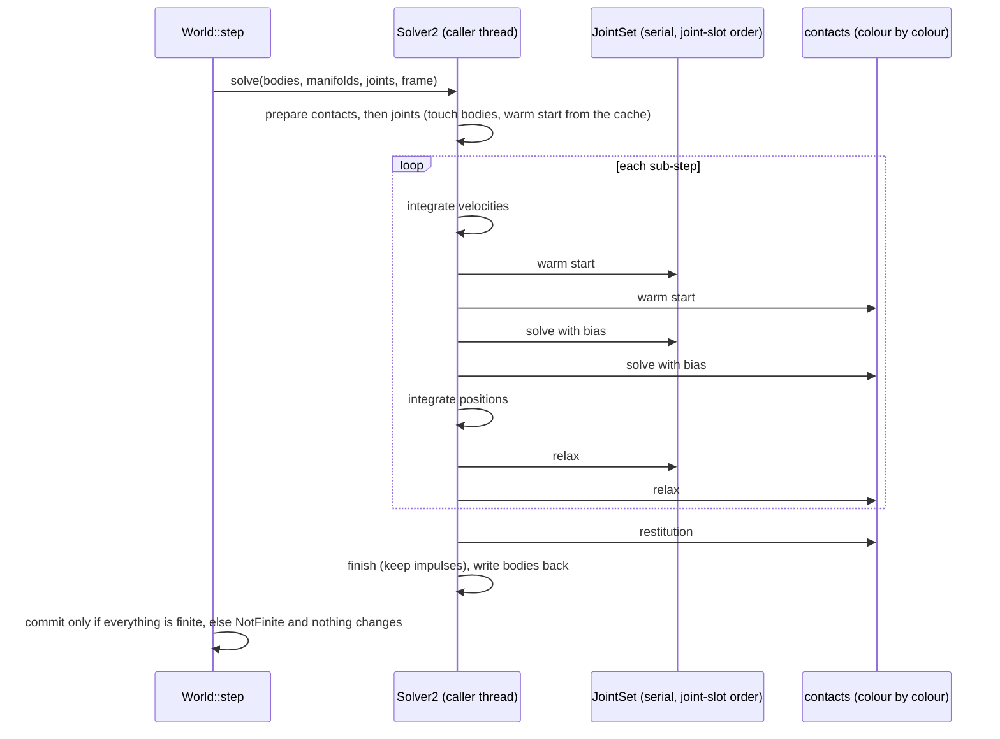
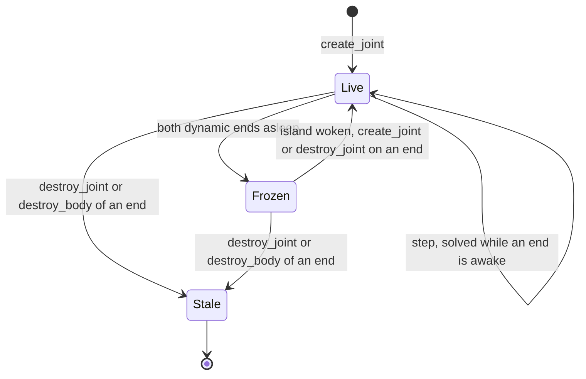

# Review 4-16: joints v0 (revolute, distance) and the chain scene

Task: 4-16. Class 2 (public API, concurrency interplay, determinism; no protected path touched). One PR into `develop`. Out of scope: prismatic, weld and wheel joints, 3D joints, colouring or SIMD for the joints (a benchmark decides, card 4-22), joint breaking, joint events, a debug-draw port.

Delivers (crate `engine/physics`): `core::joint` (`JointHandle`, `JointDesc`, `JointEntry`, `JointShape`, `JointTable`, `MAX_JOINTS`), `d2::joint` (`Joint2`, `RevoluteJoint2`, `DistanceJoint2`, `AngleLimits`, `Motor`, `Spring`, `LengthLimits`), `d2::solver::joint` (the joint constraints and the serial joint set), `JointWarm` in `d2::solver::warm`, `World::create_joint` and friends, `WorldConfig::max_joints`, `SolverConfig::joint_hertz` and `joint_damping_ratio`, `SolverStats::joints_solved` and `joints_frozen`, joints in the islands, tests `tests/joints/*` and `tests/joint_allocation.rs`.

## Summary verdict

Ready for the owner. R1-R8 done; 0 open blocker, 0 open major after 2 fix loops (loop 1: the independent review found 2 majors, both fixed; loop 2: the re-review found 1 major, a test that would not have gone red without the fix, fixed with a unit test with red evidence). No existing hash pin changed. Joints are serial (not coloured, no SIMD): that is a decision, not a gap, and the benchmark card 4-22 decides whether it stays so.

## Decisions and reasons

| Decision | Reason |
| --- | --- |
| Joints are not coloured. In every pass (warm start, solve, relax) of every sub-step all joints are visited first, serially on the calling thread in joint-slot order, then the contacts colour by colour. | Parallel and SIMD equal scalar serial by construction: the joint order does not depend on the worker count or on lanes. Colouring joints together with contacts would mix two constraint kinds in one colour and change the existing contact order, which would move every existing pin. A chain is serial by nature (each link needs the one before it), so there is little to gain. Follow-up: colour joints with contacts and benchmark (card 4-22). |
| Joints are prepared after the contacts. | Existing scenes touch the bodies in the same order, so the hashes of scenes without joints are bit-identical. |
| Joints unite two dynamic bodies in the island union-find; a static or kinematic end joins nothing. | A static anchor must not merge the islands of unrelated bodies hanging from the same ground (tested). |
| `create_joint` and `destroy_joint` wake the dynamic ends; `destroy_body` destroys its joints (handles go stale) and wakes the partner islands. | A change to a sleeping island must never leave it asleep with a stale constraint. |
| A joint is solved while either end is awake; a joint whose dynamic ends are all asleep is frozen and keeps its warm start. | Same rule as a contact; the counters `joints_solved` and `joints_frozen` make it visible. |
| `collide_connected` defaults to false (Box2D default). Implemented as a sorted `no_contact` pair list searched in `contact_of`; one entry per joint, so two joints on one pair are counted. | No allocation per step (capacity fixed at creation), deterministic, no hashing. |
| Joint impulses are in the state hash only when there is at least one joint (a count, then per joint its handle and six floats). Joint parameters are not hashed. | Worlds without joints keep their hash. Parameters are immutable after creation and the handle identifies them. |
| Revolute (local anchors, optional angle limits, optional motor) and distance (rest length, optional min/max, optional spring) only. Joints are immutable after creation (no setters). Limits stay inside minus pi to pi. | Scope of the card; the chain, pendulum, bridge and rope cases need nothing else. A rope or strut is a distance joint with a spring of hertz 0 and length limits. |
| The step stays atomic: the solver works on copies, and a non-finite joint impulse gives `NotFinite` with nothing changed. A rod whose anchors coincide is skipped (no direction), unless its length is not finite. | NaN safety, the same contract as contacts. |

Parameters (named constants in `SolverConfig`, both validated):

| Parameter | Value | Reason |
| --- | --- | --- |
| `joint_hertz` (`DEFAULT_JOINT_HERTZ`) | 60 Hz | Box2D v3.0 value [K, from memory]. Capped at 0.25 of the sub-step rate (`HERTZ_LIMIT_FRACTION`), which is 60 Hz at h = 1/240, so the cap is not active by default. Tuning was not needed: the bounds below hold. |
| `joint_damping_ratio` (`DEFAULT_JOINT_DAMPING_RATIO`) | 2.0 | Box2D v3.0 value [K]; later versions use 5. Not changed: the chain bounds hold with 2.0. |
| Sub-steps, relax iterations | 4, 1 | Unchanged from the contact solver. |
| Limits | speculative when not reached, soft when violated | Same scheme as contact normals: no energy from a limit that is not touched. |

## Evidence

Tests (Windows, `cargo test -p physics`): 497 passed, 0 failed, 0 skipped, with the feature `cross-platform-determinism` off and on. Of these: 291 lib unit tests (new for joints: the joint table, the validation of descriptions, the warm cache, the joint solver including exact-value tests of the limits, the motor, the rod and the unwinding), 64 in `tests/joints` (api 17, revolute 14, distance 11, chain 8, determinism 14), 3 in `tests/joint_allocation.rs`. `cargo test --workspace`: 1726 passed, 0 failed (the abort-on-panic tests print panics by design). `cargo fmt --check` clean; `cargo clippy --workspace --all-targets -- -D warnings` clean, and `-p physics --features cross-platform-determinism` clean.

Linux (WSL Ubuntu): `cargo test -p physics` passes with the feature off and with it on; the pinned joint hashes are the same as on Windows (the four values were measured equal in all four runs: Windows and Linux, feature off and on).

Existing pins: none changed (`hash_pin`, `replay`, `parallel`, `islands`, `parallel_allocation` pass unchanged). A scene without joints hashes as before (test `the_state_hash_covers_the_joints_and_a_world_without_them_does_not_change`).

Parallel equals serial: the joint scenes (a chain with a load, a bridge, every joint kind) give the same hash at 1, 2, 4 and 6 workers, with lanes on and off, on the work-stealing pool and on the inline, reversed and shuffled schedulers. Flakiness: the `joints` and `parallel` test binaries run 25 times each (50 runs), 0 failures, and the same 50 runs again on the final code, 0 failures.

Allocation: zero heap allocations per step in `tests/joint_allocation.rs` (counting allocator, per-thread counters) in its 3 tests (see the file for the scenes). Capacity overflow is an error value and changes nothing; a destroyed handle is refused; NaN velocities give `NotFinite` and an unchanged hash (hinge with limit and motor, and rod).

Mutation (cargo-mutants, `-j 1`, `CARGO_BUILD_JOBS=1`, timeout 120 s, tests `--lib --test joints`), files `d2/solver/joint.rs`, `core/joint.rs`, `d2/joint.rs`, `d2/solver/warm.rs`:

| File | Caught | Missed | Unviable | Timeout |
| --- | --- | --- | --- | --- |
| `d2/solver/joint.rs` | 311 | 0 | 22 | 0 |
| `core/joint.rs` | 32 | 4 | 34 | 0 |
| `d2/joint.rs` | 23 | 0 | 0 | 0 |
| `d2/solver/warm.rs` | 41 | 0 | 1 | 0 |
| total | 407 | 4 | 57 | 0 |

Score 407 / (407 + 4) = 99.0% (unviable mutants do not compile and are not counted; there were no timeouts, so the question of counting them as detected does not arise: they would be counted as detected). The first run left 11 survivors; the 6 in the solver and 1 in `core/joint.rs` were killed with new tests (the relative spin of both bodies in the motor and in both limits, a zero-inertia hinge, the rigid rod without bias in the relax pass, the soft limit scaling, destroying a joint that is not first in the pair list), and the re-run of those functions shows 0 missed there. The 4 that remain are provably equivalent, not "no scene found":
- `NoJoint::validate -> Ok(())`: the type is an empty enum, the function cannot be called.
- `ordered`, `<` to `<=`: for equal indexes both branches return the same pair.
- `ordered`, `<` to `>`: gives a consistent descending key; the list only needs one canonical form per pair, and it is used on both the insert and the lookup side.
- `exempt`, `<` to `<=`: only moves an insertion among entries that are equal, which cannot be told apart.

Chain numbers (bounds fixed before measuring, measured values after):

| Scene | Bound | Measured |
| --- | --- | --- |
| 20 links released horizontally (whip), density 1: worst anchor separation | 0.05 m | 0.0361 m; fastest point 27.3 m/s; total energy never above the initial 98.07 J |
| the same with a last link 10 times heavier | 0.05 m | 0.0406 m |
| a weight ten times a link at the end of the chain (mass ratio ~10) | 0.03 m | within the bound |
| a weight 64 times a link (stress, not the card's ratio) | 0.1 m | within the bound |
| bridge of 16 planks between two pins with a dropped load | 0.05 m | 0.0114 m |
| chain sliding on the ground (contact + joint) | 0.03 m, no sinking | 0.0014 m |
| chain of 10 links sleeping on the ground, and a hanging chain of 6 | joints intact, sleeps and wakes as one island | passed |

Honest findings from the measuring:
- The implicit spring step is numerically damped: an undamped 2 Hz spring loses part of its amplitude. The test asserts a peak above 0.2 (not 0.4 as first planned) and says so in a comment; the pendulum period and the spring frequency are within their bounds.
- My first heavy-load case had a mass ratio of 64, not 10. A ratio-10 test (bound 0.03 m) was added, and the ratio-64 case stays as a stress test with its own looser bound (0.1 m).
- A chain released horizontally never fell asleep within 50 s (it keeps swinging), so the sleeping test uses a chain dropped on the ground and a hanging chain.

Test bounds changed after measuring (all stated in the PR):
1. `distance.rs`, `a_spring_with_limits_is_held_inside_them_by_a_fast_ball`: the ball starts at 20 m/s, not 8 m/s. At 8 m/s the 2 Hz spring alone stopped it at 2.33 m, before the limit, so the lower bound of the test (it must reach 2.4 m) was a wrong premise, not a solver fault. The bounds themselves (reaches above 2.4 m, never beyond 2.55 m) did not change. The test is an integration check; the regression for the stale-speed bug is the exact-value unit test below.
2. `revolute.rs`, the unwinding test: the bound is 0.08 rad, first written as 0.03 rad. The soft limit overshoots by 0.037 rad; a missing unwind would be off by about 2 rad or not meet the limit at all, so 0.08 still discriminates.
3. `determinism.rs`: the pin of the scene "every joint" (it has limits, so it reads angles with `atan2`) is checked only with the feature `cross-platform-determinism` on, because only then is the angle function promised equal on every platform. The value was equal in all four measured runs; the other three pins are checked in every build.
4. Spring peak > 0.2 and the 64:1 stress case: see above.

## Review loop

| Phase | Result |
| --- | --- |
| R1 self | Clippy limits found and fixed in the code (nesting, function length, cast lints); no `unwrap`, `expect` or indexing in `src`. |
| R2 automated | fmt, clippy (both feature variants), tests on two platforms, mutation, flakiness loop. |
| R3 independent (read-only subagent), loop 1 | 2 majors: (a) the spring-plus-limits rod path used the closing speed from before the rod impulse for the limits; fixed by `closing_rate` read again before the rod impulse and before each limit; (b) no tests for the angle unwinding across the half turn; added (unit test and integration test in both directions). Minors: a rod with coincident anchors piled up impulse for no direction (fixed: skipped, NaN still reaches the finiteness check); `unwound` uses `PI`; `destroy_touching` returns at once when there are no joints. |
| R3 loop 2 | Fixes confirmed correct. 1 major: the integration test added for (a) would probably pass without the fix. Fixed: the unit test `a_limit_sees_the_speed_left_by_the_rod_impulse_before_it` asserts exact values (-3.75 m/s); red evidence: with the old stale speed it fails with -5.0. Minors: pin comment reconciled (item 3 above); the early return for coincident anchors also skips the speculative min-length limit for that step (accepted, the warm start stays); spring mode has no hertz cap, as in Box2D v3 [K] (accepted, noted). |
| R4 QA | Scenes and bounds above; the sleeping, destroy and capacity cases; the dedicated test that waking one link wakes the whole chain through the joints alone; the contact-plus-joint cases are the bridge with a load and the chain on the ground. |
| R5 architecture | `core::joint` is dimension-generic (`Dim::Joint: JointShape`), 2D shapes in `d2`; no new dependency; layer rules unchanged. |
| R6 security | No `unsafe`, no new dependency, no parsing of external data; capacities fixed at creation; descriptions validated (finite, ranges, distinct live bodies). |
| R7 performance | Zero allocations per step; no benchmark was run (see not verified). |
| R8 product fit | Chain, pendulum, bridge and rope scenes work within the bounds; the heavy-on-light case holds at ratio 10. |

Open after loop 2: 0 blocker, 0 major.

## Not verified

- No benchmark and no instruction-count comparison: the cost of the serial joint sweep, and whether colouring or SIMD for joints pays, are open (card 4-22).
- No ThreadSanitizer or Miri run (no `unsafe` was added; the joint sweep runs on the calling thread only).
- Box2D v3 numbers (60 Hz, ratio 2.0 in v3.0, 5 in later versions; the limit restriction to minus pi to pi; no hertz cap on the distance spring) are from memory [K], not checked against the source.
- The pins were measured on one Windows machine and one WSL Ubuntu on the same CPU; other CPUs (with or without FMA) were not tried. With the feature off, results can differ between machines by the rule of the determinism section.
- Mutation testing covered only the joint files; the changed lines in `world.rs`, `solver.rs` and `islands.rs` are covered by the joint tests but were not mutated separately.
- The flakiness loop ran on a Windows desktop (50 runs); not on Linux.
- Revolute and distance joints only; no prismatic, weld or wheel joint, no joint breaking, no reaction force output.
- The CI run on `develop` does not exist (no CI there by policy); the local gates are the evidence.
