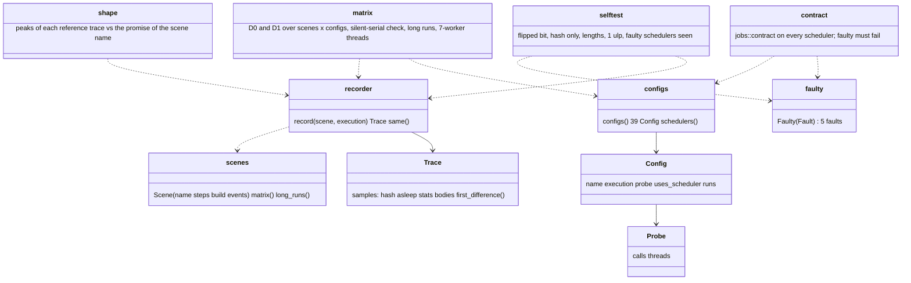
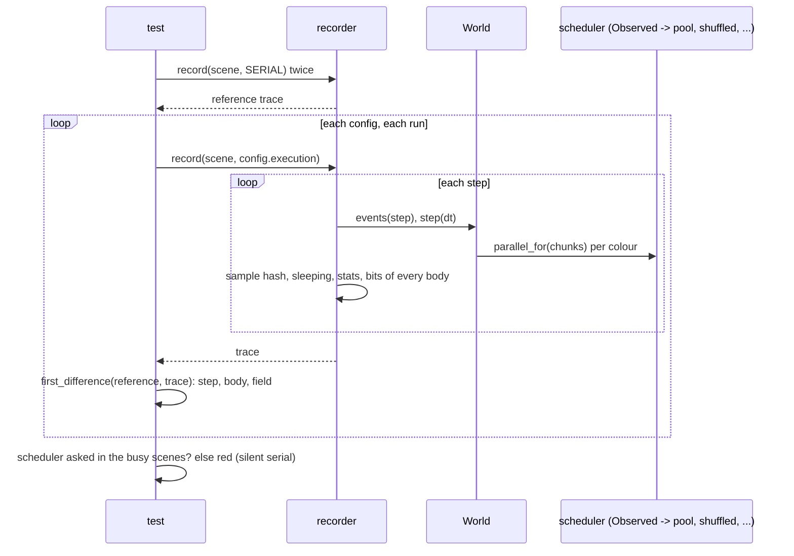

# Review 4-18: determinism harness, D0 and D1 replay at several worker counts and schedulers

Task: 4-18. Class 2 (determinism), tests only: no engine source file, no gate file, no hash pin and no protected path changed. One PR into `develop`. Out of scope: the golden hash and the D2 job (card 4-20), Clippy `disallowed-methods` (4-19), TSan (4-21), benchmarks (4-22).

Delivers: the integration test target `engine/physics/tests/determinism/` (16 tests, 7 modules), the dev-dependency `jobs` with the feature `contract-tests` in `engine/physics/Cargo.toml` (an ordinary file; the generic scheduler contract suite already existed in `jobs`), the as-built paragraph in `wiki/architecture/physics-and-jobs-v0.md`, a pointer in `physics.md` and the changelog row v0.94.

## Summary verdict

Everything the harness runs is bit-identical to the scalar serial reference: 10 scenes under 39 execution configurations, every step, the hash, the sleeping count, the solver counters and the bits of every live body. **No nondeterminism was found.** The harness was shown to fail on seven deliberately broken variants of the solver and on five faulty schedulers (table below); the changes that cannot change a bit by construction (the order of independent constraints inside a colour, the thread that runs a chunk, jitter) pass, as the design says they must, and the one that changes how often the scheduler is asked is caught by the silent-serial check.

Not verified: a perturbed floating-point control state on the calling thread (see below), D2 golden (4-20), Clippy bans (4-19), TSan (4-21), Miri (the target has no `unsafe`; `jobs` Miri is card 4-7's).

## What runs

Scenes (every random choice from `Pcg32` with a fixed seed; steps in brackets):

| Scene | What it shows | Promise checked from the trace (`shape.rs`) |
| --- | --- | --- |
| pyramid, 8 rows (45) | many colours, stacking | at least 3 colours |
| row of boxes, 24, the first thrown and spinning (60) | a chain of collisions | at least 2 colours |
| chain, 12-link whip (60) | joints solved before contacts | hinges solved |
| scatter seeds 3, 11, 2024, 40 mixed circles and boxes between walls (70) | random shapes, default sleeping | at least 20 contacts solved at once |
| sleep and wake (160): two pyramids sleep, a ball is dropped at step 70 | island sleep and wake | sleepers asleep before the drop, a step in which fewer sleep |
| creation and destruction (60): bodies and a hinge destroyed, boxes and a hinge created between steps | slot reuse with a higher generation | population changes at least 3 times, a generation above 0 |
| colour overflow hub (45): a ball with 30 spokes falls on the floor next to a pyramid | the overflow set (24 colours, 6 overflow) | overflow above 0, all 24 colours |
| joints and contacts (60): a whip swings through a heap | joints and contacts in one solve | both solved in the same step |
| long runs (600): scatter seed 3, joints and contacts | slow drift over 10 s | (same bit-for-bit test, four configurations) |

All also: the hash changes in at least half of the steps (not quiet). The check of the promises is itself tested to fail (`the_promises_are_checked_by_a_check_that_can_fail`).

Configurations (39): scalar serial is the reference; serial lanes; each of inline, reversed, one-range (one call with the whole range), shuffled with seeds 1, 99 and 0xC0FFEE, and pools of 1, 2, 3 and 7 workers, with the scalar and the lane path at chunk size 7; chunk sizes 1, 32 and 1,000,000 (never reaches the scheduler) on pool of 3 and shuffled seed 1, chunk size 1 on reversed; two refusing schedulers (always `Busy`; a shuffled one whose capacity is 2 chunks) at chunk 7. Pool and shuffled configurations run each scene twice, the others once, because they have no source of difference between runs; the reference runs twice.

| Configuration family | Scenes (10) |
| --- | --- |
| serial lanes | equal |
| inline / reversed / one-range, scalar and lanes, chunk 7 (and 1) | equal |
| shuffled seeds 1, 99, 0xC0FFEE, scalar and lanes (seed 1 also chunk 1, 32, huge) | equal, both runs |
| pool of 1, 2, 3, 7, scalar and lanes (pool of 3 also chunk 1, 32, huge) | equal, both runs |
| refusing, shuffled with too few chunks, scalar and lanes | equal (the solver runs the colour itself) |
| long runs, 600 steps, serial lanes, pool of 3 lanes, reversed chunk 1, shuffled 99 lanes | equal |

Chunk size does not change a bit; it was an open question in the card and it holds because the constraints of a colour touch different bodies and the lane path is bit-identical to the scalar one. It does change the work: the probes show the scheduler is asked in the busy scenes at chunk 7 and below, and not at all at 1,000,000.

Checks that a configuration did what its name says: every configuration that is meant to use its scheduler must have been asked at least once in each of five busy scenes (pyramid, row, two scatters, joints and contacts); a pool of 7 must have run chunks on at least two threads over those scenes (it does; looped below).

## Fault injection (done by hand, source restored with `git checkout` after each, not committed)

| Break | Caught by |
| --- | --- |
| A: the overflow set solved before the colours (staged path only) | the matrix (first difference at step 0, body 1, `position.x`), all staged configurations |
| B: the overflow set first only when the scheduler has more than one worker | the matrix (pools of 2, 3, 7; not inline, not pool of 1) |
| C: a pool worker thread skips the last group of its chunk | the matrix and the long runs (only the pools, whose workers ran chunks) |
| D: the lane addition is not bit-equal to the scalar one | the matrix and the long runs (every lane configuration against the scalar reference) |
| E1: a worker runs its groups in reverse order | not caught, correct: constraints of a colour are independent |
| E2: chunk size multiplied by the worker count | results equal (partition cannot matter), but the silent-serial check and the 7-worker thread test fail: the scheduler is no longer asked |
| E3: 200 microsecond sleep in every odd chunk | not caught, correct: jitter changes no bit |
| I: the remainder chunk of a colour is dropped | the matrix (594 differing runs), the long runs, the self-test that a never-asked faulty scheduler changes nothing |
| J: the harness itself: `first_difference` always says equal | five self-tests fail |

A permanent fault switch exists only in test code: `faulty.rs` holds schedulers that skip the last chunk, run the first chunk twice, run nothing, or skip or repeat a task. Each must fail `jobs::contract::scheduler_contract` (`every_deliberately_faulty_scheduler_fails_the_contract`) and each of the three loop faults must change the replay of the pyramid, the hub and the row (`every_faulty_scheduler_is_seen_...`). A scheduler that returns before the jobs finish cannot be written in safe code (the body is borrowed for the call); the join is covered by the pool tests of `jobs` (visibility of the writes after the call).

## Decisions

| Decision | Reason |
| --- | --- |
| The contract suite is `jobs::contract` (feature `contract-tests`, exists since card 4-4) and is used from `physics` as a dev-dependency feature | No protected path needed; the faulty schedulers of `jobs` are `#[cfg(test)]` and private, so `faulty.rs` is written again in the physics target (`Chunks` is crate-private there too). |
| Allocation per call is not repeated here | `jobs/tests/no_allocation.rs`, `pool_no_allocation.rs` and `physics/tests/parallel_allocation.rs` cover it for the same schedulers. |
| Bit dump of every body besides the hash | The hash says that something differs; the dump says which step, body and field. |
| Solver counters are part of the compared sample | They are counts of work and must not depend on the execution; they also feed the shape checks. |
| One `Observed` wrapper with a `Probe` around every scheduler | To make a silent serial run a red test; the wrapper passes the contract suite on the pools it wraps (it forwards). |
| Pool and shuffled configurations run twice, the others once | Time: the debug build is slow with the lane path. The reference runs twice, and a configuration with no thread, no state and no randomness has no way to differ between runs. |
| Floating-point control state is not perturbed | See below. |

## Bounds and assumptions that changed after the first measurement

- The hub scene was first built in zero gravity: nothing moved, every colour had at most one or two constraints, and the faulty-scheduler self-test showed that "skip the last chunk" changed nothing there. The hub now falls onto the floor next to a pyramid; the 24 colours and 6 overflow constraints are unchanged.
- The self-test chunk size was 4, then 1 (every colour with two members goes to the scheduler).
- Scene sizes were cut after the first full run took 62 s: pyramid 60 to 45 steps, row 90 to 60, chain 90 to 60, scatter 90 to 70 steps with a drop height of 4 m instead of 8, sleep and wake 200 to 160 steps (drop at 70), hub 60 to 45, mix 90 to 60, churn 80 to 60. The chunk sizes of `reversed` were cut from three to one.
- The second run was dropped for the configurations without threads or state (see decisions).
- The test-time numbers in the next section are the measurements; the card's 60 s target was not reached on the slow state of the machine.

## Evidence

- Time (debug, Windows): the first full run of the target took 46 to 62 s with the machine idle. Later runs of the same target took 174 to 236 s (the matrix test alone 194 s), while `cargo test -p physics --test stability` took 9 s instead of the 5 s of review 4-17 and the free memory was 1.7 GB of 16 GB: the machine was slow and loaded, not the tests changed. After halving the runs of the non-threaded configurations the target took 124 s in that state. The target therefore does **not** meet "under 60 s" reliably on this machine; the matrix is 90 percent of the time. If the owner wants it faster, drop the lane variants of the reversed, one-range and refusing schedulers (about 15 percent) or one of the three shuffle seeds.
- Flakiness, Windows: the pooled, long, contract and self-test tests ran 20 times with 0 failures; the matrix ran 3 times with 0 failures.
- `cargo fmt --check`, `cargo clippy --workspace --all-targets -D warnings` and `cargo clippy -p physics --features cross-platform-determinism` are clean.
- Tests per package on Windows (`CARGO_BUILD_JOBS=2`, `--test-threads=4`): `base`, `jobs`, `physics` and the rest of the workspace all pass; the rest of the workspace and `local_gates.py` once saw 6 `tools_shaderc` tests fail in the gates run (temporary-file collision, os error 183), which pass in three separate reruns and in the package run; that crate is not touched by this card, so it is reported as a pre-existing flake, not a result of this change.
- Linux (WSL Ubuntu): `cargo test --workspace --locked` (feature off) passes through `local_gates.py --wsl`; `cargo test -p physics --features cross-platform-determinism` passes (all 16 determinism tests, 52 s; `hash_pin` 5 of 5).
- Local gates: exactly the 4 deliberate FAIL lines (mutation.score_min, CLAUDE.md import, G1 score, report write) plus the `tools_shaderc` flake above; all other steps pass. Headless `cargo tree`: 0 adapter_/app_ crates.
- Per-test time, Windows debug, loaded machine (`--test-threads=4`): the whole determinism target 149 s (the matrix test about 130 s, the long runs 16 s, the others under 1 s); on an idle machine the first full run took 46 to 62 s; Linux 52 s. **The 60 s budget is not reliably met on Windows**; no further cut was made because every step or configuration removed lowers coverage.
- Independent review (read-only subagent): no blocker, no major. Minor, not fixed: the 7-worker thread check has no retry (a latent flake on a machine with very few cores); a refusing shuffled scheduler capacity of 4096 chunks is unseen by the idle check; the idle check proves the scheduler was asked, not that its body ran; `PhysicsError::NotFinite` is reused as a generic test error; `shuffled, too many chunks` also runs twice.
- Non-test code and pins: `git diff --stat origin/develop` shows only `engine/physics/Cargo.toml` (one dev-dependency feature), the new directory `engine/physics/tests/determinism/`, `reviews/4-18.md` and three wiki files. No `src` file, no `hash_pin.rs` and no gate file changed.

## Floating-point control state (item 5): not verified

`base::fpenv` offers `current`, `assert_deterministic` and `set_deterministic`; setting a non-default MXCSR (rounding, flush to zero) needs `std::arch` or assembly, which the architecture check allows only in `base`, and the test constructors (`with_rounding` ...) are `#[cfg(test)]` inside `base`. So the harness cannot put the calling thread in another state without `unsafe` or a protected-path change. What is covered: the existing test of card 4-15 (the caller's state is deterministic and restored) and the removal of `FpGuard` in the solver, which was not run as a fault injection because the default state is already the deterministic one and nothing would change. Reported as not verified.

## Not verified and follow-ups

| Item | Where |
| --- | --- |
| D2 golden hash, Windows and Linux job | card 4-20 |
| Clippy `disallowed-methods` for the bans | card 4-19 |
| TSan on the pool and the replay | card 4-21 |
| Perturbed MXCSR/FPCR on the caller or a worker | needs a helper in `base` (card to propose) |
| Linux with a pool of 7 workers on a machine with fewer cores | the thread check ran on a 20-thread machine only |
| Time budget of the target | see Evidence |
