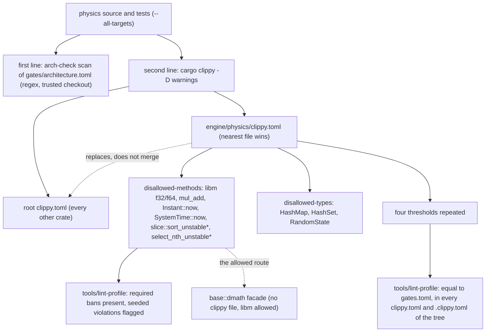
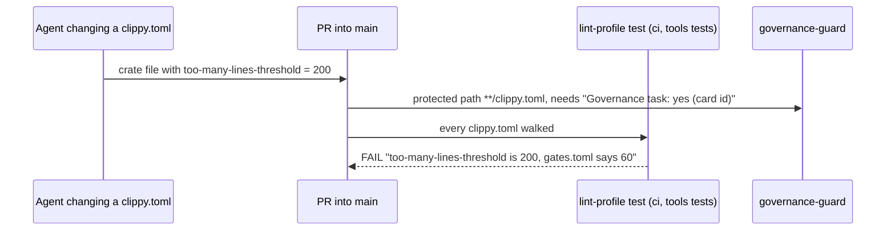

# Review 4-19: Clippy disallowed-methods for the physics crate

Task: 4-19. Class 3 (governance task declared by the owner's pick: protected path `**/clippy.toml`; the digest sentence is a governance file too). Size: standard. One PR into `main`. Open blocker/major: see the end.

Delivers: `engine/physics/clippy.toml` (new, in a folder that has no crate on `main`; it takes effect when `main` is merged into `develop`), `tools/lint-profile/test_lint_profile.py` (threshold check of every `clippy.toml`, required-ban check, seeded tests), `docs/gates/clean-code-lint-profile.md`, `wiki/architecture/ports-and-adapters.md`, `wiki/architecture/physics.md` (rule 6, one phrase), `wiki/rules-digest.md` (one sentence and the status line), `wiki/README.md` (changelog v0.95), this file. No ADR, workflow, arch-check, classifier, `gates/*`, `CLAUDE.md` or physics code touched.

## Decisions

1. **A crate-level file, thresholds repeated.** Verified here: Clippy takes the nearest `clippy.toml` and does not merge (test `test_a_crate_file_replaces_the_root_file`: a crate file with only `disallowed-methods = []` lets a 75-line function pass). So the physics file carries the four numbers of `gates.toml`; the real risk of the card is a crate file that relaxes them, closed by the tool change (decision 4).
2. **Method list** (`f32` and `f64`, each with a `reason` naming physics.md section 3): `sin cos tan asin acos atan atan2 sinh cosh tanh asinh acosh atanh sin_cos exp exp2 exp_m1 ln ln_1p log log2 log10 powf powi hypot cbrt` (the list of the arch-check scan, `gates/architecture.toml`) and `mul_add`; `std::time::Instant::now`, `std::time::SystemTime::now`; `slice::sort_unstable`, `sort_unstable_by`, `sort_unstable_by_key`, `select_nth_unstable`, `_by`, `_by_key`. **Allowed on purpose:** `sqrt` (IEEE exact, `base::dmath` itself is built on it), `abs`, `min`, `max`, `floor`, `ceil`, `round`, `trunc`, `clamp`, `signum`, `to_bits`, stable `sort`, `sort_by`, `sort_by_key`.
3. **Type list:** `std::collections::HashMap`, `HashSet` (the arch-check scan bans the names; Clippy also catches a use through an alias) and `std::hash::RandomState` (the random seed behind `HashMap::new`, a source of run-to-run difference).
4. **Tool change.** `tools/lint-profile` (a Python unit test file, as before): `config_files()` walks the tree for `clippy.toml` and the hidden alias `.clippy.toml` (skipping hidden folders and `target`), `threshold_problems()` flags a missing, higher or lower threshold in each, `ban_problems()` flags a physics file that lost one of 8 method bans or 2 type bans (a floor, not the full list: the full list is the file). Seeded tests lint throwaway crates with the real physics file. A crate file may carry no key other than the four thresholds (the physics file also `disallowed-methods` and `disallowed-types`, without `allow-invalid`), so `msrv`, `allow-*-in-tests` and the like cannot slip in; the f32 and f64 method sets must be equal and equal to the name list of the arch-check scan.
5. **Path syntax found by experiment (a `[K]` of the brief, now verified).** The slice methods are not reachable as `<[_]>::sort_unstable` (accepted without a warning, never fires), nor as `core::slice::<impl [T]>::...`, `alloc::slice::...`, `std::slice::sort_unstable_by_key` or `core::slice::sort_unstable` (each: "does not refer to a reachable function"). The spelling `slice::sort_unstable` resolves and fires, also through `Vec` auto-deref. An unresolvable path is a Clippy warning, so `-D warnings` fails on a typo, **but only when the path starts with a module or type** (`std::time::Instant::nowx`, `std::collections::HashMapp` warn). A typo after a primitive root (`f32::sinn`, `slice::sort_unstable_byy`) is silent and the entry would just never fire (found by experiment in review loop 1). So the tool seeds every `f32::`, `f64::` and `slice::` entry with a use of the real method and requires Clippy to name the path, and a second test resolves all paths with an empty crate.
6. **Unstable sorts banned outright.** Neither tool can know whether keys are equal; the physics crate and its tests contain no `sort_unstable` or `select_nth_unstable` today (grep and the clean run), so nothing is narrowed. A sort on unique keys uses the stable `sort`.
7. **`base` is not subject to the file** (no file in `engine/base`): `dmath` calls libm and `mul_add` legitimately. No other crate has a file; `jobs` and the rest are untouched.
8. **Digest and docs.** The digest sentence "planned ... not configured yet" is replaced and the status line gets the version note; the digest check compares numbers only and stays green. `physics-and-jobs-v0.md` rows 4-19 and "Clippy disallowed-methods for physics" still say "planned": they are not edited because the lines next to them differ on `develop` (cards 4-8 and 4-18), which would give merge conflicts; the pointer lives in ports-and-adapters and this file (follow-up: one-word fix on `develop` after the merge).

## Evidence

Verification A, on a scratch tree at `origin/develop` (6488c98, where the crate exists) plus the new file, toolchain 1.94.1, `CARGO_BUILD_JOBS=2`:

- `cargo clippy -p physics --all-targets --locked -- -D warnings`: clean, with and without `--features cross-platform-determinism`. No path warning. The physics code and its integration tests (determinism harness, joints, solver, oracle) violate none of the bans.
- Experiment: a scratch module (`zz_probe.rs`, deleted afterwards) with one violating line per class, linted with the physics file:

| Snippet | Result |
|---|---|
| `x.sin()`, `x.cos()`, `x.powi(2)`, `x.powf(2.0)` | `use of a disallowed method f32::sin / cos / powi / powf` |
| `x.mul_add(1.0, 2.0)` | `f32::mul_add` |
| `f32::exp(x)` (path call), `y.ln()` on `f64` | `f32::exp`, `f64::ln` |
| `std::time::Instant::now()`, `SystemTime::now()` | both flagged |
| `HashMap<u32, u32>` type and `HashMap::new()`, `HashSet` | `disallowed type` on the type in the annotation and on the call path |
| `std::hash::RandomState::new()` | flagged |
| `v.sort_unstable()`, `_by`, `_by_key`, `select_nth_unstable`, `_by`, `_by_key` on `&mut [u32]`; `Vec::sort_unstable` | all flagged (`slice::...`) |
| `x.sqrt()`, `abs`, `min`, `max`, `floor`, `ceil`, `round`, `signum`, `clamp`, `to_bits`, `sort`, `sort_by`, `sort_by_key` | not flagged by the bans (other pedantic lints about the probe style appeared and were ignored) |

  With `--features cross-platform-determinism` the same ban warnings repeat (the feature does not change the paths).
- Threshold bypass check: with `too-many-lines-threshold = 200` in the physics file, `test_every_config_in_the_tree_carries_the_gate_numbers` fails with `too-many-lines-threshold is 200, gates.toml says 60`, and the seeded length test fails too; restored afterwards.

Verification B, on the real branch from `origin/main` (no physics crate there): see the lists at the end.

TDD: the 7 new profile tests were written first and failed with `NameError` (helpers missing) before the helpers existed; the seeded tests then failed once for the wrong seed source (`must_use_candidate`, `manual_clamp` on the test snippet, fixed in the snippet). The bypass experiment above is the mutation of the check. The tool is a test file, so no separate mutation run applies.

## Not verified

- Clippy behaviour on other toolchains: paths and the "nearest file wins" rule were checked on 1.94.1 only (pinned).
- The `slice::...` spelling relies on Clippy's path resolution of primitive-type inherent methods; a future Clippy may change it, the unresolved path would then warn and fail CI loudly.
- Macros: a call inside an external macro expansion is not reported by Clippy; the arch-check scan sees the source text. The two lines cover each other only partly.
- Linux and ARM64 were not run for this change (the file has no platform dependence; CI runs Clippy on both).
- `CLIPPY_CONF_DIR` set in the environment would override all files; the workflow files and `.cargo/config.toml` are protected paths and no such variable is set.

- `#[expect(clippy::disallowed_methods, reason = ...)]` is a permitted waiver form (the workspace denies plain `allow`); the arch-check scan still sees the same names, and the classifier lists every added waiver for the owner.
- Hidden folders are not walked by the config search (the walk must skip `.claude/worktrees`); a workspace crate under a hidden path would escape it. No such crate exists.

## Follow-ups

- On `develop` after the merge: update the two stale "planned" rows of `physics-and-jobs-v0.md` (section 5 table, card table row 4-19).
- The `lint-profile` unit test step of `ci` runs from the PR tree (like the other tool tests), so the new check protects against honest drift and is not a trusted gate against a PR that edits both the file and the test; the owner reads any `clippy.toml` diff anyway (Class 3).

## Review loops

Independent read-only review by a subagent (bypass paths, path completeness, false positives, docs, tests).

- Loop 1: 0 blocker, 2 major, 4 minor, 2 nit. Major 1: a crate file was checked only for the four thresholds (extra keys such as `msrv`, `allow-*-in-tests`, `allow-invalid` could weaken it): fixed, `key_problems` and tests. Major 2: only 10 of about 60 entries were guarded against typos: fixed, and the experiment showed the reviewer's premise was only partly right (primitive-root typos are silent, see decision 5), so every float and slice entry is now seeded. Minor: case-insensitive file names (fixed), message-level assertions and more seeds (fixed), `expect` waiver (stated above), hidden folders (stated above). Nits: `SystemTime` wording in the table of ports-and-adapters is pre-existing text and left alone (only `SystemTime::now` is a ban; an instance can only come from it).
- Sabotage after the fix: a typo in a `slice::` entry, a typo in an `f64::` entry, an extra `msrv` key, a dropped `f64::cbrt` entry and a relaxed threshold each make the tool tests fail.
- Open blocker/major after loop 1: **0** (a second review was not run; the fixes were checked by the sabotage runs above and a full re-run of the tool tests).

## Local gates

`python tools/local-gates/local_gates.py --base origin/main` on the tree before loop 1: all steps pass (fmt, clippy, build, tests, architecture, unsafe budget, wiki lint 54 pages, digest, diff hash, tool tests) and exactly the 4 known deliberate FAIL lines appear (`mutation.score_min`, `CLAUDE.md does not import`, `G1: well-tested score`, `cannot write the report`); they are self-tests of the tools, printed by design. The digest check run on its own agrees with the changed digest. Merge simulation: `main` branch merged into a scratch copy of `develop`: one conflict, `wiki/README.md` (status line and top of the changelog), resolved by keeping both sides (v0.95 above v0.94 to v0.86); no other conflict; `cargo clippy --workspace --all-targets --locked -- -D warnings` clean, `cargo clippy -p physics --all-targets --features cross-platform-determinism -- -D warnings` clean, wiki lint and digest check clean, 32 lint-profile tests passed at that time.
