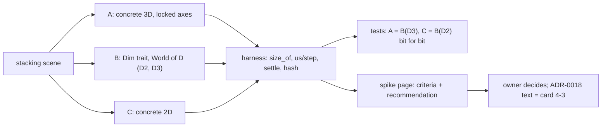

# Review 4-2: physics core spike (ADR-0018)

Task: 4-2. Class: spike (TDD exception: throw-away measurement harness and a wiki page; no engine crate, no protected path, no ADR edit). Loops: see the end. Open blocker/major: see the end.

Delivers: `wiki/spikes/physics-core-spike.md` (summary, results, criteria, Rust frictions with evidence, recommendation for the owner, not-verified list), `engine/tools_physics_spike/` (harness, 8 sanity tests), `Cargo.toml` workspace member line and the matching `Cargo.lock` entry, `wiki/README.md` index row 34 and changelog v0.78.

## Decisions and deviations

- Variant C is the native 2D world; option C of physics §4 (two libraries) is C plus A as the 3D code. The `D=3` instance of B was added because "code shared with a hypothetical 3D instance" is better answered with a running one.
- A's and B(D=3)'s narrowphase is the 2D one on the projected boxes (valid only because the sole rotation is about Z), with each point doubled in Z to give the four points of a real face contact. This is a lower bound for a locked-axis 3D engine and favours A; the page says so.
- Four Cargo features (`variant-a`, `variant-b`, `variant-b3`, `variant-c`, all on by default) exist only so each variant can be built and timed alone, because the all-in-one binary changed the timing of B and C by 4.5 to 5.2 times for a reason not found (the hand-written C as much as the generic B). They are harness plumbing, not engine design.
- The workspace `Cargo.toml` gained one member (`engine/tools_physics_spike`), as every earlier `tools_*` crate did; the layer glob `tools_*` maps it to layer 4, and no gate configuration was changed.
- Clean-code limits were met in the harness (nesting, parameters, complexity, function length) by splitting functions, with no `#[allow]`.
- Coverage and mutation testing were not run: not meaningful for throw-away code.

## Evidence

- `cargo test -p tools_physics_spike --release`: 8 passed (stack settles in every variant, same hash twice, A equals B(D=3) and C equals B(D=2) bit for bit, narrowphase and tangent sanity, a dropped box lands and stops).
- Benchmarks: 3 sessions, each variant built alone and all in one binary. The raw output files are local only (`target/spike-raw`, git-ignored), so the medians of the pyramid (us per step, sessions 1/2/3) are kept here:

  | variant | built alone | all in one binary |
  |---|---|---|
  | A | 557.2 / 550.3 / 549.0 | 541.3 / 548.8 / 552.7 |
  | B(D=3) | 577.1 / 560.9 / 556.1 | 2633.2 / 2666.1 / 2594.0 |
  | B(D=2) | 63.1 / 61.6 / 61.6 | 290.9 / 298.6 / 319.3 |
  | C | 60.1 / 60.0 / 60.0 | 288.5 / 281.0 / 267.0 |

  Exploratory single runs behind the page's section 3.1 (inlining and codegen-units experiments) were not kept as files.
- Compile-time table: `cargo clean -p` then build, 5 repetitions per cell.
- Rust frictions: four one-file reproductions with `rustc 1.94.1` covering three items (associated constant and const-generic arithmetic for the array length, overlapping impls without specialisation, derive bound on `Copy`). The operator-bound and readability points are observations, not reproductions.
- Local gates, clippy (Windows and `x86_64-unknown-linux-gnu`), workspace tests and the headless graph check: see the PR.

## Not verified

One machine, Windows only; the all-in-one slowdown (4.5 to 5.2 times for identical arithmetic) and the slow 3D column (one build ran it in 56 us) are unexplained, so ratios are only as good as the build they come from; no real 3D narrowphase, tree, islands, colouring, threads or SIMD; soft-step solver not tried; compile time of a full engine not predicted; coverage and mutation not applicable.

## Review loops

R3 (independent, read-only) ran 1 loop: its findings (the 9 times figure depending on the build, ranges, the unexplained slowdown also hitting the hand-written 2D code, the extruded-narrowphase and pair-rejection asymmetries, overstated reproductions, a weak drop test) were fixed in the page, review and harness. Loops used: 1 of 3. Open blocker/major: 0. A second R3 pass was not run; the fixes are checked by this author only.
