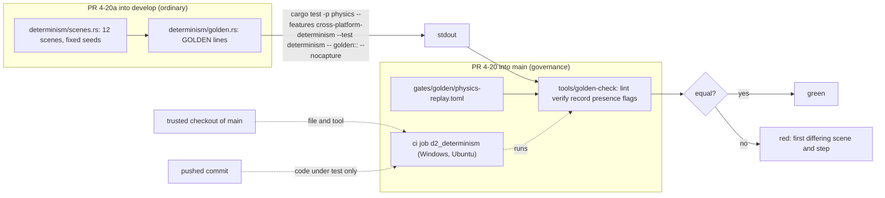
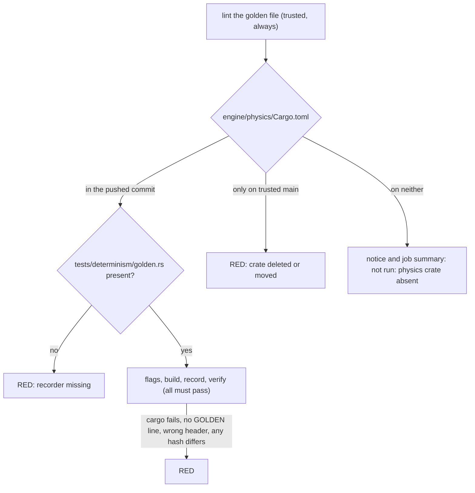

# Review 4-20: D2 golden hashes and the Windows and Linux determinism job (governance)

Task: 4-20. Class 3 (governance task declared by the owner's pick: `gates/golden/`, `gates/protected-paths.txt`, `.github/workflows/ci.yml`, `tools/release/`, `wiki/rules-digest.md` are protected paths). Size: large. One PR into `main` (body line `Governance task: yes (card 4-20)`). Its companion is the ordinary PR 4-20a into `develop` (review [4-20a](4-20a.md)): the recorder, which cannot be in a PR into `main` because the `physics` crate is only on `develop`.

Delivers: `gates/golden/physics-replay.toml` (new), `tools/golden-check/` (checker and 55 tests, new, added to `gates/protected-paths.txt`), the job `d2_determinism` and one test step in `.github/workflows/ci.yml`, 4 workflow tests in `tools/release/test_workflows.py`, and docs (`wiki/rules-digest.md` section 5, `wiki/architecture/physics.md` rule 8, `wiki/workflow/ci-diagrams.md`, `wiki/README.md` v0.96, this file). No other job, no ADR, no gate threshold, no arch-check rule, no classifier and no physics or base code touched.

## The job and the skip decision

**Alternatives for the physics-absent case** (the crate is on `develop` only; `main` has `engine/physics/clippy.toml` and nothing else):

1. Fail on `main` until the release (honest, but turns `ci` red for the whole time `main` lags; it also contradicts the owner's rule for jobs that cannot run).
2. Skip with a notice when `engine/physics` is absent, decided in the workflow from the pushed tree (the pattern of `glfw_linux` and `gl_linux`). Easy to trip: a PR that deletes the crate skips its own gate.
3. **Chosen:** decide from two trees by a tested tool (`golden_check.py presence`): skip only if neither `main` nor the pushed commit has `engine/physics/Cargo.toml` (a folder with `clippy.toml` does not count); a crate in the push with no recorder is red; a crate on `main` that the push lacks is red. The lint of the golden file runs in every case, so the file is not unguarded while the crate is absent. Cost: after the release PR the "absent" branch is dead code with a test; the job cannot be skipped by deleting the crate, and cannot be skipped by deleting or renaming the recorder (cargo finds no test, no `GOLDEN` line, red).
4. Run the job in the release PR only (a `pull_request` trigger): refused, `ci` runs only on `main` and by hand (card 1-38), and a new trigger would change that policy.

## Golden format

TOML (`tomllib`, Python 3.11 on the runners and here), LF only. Header: `format = 1`, `feature = "cross-platform-determinism"`, `toolchain`, `recorded`, `recorder` (the command). Per scene `[[scene]]` with `name`, `steps`, `stride`, and a table `[scene.hash]` of `step = "16 lowercase hex digits"` (the `World::state_hash`, FNV-1a, after the step; scalar serial reference; D1 says other configurations equal it). Checkpoints are step 1, every `stride`-th step and the last (stride 5 for the 10 matrix scenes, 25 for the two 600-step scenes); the checker refuses a file or a run with another set. 12 scenes, 200 hashes: pyramid (45 steps), row of boxes (60), chain (60), scatter seeds 3, 11 and 2024 (70 each), sleep and wake (160, ball dropped at step 70), creation and destruction (60: bodies and joints made and destroyed between steps), colour overflow hub (45), joints and contacts (60), scatter seed 3 long (600, comes to rest and sleeps: constant hash after step 200) and joints and contacts long (600). Not stored: platform, thread counts, timings.

The output of the recorder is a stream of `GOLDEN|kind|...` lines: `format`, `feature`, `platform`, `fma`, `scene`, `hash`, `end|<count>`. The checker fails on: no GOLDEN line, missing or wrong `end` count, lines after `end`, duplicate scene or step, a hash of an undeclared scene, a hash that is not 16 lowercase hex digits, an unknown or malformed line, another format, a checkpoint set that is not the rule, feature off, `fma` true, a platform that is not Windows or Linux on x86-64, a missing or extra scene, changed steps or stride, any different hash (first differing step per scene, every differing scene listed), a missing or malformed golden file.

## Measured: Windows equals Linux

Recorder run with the feature on, Windows x86-64 (MSVC, toolchain 1.94.1) and Linux x86-64 (WSL2 Ubuntu, same toolchain): all 12 scenes and 200 hashes **identical** (the only differing line is the informational `platform` line). Recorded on Windows; `verify` of the Linux output against the file: equal. No platform difference was found, so there is no D2 finding.

The check discriminates: the checker run on a Linux build with the feature **off** is red (first differences at step 1 of the scatter scenes: the glibc `sin`/`cos` give other bits than the own functions), and it is refused first anyway for the header `feature off`. Windows with the feature off gives the same 200 hashes as with it on (the MSVC runtime agrees with the own functions on these inputs); that is a limit of the evidence: a bypass of the facade would be caught by the Linux job only where glibc differs from the own functions. FMA: the build refuses it (`compile_error!` in `base`, card 4-8), the recorder prints `fma|false` from `cfg!(target_feature = "fma")`, and the job fails first on a `target-cpu` or `+fma` text in `RUSTFLAGS`, `CARGO_ENCODED_RUSTFLAGS`, `CARGO_BUILD_RUSTFLAGS`, `RUSTDOCFLAGS` or a Cargo config of the checkout or of `CARGO_HOME`.

## Deviations from the plan, and why

- **The recorder is a module of the existing `determinism` target, not a new target `tests/golden/` and not a tool `tools_physics_bench`.** The first draft (a new target including the harness files by `#[path]`, reading `std::env::consts`) was refused by the arch-check scan of the physics crate (`#[path]` and `std::env` are banned there), so the recorder reuses the scenes as a sibling module and takes the platform name from `cfg!`. The job selects it with the test filter `golden::`.
- **Two PRs.** The crate is not on `main`, so the recorder (ordinary, `develop`) and the golden file, checker and job (governance, `main`) are separate. The golden values were taken from the recorder as it is in PR 4-20a, so the job is a real comparison as soon as both are in one tree.
- **A one-line edit of the `g1` job** (a step that runs the 50 tests of the checker) and 4 tests in `tools/release/test_workflows.py`: every tool's tests run in `g1`, and a new tool without that step would be untested in CI. No other existing job was touched.
- **Tests were written first (55 for the checker after the review loop, 4 for the workflow).** The checker's file was written after its tests; the first complete run was green except the one test that reads the stored golden file (it did not exist yet in the scratch copy), so a red-before-green record exists only for that test and for the sabotage runs below. Sabotage runs of the workflow tests: removing the `if:` of the toolchain step, pointing the `presence` step at `head` instead of `trusted`, or reading the golden file from `head` each make a workflow test fail.

## Merge order and dependencies

1. Either order is safe. If 4-20 (governance, `main`) merges first, `ci` on `main` shows the job as "not run: physics crate absent" and lints the file. If 4-20a (`develop`) merges first nothing changes on `main`.
2. After the release PR (`develop` into `main`) both are in `main` and the job is a real comparison on Windows and Linux. The owner starts the first real run by hand on a branch that has both: `gh workflow run ci.yml --ref <branch>` (the checker and the file are read from `main`, so the PR 4-20 must be merged first).
3. `main` merged into `develop` afterwards: conflicts expected in `wiki/README.md` (status line and the top of the changelog; keep both rows, v0.97 above v0.96) and none expected in `wiki/architecture/physics.md` (only rule 8 is edited on `main`; the `develop` side edits rules 7 and 9 and the limits line, not rule 8). `wiki/architecture/physics-and-jobs-v0.md` is not edited here: its rows for the golden file and the job ("the folder does not exist today") become stale and are a one-line follow-up on `develop`.
4. **Consequence the owner should know:** the golden file is read from `main`. An intended change of physics results is therefore two steps: a governance PR with the re-recorded file into `main` (the agent runs `record`, the owner reads the golden diff), and the code change reaching `main` by a release; between the two the D2 job on `main` is red. The alternative (reading the file from the pushed commit) would let a code PR rewrite its own expectation, so it was not taken. A release PR that changes physics results needs the re-recorded file on `main` first, then the job on the release PR is red until the merge: expect to run `ci` by hand on `develop` after the file is updated, or accept the temporary red.

## Evidence

- `python -m unittest -q test_golden_check` (tools/golden-check): 55 tests OK, including the test that the stored file is well formed and LF only.
- `python -m unittest -q test_workflows` (tools/release): 58 tests OK (4 new).
- Recorder (PR 4-20a): 4 tests pass on Windows and Linux; `cargo clippy -p physics --all-targets --locked -- -D warnings` clean with and without the feature; arch-check clean.
- The checker against the real outputs: Windows on and Linux on equal; Windows off and Linux off refused with "feature ... is off"; Linux off also lists the differing scenes when the header is ignored (first difference at step 1 of `scatter seed 3`: got `03b7c13d4ab0a9c9`, golden `0c1e4bf48f580646`).
- Mutation testing: not run (memory budget, and no Rust source with logic was added; the Python tool is covered by tests and the sabotage runs above).
- YAML: parsed with PyYAML; `actionlint` is not installed here, so the workflow was read against the job patterns already in the file (checkout pinned by commit, `persist-credentials: false`, `timeout-minutes`).

## Not verified (until the owner's hand-run of `ci`)

- The job itself on the hosted runners: that `windows-latest` bash finds `python` (3.11 or newer for `tomllib`), that `tee` with `pipefail` and `$RUNNER_TEMP` behave as in the `metrics` job, that the `date +%s%N` of the cost step works on Windows bash (it is report-only with `continue-on-error`), the run time (budget 25 minutes) and the Windows runner's own result (the Windows value was recorded on a Windows 11 PC with MSVC build tools, not on the hosted image).
- The absent-branch on a real `main` run (the logic is unit-tested and the path was run locally with the tool, not in Actions).
- Exact command for the first run after both PRs are merged and a branch has both: `gh workflow run ci.yml --ref <branch>`. This agent did not start `ci`.
- ARM64, macOS, other toolchains: not gated.

## Follow-ups

- On `develop` after the merge: refresh the stale rows of `physics-and-jobs-v0.md` (golden file, D2 job, cost report, card table 4-20), a one-line fix.
- The cost report is wall time of a 3-second test, mostly the build excluded; it is a first figure, the real cost report is card 4-22 (benchmarks).
- Decide the order for a future intended change of physics results (consequence 4 above).

## Review loops

Independent read-only review by a subagent (vacuous pass, trusted checkout, skip conditions, Windows, FMA bypass, parser, YAML, docs).

- Loop 1: **1 blocker, 0 major**, 4 minor, 3 nits. Blocker: the `presence` check looked for the recorder at `engine/physics/tests/golden/main.rs` (the first draft's path) while the recorder is `engine/physics/tests/determinism/golden.rs`; with the crate in the tree the job would have been red for good, and the unit tests had the same wrong path in their fixture. Fixed: constant, docstring and fixture corrected, a test pins the constant, and the real combination was run (a head with the crate and the recorder gives `present=true`, the current `main` tree gives the skip). A check that the constant matches the file on the companion branch exists in effect: the first hand-run on a branch with both would be red. Minor: malformed but valid TOML crashed with a traceback instead of a clean error (fixed, type checks and a test); a recorder printing a huge step count could hang the checker (fixed, steps and stride are limited to 1,000,000 before any expansion); a step `01` parsed as `1` (fixed); the `flags` scan missed `CARGO_TARGET_<TRIPLE>_RUSTFLAGS` (fixed, a test; the cfg checks stay the authoritative backstop); physics.md rule 9 still says the CI check is future (not edited: rule 9 differs on `develop`, so the as-built text sits in rule 8). Nits: the recorder in the pushed tree could print canned lines (inherent to the policy, now written down in physics.md rule 8: the owner and the reviews read diffs of `engine/physics/tests/`); the digest wording slip and the order of the version notes (fixed); `main` can move between push and checkout (accepted).
- Re-review after the fixes: not run (the changes are the listed fixes, each covered by a new test; the complete tool and workflow tests pass). Open blocker/major: **0**.

## Local gates

`python tools/local-gates/local_gates.py --base origin/main` on the tree after loop 1: every step passes (fmt, clippy, build, tests, architecture, unsafe budget, wiki lint, digest, diff hash, the tool tests including the new `tools/golden-check`) and exactly the 4 known deliberate FAIL lines appear (`mutation.score_min`, `CLAUDE.md does not import`, `G1: well-tested score`, `cannot write the report`). No deviation. The classifier gives class 3 (protected paths: `.github/workflows/ci.yml`, `gates/golden/physics-replay.toml`, `gates/protected-paths.txt`, `tools/golden-check/*`, `tools/release/test_workflows.py`, `wiki/rules-digest.md`), 0 waivers.
