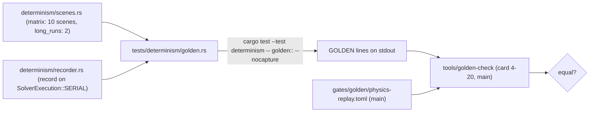

# Review 4-20a: the golden hash recorder target (first half of card 4-20)

Task: 4-20a, the ordinary half of card 4-20 "D2 golden file and Windows+Linux job". Class 2 (determinism, tests only): one new module `golden` of the existing integration test target `determinism`, no engine source, gate file, hash pin or protected path changed. One PR into `develop`. The governance half (golden file, tool, `ci` job, docs) is review 4-20, a PR into `main`. Out of scope: the golden file itself, the job, the verifier.

Delivers: `engine/physics/tests/determinism/golden.rs` (4 tests, one `mod golden;` line in `main.rs`) and the changelog row v0.97. The scenes and the recorder are those of the harness, used as sibling modules, so there is one builder per scene. First draft: a separate target `tests/golden/` including the harness files with `#[path]`; the arch-check scan refused it (`#[path]` escapes the source scan, and `std::env` is OS-facing), so it became a module of the determinism target and the platform name comes from `cfg!`. The job selects it with the filter `golden::`.

## What it prints

Lines `GOLDEN|kind|...` with `|` as separator (scene names contain spaces and commas): `format` (1), `feature` (on/off, from `cfg!`), `platform` (os, arch; informational), `fma` (`cfg!(target_feature = "fma")`), then per scene a `scene|name|steps|stride` line and `hash|name|step|%016x` lines for step 1, every `stride`-th step (5 for the 10 matrix scenes, 25 for the two 600-step scenes) and the last step, then `end|<count of the lines before it>`. 212 lines of scene and hash data (200 hashes, 12 scenes). The hash is `World::state_hash` (FNV-1a over capacity, gravity, every live body, the solver warm start) after the step, on the scalar serial reference; D1 says every other configuration equals it.

## Tests (written first as a design list; the first compile was green, see Evidence)

1. `print_the_golden_lines`: prints the lines (the job runs it with `--nocapture`).
2. `the_lines_are_the_same_twice`: the output is a pure function of the code within one process.
3. `the_lines_cover_every_scene_with_the_first_and_the_last_step`: scene count, one `end` line whose count is right, first and last step of every scene present.
4. `checkpoints_are_the_first_step_every_stride_and_the_last`: the selection rule.

## Evidence

- Windows x86-64, feature on: 4 tests pass (3 s; the other 16 tests of the target are filtered out). Linux x86-64 (WSL2 Ubuntu), feature on: 212 data lines **identical** to Windows (only the informational `platform` line differs; checked again after the move). This is the D2 claim for these 12 scenes.
- The golden target discriminates: Linux with the feature **off** gives 55 of the 200 hashes different from the feature-on Windows values (the platform `sin`/`cos` differ in the bits there). Windows with the feature off equals the feature on in all 200 hashes (the MSVC runtime agrees with the own functions on these inputs), so the cross-platform comparison, not the on/off one, is what proves the facade.
- `python tools/arch-check/arch_check.py` on the tree: 0 violations (after the move; 4 before it).
- `cargo clippy -p physics --all-targets --locked -- -D warnings`, with and without `--features cross-platform-determinism`: clean.
- Mutation testing: not run; the file is test code (no engine source changed).

## Not verified

- The target is not run by any workflow on `develop` (no CI there); it runs in `cargo test --workspace` of the `ci` job on `main` after the release and in the D2 job of card 4-20.
- A second toolchain, ARM64 and macOS: not run (ARM64 is not gated for D2).

## Review loops and local gates

The independent read-only review of the pair (see review 4-20, loop 1) covered the printed lines (leading newline so the first line is not glued to `test ... `, CRLF, the filter `golden::`) and found nothing to change in this PR; its one blocker was in the checker on `main` (the recorder path). Open blocker/major: 0.

`python tools/local-gates/local_gates.py --base origin/develop` on the tree (the two commits before this review file was finished): every step passes (fmt, clippy, build, `cargo test --workspace`, the architecture check, wiki lint, digest, the tool tests) and exactly the 4 known deliberate FAIL lines appear (`mutation.score_min`, `CLAUDE.md does not import`, `G1: well-tested score`, `cannot write the report`). The first run before the move into the determinism target had 2 extra FAIL lines (architecture, and the arch-check tests that run the real tree): the `#[path]` and `std::env` bans, fixed as described above.
