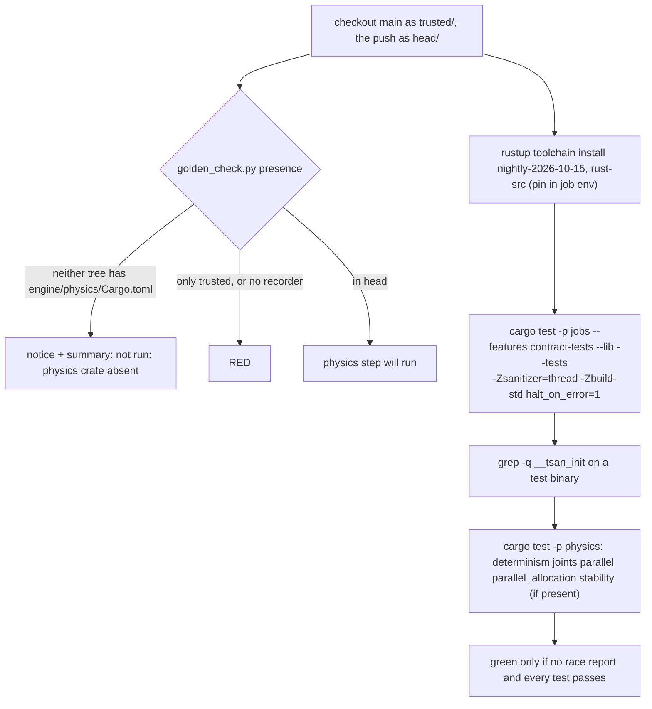

# Review 4-21: ThreadSanitizer job on Linux, dated toolchain pinned (governance)

Task: 4-21. Class 3 (governance task declared by the owner: `.github/workflows/ci.yml`, `tools/release/` are protected paths). Size: standard. One PR into `main` (body line `Governance task: yes (card 4-21)`).

Delivers: the job `tsan` in `.github/workflows/ci.yml`, 3 workflow tests in `tools/release/test_workflows.py`, and docs (`wiki/README.md` v0.98, `wiki/architecture/physics-and-jobs-v0.md` section 6 as-built note and two table rows, `wiki/workflow/ci-diagrams.md`, `wiki/workflow/quality-metrics.md` one cell, this file). No engine code, no `unsafe`, no threshold, no ADR, no digest edit (the digest does not mention TSan, so nothing in it became false).

## Design decisions and deviations

- **Pin location.** `RUSTUP_TOOLCHAIN: nightly-YYYY-MM-DD` in the job `env` of `ci.yml`. It overrides `rust-toolchain.toml` for this job only; `ci.yml` is protected, so a bump is a visible governance diff. A separate protected file was rejected: it would add a path to `protected-paths.txt` and a reader step for no gain. A workflow test refuses any nightly that is not dated. The date `2026-10-15` was verified on a hosted run (rustc 1.101.0-nightly, 7df81381d 2026-10-14), not guessed.
- **Presence of the physics crate** reuses `tools/golden-check/golden_check.py presence` from the trusted checkout (two trees, so a push cannot skip the gate by deleting the crate). Its summary text names the D2 job, so the job writes its own summary line `not run: physics crate absent` in a following step; the tool's own summary goes to a scratch file.
- **Deviation 1: unwinding profiles.** First hosted run: `error: the crate panic_abort does not have the panic strategy abort` (the workspace profiles say `panic = "abort"`; `-Zbuild-std=std,panic_unwind` did not help). Fix: `CARGO_PROFILE_DEV_PANIC` and `CARGO_PROFILE_RELEASE_PANIC` set to `unwind` in this job. Consequence: the code under test is built with unwinding, not as shipped. The race detector does not depend on the panic strategy; the weakness is stated.
- **Deviation 2: no `-D warnings`.** Third hosted run: `use of deprecated method Atomic::<u64>::fetch_update` in `platform` (stable 1.94.1 accepts it). A dated toolchain has lints the stable one lacks and every bump would risk a red that has nothing to do with races. Warnings stay gated by Clippy with `-D warnings` in `g1`. This departs from "consistent with other jobs" on purpose.
- **Addition: instrumentation proof.** A step greps a test binary for `__tsan_init`, so a build that silently lost the flag cannot go green. It first failed (wrong path assumption under the new cargo build layout) and was fixed to search `target-tsan`.
- **Not nightly.** Runs on `main` and by hand like the rest of `ci` (R-24).
- **Doc tests** are not run (rustdoc is not sanitized by this job); stated in the job comment.

## Hosted runs (the only place TSan can run: this machine is Windows)

| Run | Branch | Result of job `tsan` |
|---|---|---|
| 42291505758 | `agent/4-21-tsan` | red: YAML (an earlier push run: invalid scalar) then `panic_abort` build error |
| 42292192221, 42292876071 | `agent/4-21-tsan` | red: `panic_abort`, then deprecation under `-D warnings` |
| 42293239169 | `agent/4-21-tsan` | job green (run cancelled by a newer push); jobs tests 102 passed, physics skipped with `not run: physics crate absent` |
| 42294088764 | `agent/4-21-tsan` (final workflow) | green, job 66 s; whole run green; instrumentation step passed |
| 42294083684 | `agent/4-21-tsan-verify` (= branch + `develop`, never PR'd) | green, job 30 min; physics ran |

Final branch run (`agent/4-21-tsan`): jobs 92 unit + 4 + 4 + 2 integration tests, no data race reported, physics skipped and stated in the summary.
Verify run (physics present): determinism 20 tests (909 s), joints 64 (94 s), parallel 15 (472 s), parallel_allocation 3 (20 s), stability 34 (229 s): 136 tests, 0 failed, 0 ignored, no `WARNING: ThreadSanitizer` line. TSan result: **run on hosted runner, no race found**. Not run: Miri (unchanged, a separate card), the serial physics unit tests and the other physics targets (no worker thread), doc tests.

Cost: the job is 66 s on `main` today (physics absent) and about 30 minutes of Ubuntu time once the crate is on `main` (about 15 of them in `determinism`). On `main` and by hand only.

## Tests (TDD)

Workflow tests written first in `tools/release/test_workflows.py` (3 tests: Ubuntu only and dated pin; flags, build-std, target, separate target dir, `halt_on_error`, unwinding profiles; coverage, presence skip, summary line, instrumentation step, no `continue-on-error`). Red run: 3 errors (job absent). Green after the job; the later hosted-run fixes changed the tests first or with the workflow (profiles, no `-D warnings`, instrumentation). 61 workflow tests pass; the YAML parses with PyYAML (an invalid scalar in a first push was caught that way).

## R1-R8

R1 self, R2 automated (workflow tests, wiki lint, local gates, hosted runs), R3 independent (reviewer subagent, see below), R4 QA (hosted runs both ways), R5 architecture (no layer, port or crate touched; reuses the presence tool), R6 security (no secrets; pinned actions by commit as in the other jobs; `persist-credentials: false` on both checkouts; the toolchain comes from rustup over HTTPS; the pinned toolchain is data in a protected file), R7 performance (cost above), R8 product fit (answers the phase 4 exit item "TSan clean" for the pool and the parallel solve).

Open blocker/major: 0.

Independent reviewer (read-only subagent), loop 1: 0 blocker, 1 major, 4 minor. Major (tests do not pin the unwinding profiles and the `__tsan_init` step): already covered, the assertions exist in `tools/release/test_workflows.py` (checked by grep; the reviewer read an older state). Minor fixed: `head -n 1` under `pipefail` replaced by `find -print -quit`; over-long comment line wrapped; table row corrected. Minor accepted: the presence tool's `::notice::` annotation names the D2 job (the tool is shared and protected; the job summary line is its own); the instrumentation proof covers the `jobs` binary, and physics binaries are built by the same flags in the same job.

## Limits and follow-ups

- The code under TSan is built with unwinding (deviation 1).
- The physics step is about 29 minutes; if the minutes budget needs it, the owner can restrict it to `parallel` and `joints` in a follow-up (not done: nothing is excluded without the owner).
- The nightly date needs an owner-visible bump from time to time; a stale date keeps working while rustup keeps serving it.
- Numbering: `develop` has a v0.97 changelog line (4-20a); this PR uses v0.98, so the merge of `main` into `develop` should have no collision except adjacent lines in `wiki/README.md`.
