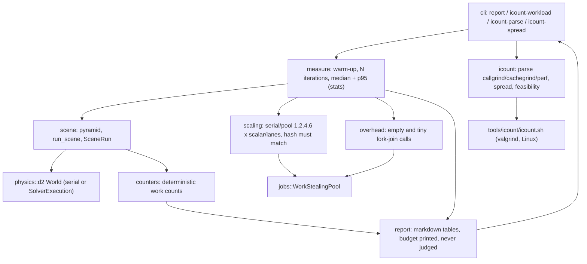

# Review 4-22: physics benchmark tool, instruction-count investigation

Task: 4-22. Class 2 (new crate, new tool; no governance file touched). Size: large (new crate, a hosted-runner probe, docs). One PR into `develop`.

Delivers: crate `engine/tools_physics_bench` (library plus thin binary, no new dependency, no `unsafe`, no `unwrap`/`expect`), `tools/icount/icount.sh`, the report `docs/budgets/physics-benchmark-4-22.md`, docs (`wiki/README.md` v0.99, `wiki/architecture/physics-and-jobs-v0.md` as-built note and four stale rows fixed), this file. No gate, threshold, ADR, workflow, `clippy.toml`, digest or `CLAUDE.md` edit.

## Findings of the benchmark (reported, nothing tuned)

- **F-W1: the full pyramid does not stay standing.** 44 rows (990 boxes), 300 steps of 1/60 s, default solver (4 sub-steps, 1 relax pass): max drift 0.2473 m, settled drift 0.1492 m, final speed 0.0370 m/s, so the "standing" test (< 0.05 m and at rest) says NO. By size: 10 rows yes, 20 rows NO (0.0516 m), 30 rows NO, 44 rows NO. The solver and the assertion were not touched. The test in `tests/w1.rs` asserts the 10-row pyramid (55 boxes) and says so in its header. This is a product question for the owner (solver quality at W1 size), not a tool defect.
- **F-SCALE: the parallel path is slower than serial on this scene.** Serial scalar median 2.2 ms per step; pool at 1 worker 4.3 ms; pool at 6 workers 3.3 ms (efficiency 0.21 scalar, 0.20 lanes). All rows have the same replay hash (D0/D1 hold). Cause not profiled (marked as a hypothesis in the report). Scheduler overhead: an empty fork-join costs about 60 to 100 ns, a 64-index job 160 ns at 1 worker and 1.3 us at 6 workers.
- **Instruction counts.** Feasible on a GitHub-hosted Ubuntu runner with valgrind (callgrind and cachegrind): spread 0.0% over six runs in two workflow runs. `perf stat -e instructions:u` is not supported there. Not feasible on this Windows machine. Limits: serial only, Linux x86-64 only, the runner image can drift (valgrind or CPU model changes shift counts, so base and head must be counted in the same job). Recommendation for card 4-23: count base and head in one job.

All wall times are from this machine only (Windows, 20 logical CPUs, not a quiet reference machine, other work was running); they are report only and never judged. The work counters do not depend on the machine and are pinned in tests.

## Probe

Throwaway branch `agent/4-22-icount-probe` (a workflow with a `push` trigger, because `workflow_dispatch` needs the workflow on the default branch; a rerun gave the second workflow run). Never opened as a PR. Branch deleted locally and on the remote (checked with `git ls-remote`: absent).

## Tests (TDD)

Test list first, red evidence per step (placeholders failed, then the measured values were pinned). Pinned counters: 60 steps (8700 pairs, 8700 manifolds, 8700 solved, colours max 6, colours sum 360, awake 3300) and sleeping-on 300 steps (43500 pairs, 5220 solved, 38280 frozen, colours sum 216, awake 1925). Also: untimed workload equals the timed run; pooled sample count; hashes equal across all scaling rows; parse tests including the real hosted-runner lines; cli refusals.

Crate tests after the last edit: `cargo test -p tools_physics_bench` all green; clippy `--all-targets` clean; `cargo fmt` clean.

## Mutation

`cargo mutants -j 1` on `stats.rs`, `icount.rs`, `cli.rs`: 115 mutants, first pass 98 caught, 9 missed, 8 unviable (score 91.6% of viable). The 9 survivors (`below_protocol` per-field, the count limit boundary, `as_f64` halves, the two-count spread) got new tests; a re-run of the affected functions (49 mutants) left 2 missed in `as_f64` (a tolerance too loose), the test was tightened and a re-run of `as_f64` caught 12 of 12. Final: every viable mutant in the three files caught (107 of 107), as shown by the first pass plus the two targeted re-runs, not by one full run after the last edit. Not run for `report.rs`, `scaling.rs`, `counters.rs`, `overhead.rs`, `measure.rs`, `scene.rs`, `main.rs` (machine limits: 3 to 4 GB free; the timed scenes make each mutant minutes long). The mutation gate is not met by evidence for those files; this is stated, not hidden.

## R1-R8

| Phase | Result |
|---|---|
| R1 self | Diff re-read; leftover placeholders removed; magic numbers named. |
| R2 automated | fmt, clippy `-D warnings` via workspace lints, crate tests, wiki lint (55 pages, 0 violations), local gates (see the report back for the output). |
| R3 independent | Read-only reviewer subagent, loop 1: 0 blocker, 0 major, 5 minor, 4 nit. All fixed (see below). |
| R4 QA | Counters pinned; standing test at a stated smaller size; boundary tests added after mutation. |
| R5 architecture | Layer 4 tool (`tools_*`), depends on base, jobs, physics, platform only; no cycle; arch-check clean. |
| R6 security | No secrets; the script only runs valgrind and the tool; file paths come from the command line; no network; no `unsafe`. |
| R7 performance | Tool code, not a hot path; scenes allocate once per run. |
| R8 product fit | Delivers the W1 measure and the finding the owner needs for the phase 4 budget talk; the instruction-count answer is evidence-based. |

Reviewer minors and nits, all fixed: the standing test now asserts `run.complete` (no dropped work); the literal rest speed became a named constant; the feasibility limit became `FEASIBLE_MAX` and the Marginal wording was softened; `icount.sh` checks `runs >= 2` and the valgrind exit status and states honestly that the script itself ran only against a stand-in valgrind; the report sentence was reworded the same way; a perf hybrid-CPU note was added to the docs; wiki lint wording fixes.

Open blocker/major: 0.

## Limits and follow-ups

- Wall times: this machine only, loaded, not the reference machine; the numbers show shape, not a budget verdict.
- `icount.sh` has not run on a real valgrind (the probe used the same command line, the script was tested with a stand-in).
- Instruction counting covers the serial path only; a threaded count is not deterministic under valgrind.
- F-W1 and F-SCALE are for the owner to decide on; no card was created.
