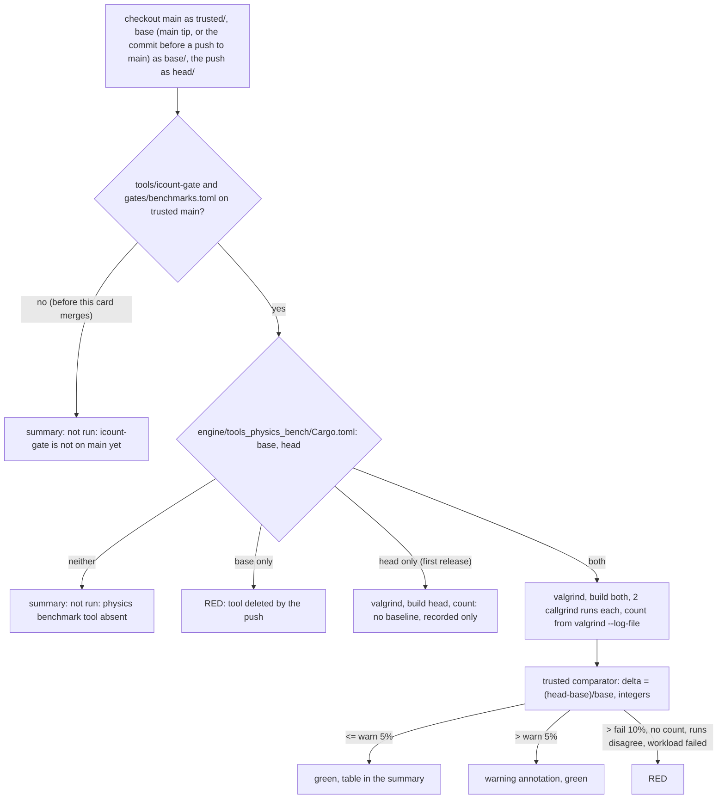

# Review 4-23: physics instruction-count gate in CI (governance)

Task: 4-23. Loops: 1 of 3 used. Author session and reviewer session differ (reviewer is a separate read-only subagent). Class 3 (governance task declared by the owner: `.github/workflows/ci.yml`, `gates/`, `tools/release/`, `gates/protected-paths.txt` are protected paths). Size: standard. One PR into `main` (body line `Governance task: yes (card 4-23)`).

Delivers: job `physics_icount` in `.github/workflows/ci.yml`; new tool `tools/icount-gate/icount_gate.py` (comparator, parser, presence check) with 79 unit tests; new `gates/benchmarks.toml` (the registered benchmark); `tools/icount-gate/` added to `gates/protected-paths.txt`; 7 workflow tests in `tools/release/test_workflows.py`; docs (`wiki/README.md` v1.01, `wiki/workflow/ci-diagrams.md`, `wiki/workflow/quality-metrics.md`, `wiki/architecture/physics-and-jobs-v0.md`, this file). No engine code, no `unsafe`, no new third-party crate, no threshold changed (`gates/gates.toml` is untouched: warn 5, fail 10), no ADR, no digest edit (the digest states the bands only and they did not change).

## Design decisions

- **What is compared.** BASE is what `main` was before the run: the `main` tip on a manual run on a branch, `github.event.before` on a push to `main`. HEAD is the pushed commit. Both are built and counted in the same job, so a drift of the runner image or of valgrind moves both counts and cancels (the recommendation of the 4-22 report). The workflow is: ordinary card PRs into `develop` run no CI; `ci` runs on `main` and by hand; the release PR of `develop` into `main` is the event where the gate speaks, answering "how much more or less work does the physics workload do than on `main`". A manual run on any branch (as done for this evidence) compares that branch with `main`.
- **Trust boundary (digest section 8).** From the checkout of `main`: the comparator, the bands (`gates/gates.toml [benchmark]`), the registered workload and the noise limit (`gates/benchmarks.toml`), the count parser. From the trees under test: only the built `tools_physics_bench` binaries, which run as the measured program. The count is read from valgrind's own log (`--log-file`), requires the `==pid==` prefix and takes the last `Collected :` line, so nothing the program prints on stdout or stderr can pose as a count. Workload arguments are passed to both trees from the trusted file, so a pushed commit cannot shrink its own workload via the command line. A pushed commit can still change what the workload does in code; the summary prints both workload outputs (work counters and replay hash) and states when they differ, and the owner reads the diff of a release anyway.
- **Registration file.** The bands stay in `gates/gates.toml [benchmark]`, the only place the digest check and the wiki lint compare with the digest. Both tools admit only scalar thresholds under a table; a nested `[benchmark.physics_icount]` made them fail ("not covered by the digest check"; seen in a trial). Rather than loosen two governance tools, the registered benchmark (package, manifest, rows, steps, runs, noise limit) is in `gates/benchmarks.toml`. The card text said gates.toml; this is a deliberate deviation with that reason.
- **Noise limit.** `noise_max_percent = 0.5`: the runs of one tree must agree within it, or the bands cannot be read (red). The tool refuses a value above one tenth of the warn band or not a multiple of 0.1 (the feasibility rule of card 4-22). Measured spread on the hosted runner: 0.0%. It is a new parameter, not a loosening of an existing one.
- **Boundaries.** Strictly above 5% warns, strictly above 10% fails (quality-metrics: "regression > 5% warn, > 10% fail"); integer arithmetic, no float comparison; an improvement never fails and is labelled.
- **Cases.** Tool in neither tree: stated line, not green by silence. Only in HEAD (first release): "no baseline, recorded only", neither pass nor fail. Only in BASE: red. Bootstrap (main has no gate tool yet; first discovered on a hosted run, see below): stated skip.
- **Toolchains.** Each tree builds with the toolchain its own `rust-toolchain.toml` pins and the summary records both `rustc` versions; a toolchain bump in the push would show as an instruction change, which is true to what ships.
- **Cost.** One Ubuntu job. Measured on the hosted runner: apt install of valgrind about 17 s, one release build of the bench tool about 15 s, two callgrind runs of the workload about 2 s each; whole job 43 s with only the head built, so about 1.5 minutes with both trees built. Per release PR and per manual run; nothing runs on card PRs.

## Hosted runs (the only place valgrind can run: this machine is Windows)

| Run | Branch | What it shows |
|---|---|---|
| 42314068766 | `agent/4-23-bench-gate` | job red: `trusted/tools/icount-gate/...` does not exist on `main` yet (bootstrap). Run cancelled. Led to the bootstrap step |
| 42314335152 | `agent/4-23-bench-gate` (final workflow) | whole run green; job `physics_icount` 10 s, summary `not run: icount-gate is not on main yet` |
| 42319403165 | `agent/4-23-bench-gate` (final workflow, commit before the docs of loop 2) | whole run green after one rerun of one job: the first attempt had `tsan` red on `pool::tests::as_many_tasks_as_threads_run_at_the_same_time` (a timing test of the `jobs` crate under TSan, 2 workers; code this card does not touch; passed on rerun and in run 42314335152). A flaky pre-existing test, reported, not fixed here. `physics_icount` green: bootstrap line |
| 42318179973 | throwaway verify branch (= branch + `develop`, trusted checkout pointed at the tool branch, only this job kept) | real path, base = `main` has no crate: counted 162,567,125 instructions, `no baseline, recorded only`, green, 43 s |
| 42318330639 | verify, base = `develop` | both trees built and counted: 162,567,125 and 162,567,125, `pass +0.00%`, both runs of both trees identical |
| 42318443688 | verify, head workload does 50% more steps | `instruction count rose +49.13%, above the fail band of 10%`, job red (exit 1) |
| 42318560084 | verify, head does 2 extra steps | `warn +6.55%`, `::warning::` annotation, job green |

The verify branch was never a pull request and is deleted (local and remote). Its edits (trusted checkout from the tool branch, only this job, base `develop`, an altered `icount_workload`) exist only to exercise the paths; they are not in the PR. The count 162,567,125 agrees with the 162,566,311 of the 4-22 probe to 0.0005% (different build).

Not run on a hosted runner: the whole `ci` on the verify branch (only this job was kept, to save minutes); the case "base has the tool, head deleted it" and "push to `main`" (the `github.event.before` base) are covered by unit and workflow tests only, since a push to `main` is the merge itself.

## Tests (TDD)

`tools/icount-gate/test_icount_gate.py`: 79 tests written before the module (red: import error), covering the parser (pid prefix, last line wins, zero, spoof without prefix, CRLF), config validation (bands ordered, noise limit, package name as a shell-safe identifier, manifest inside the tree, ranges), classification at both sides of each boundary with large counts, spread, measure with an injected runner (arguments, noise, failing workload, different work in the second run, empty output), presence (four states), summary, and the CLI (exit codes, annotations, no-baseline, missing arguments). The workflow tests were written after a first draft of the job; their power was checked by 9 manual sabotage runs of `ci.yml` (8 of 9 killed at first; the survivor `path: base2` led to a stricter assertion, then killed), plus the bootstrap tests written red first (2 failures before the step existed).

Mutation: the Python governance tools have no mutation tooling in this repository (cargo-mutants is for Rust). A hand-rolled operator-swap pass over `icount_gate.py` (script kept outside the repo, not a gate) gave 83 mutants: 47 killed on the first test set, 71 killed (85.5%) after the additions; the 12 survivors are all inside message strings or the float epsilon, i.e. equivalent. The >= 80% rule is met on the changed testable code by that measure; it is not the official cargo-mutants gate (not applicable to Python).

Local gates: `python tools/local-gates/local_gates.py --base origin/main`: all lines pass, including the new tool's tests (the four deliberate FAIL lines the brief expected did not appear). Wiki lint 0 violations, digest check agrees, workflow tests 68 pass.

## R1-R8

R1 self, R2 automated (unit and workflow tests, wiki lint, digest, local gates, hosted runs above), R3 independent (reviewer subagent, below), R4 QA (hosted runs of all four verdict paths: no baseline, 0.0%, warn, fail), R5 architecture (no layer, port or crate touched; reuses the presence idea of `golden_check`), R6 security (below), R7 performance (cost above), R8 product fit (answers O11 and card 4-23: the 4-22 measure is now a registered gate that can only fire on the serial W1 workload).

R6 security: no secrets; checkouts pinned by commit with `persist-credentials: false`; `package` reaches the shell only through `env` and is validated as an identifier from a trusted file; `subprocess.run` with a list, no shell; the apt install runs `sudo` on a hosted runner (same as `gl_linux`); the pushed binary runs under valgrind with the job token read-only (`contents: read`), like the tests of the other jobs.

## Open findings of 4-22 that this gate does not cover

F-W1 (the full 990-box pyramid does not stand) and F-SCALE (the parallel path is slower than serial) stay open: the gate counts the serial 20-row, 30-step workload, which does stand, and says so in the page. Windows and the parallel path are not counted.

## Independent review

Independent read-only reviewer (subagent), loop 1: 0 blocker, 2 major, 6 minor. All fixed or answered in loop 2 (one loop used of three):

- **M1 (major, fixed).** On a push to `main` the ref `main` is the pushed commit, so `trusted` would have equalled `head`. The trusted checkout now uses `github.event.before` on a push (the pre-push `main`, same SHA as base) and the `main` tip on a manual run; a workflow test pins it. Consequence stated: the push that first brings the tool into `main` finds no tool in the previous `main` and writes the bootstrap line.
- **M2 (major, fixed, residual stated).** Pushed code runs in the job (build scripts, the benchmark binary) as the runner user, next to `trusted/`. New first step `Lock the trusted checkout`: `sudo chown -R root:root trusted` and `chmod -R go-w` before any pushed code runs (a test pins the order). Hosted proof: run 42319297477 passes with the lock. Residual risk, accepted and stated: pushed code could still tamper with the result JSON files in `$RUNNER_TEMP` or leave a background process; the measure and compare steps run after the builds and the owner reads any workflow or build-script diff. The same pattern exists in the `tsan` and `d2_determinism` jobs.
- **m1 (fixed).** The measured program could append a forged `Collected` line to the log file it finds in its command line; the parser now requires exactly one such line (test added).
- **m2 (fixed).** A count that falls while the workload output changes is flagged in the summary ("work was removed?"); it does not fail (an optimisation is legitimate) (test added).
- **m3 (fixed).** Comment in `ci.yml`: an unreachable `before` fails the checkout, which is red.
- **m4 (fixed).** This file is committed.
- **m5 (reported).** The digest says "PR benchmark gate on instruction counts"; the gate runs on `main` and by hand, which is the PR gate of the release PR. Not edited (the digest check is about the numbers, which did not change); if the owner wants the wording changed it is a digest edit in a governance task.
- **m6 (accepted).** The exact `if:` count in the workflow tests is deliberate: any added condition is a new skip path and must be noticed.

Open blocker/major: 0.

After the fixes: 79 unit tests (icount-gate), 68 workflow tests, wiki lint 0 violations, local gates all pass. Hosted: run 42319297477 (throwaway verify branch with the final job, base `develop`): 162,567,125 against 162,567,125, `pass +0.00%`, green, lock step and exactly-one parser on a real valgrind. The verify branch is deleted again. The earlier runs in the table above were made before the loop-1 fixes (workflow differences: the lock step, the trusted ref expression); the counts, the warn (+6.55%) and the fail (+49.13%) outcomes come from the parser and comparator, which loop 1 changed only in the exactly-one rule.

## Limits and follow-ups

- The first real comparison happens at the release PR that brings `tools_physics_bench` into `main`: it will report `no baseline, recorded only`; the one after is the first real compare.
- Because the trusted tool must already be on `main`, a hosted run of this branch before the merge can only show the bootstrap line; the real path was exercised on the throwaway branch as above.
- Merge of `main` into `develop` afterwards: the top of `wiki/README.md` (status line and changelog order: v1.01 above v1.00) conflicts; `physics-and-jobs-v0.md` and `quality-metrics.md` are edited at lines `develop` did not touch except possibly the paragraph after the 4-22 text (a separate paragraph here).
- A change of the workload or of the noise limit is a governance diff of `gates/benchmarks.toml`.
- If the runner image changes valgrind's version mid-way, both trees move together (same job).
- Version numbering: `develop` tops at v1.00; this entry is v1.01 (checked on `origin/main` v0.98 and `origin/develop` v1.00).
