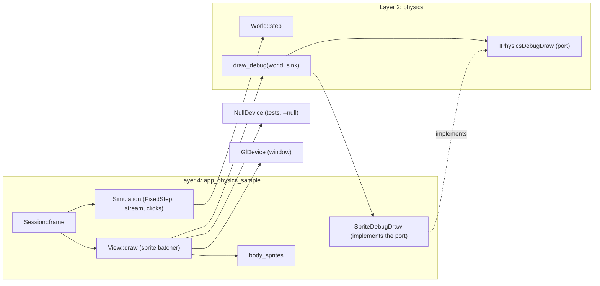

# Review 4-24: the falling boxes sample and the physics debug-draw port

Task: 4-24 (optional card of phase 4, option O8(a) of `wiki/architecture/physics-and-jobs-v0.md`, taken by the owner; ordinary card, one PR into `develop`). Class 2 expected (a new public port in the `physics` crate); no governance file, no new dependency, no `unsafe`, no `#[allow]`. The classifier decides.

Delivers:

- crate `engine/app_physics_sample` (layer 4, workspace member): `simulation` (arena, seeded stream, fixed-step accumulator), `mapping` (metres to pixels, body sprites, `SpriteDebugDraw`), `controls`, `view`, `session`, `headless` (`--null`), `app` (window), `args`, `cli`, `error`;
- `physics::d2`: `IPhysicsDebugDraw`, `DebugColour`, `CIRCLE_SEGMENTS`, `NORMAL_LENGTH`, `draw_debug`, and `engine/physics/tests/debug_draw.rs`;
- `app_sprite_sample`: visibility of existing helpers widened (`sample::{check_asset, create_pipeline, create_buffer, create_texture, camera_bytes, encode_staged, SPRITE_BYTES, VERTICES_PER_SPRITE, SLOT}`, `app::{Opened, first_size, failed, no_device, FRAME, WIDTH, HEIGHT, EVENT_CAPACITY}`; `Opened::open` takes the window title). No behaviour change.
- wiki: [examples](../wiki/architecture/examples.md) section 5, [physics-and-jobs-v0](../wiki/architecture/physics-and-jobs-v0.md) as-built paragraph, [physics](../wiki/architecture/physics.md) pointer, README v1.02.

## Decisions

- The port `IPhysicsDebugDraw` was in the design (sketch of section 2, `overview`, `physics.md`) but not in the code. The card names it, so it is declared in `physics::d2` as the design says and the sample implements it. It uses colour roles, not RGBA, so `physics` stays presentation-neutral. This is the only change to an engine crate and the reason for Class 2.
- The sample reuses 3-15 code by widening the visibility of its helpers (documented, `# Errors` sections added) instead of copying about 150 lines (duplication gate 3%).
- `--null --frames N` was added so that the whole loop (simulation, sprites, debug drawing, batching, submission) runs end to end in CI without a GPU; the window path stays thin (`app.rs`).
- The physics step runs on the calling thread; the job pool is not used.
- `Simulation::reset` rebuilds the world and allocates by design (a key press, not the per-frame path); the zero-allocation test covers warm frames with a click and a stream spawn.
- Circles are drawn from a generated 32 by 32 disc texture (the Nearest sampler of 3-15 is shared); boxes use the 3-15 checker texture.

## Evidence

(R1-R8 below; the independent reviewer was a separate read-only subagent with a fresh context.)

### Classifier

`python tools/classify-change/classify_change.py --base origin/develop --head HEAD --paths gates/protected-paths.txt` gives **class 2**: new public items in `physics::d2` and the new crate, a new workspace member (`Cargo.toml`, `Cargo.lock`), widened visibility in `app_sprite_sample`. No governance file is touched: no `gates/`, `.github/`, ADR, `clippy.toml`, `rules-digest.md`, `CLAUDE.md`, settings or arch-check table (an L4 app needs no table row: `"app_*" = 4`). No new third-party dependency, no `unsafe`, no `#[allow]`, no `unwrap`/`expect`/`panic`.

### TDD

Test list first (spawn, step, mapping, controls, args, cli, headless, determinism, no-allocation, debug draw). Each unit was driven by a failing test before code (the red evidence was a compile or assertion failure on the missing item). The reviewer's coverage gaps and the surviving mutants (turned circle spoke, call order, static circle, sleeping centre, stream x spread, sizes and tilt of spawned bodies, disc centring and area, tints) were closed with new tests, then the checks were re-run.

### Results (this machine, Windows, debug profile)

| Check | Result |
|---|---|
| `cargo fmt --check` | pass |
| `cargo clippy --workspace --all-targets --locked -- -D warnings` | pass (0 warnings, no `#[allow]`) |
| `cargo test -p app_physics_sample` | pass: 46 unit, 9 session, 1 no-allocation, 4 binary |
| `cargo test -p physics --test debug_draw` | pass: 10 |
| `cargo test --workspace --locked` (inside local gates) | pass |
| `python tools/wiki-lint/wiki_lint.py ...` | OK, 56 pages, 0 violations |
| `python tools/local-gates/local_gates.py --base origin/develop` | see the note below |

Local gates note: the first full run showed one FAIL, `clippy`, caused by a test I had just written in `simulation.rs` (a nested block, Clippy `excessive_nesting`). I fixed it with a helper function and re-ran `cargo clippy --workspace --all-targets --locked -- -D warnings`, which passes. The full local-gates script was not re-run end to end after that fix (it takes about an hour on this machine); every other step of it (fmt, build, test, architecture, unsafe budget, wiki lint, digest, diff hash, all tool tests) passed in that run. Mutation, coverage, Miri, benchmarks and cargo-deny are not run by that script.

### Mutation testing (cargo-mutants, `-j 1`, one file at a time, `-- --lib` or `--test debug_draw`)

| File | Mutants | Caught | Unviable | Missed |
|---|---|---|---|---|
| `app_physics_sample/src/simulation.rs` | 69 | 63 | 5 | 1 (equivalent) |
| `app_physics_sample/src/mapping.rs` | 58 | 52 | 6 | 0 |
| `app_physics_sample/src/controls.rs` and `args.rs` | 42 | 42 | 0 | 0 |
| `physics/src/d2/debug_draw.rs` | 25 | 20 | 5 | 0 (1 missed on the first run, the contact normal direction; closed with a test and the contact mutants re-run) |

The one missed mutant is in `Spawner::body`: `next_u32() % 2 == 1` mutated to `!= 1`. It only swaps which parity of the generator makes a disc; the stream stays seeded and deterministic and the test checks the mix of discs and boxes, so it is equivalent for the behaviour the sample promises. The first runs found real gaps (random x of the stream, sizes and tilt of spawned bodies, disc texture centring and area, tints); each was closed with a new test and the file re-run.

Not mutation-tested: `session.rs`, `view.rs`, `cli.rs`, `headless.rs`, `app.rs`, `error.rs`, `main.rs`. They are glue over a device and a window. They are covered by the session tests on the Null device, the no-allocation test, the binary tests (including `--null --frames 200` run twice with the same hash) and the CLI tests, but their mutation score was not measured. `app.rs` (the window loop) cannot be executed without GLFW and an OpenGL 4.5 driver.

### Honest limits

- **The real window path was not run.** GLFW and a GL 4.5 device are absent here: the 3-frame window run exits 3 (`not run: device not set up`), which the test reports as not run. Nothing was seen on screen. The whole loop (simulation, sprites, debug drawing, batching, submission) was exercised on the Null device and in `--null --frames N`. Nothing about the look of the sample (colours, thickness of debug lines, camera framing) is claimed as visually verified.
- Linux was not built or run here; the sample uses the same per-OS key tables as `app_sprite_sample`.
- The full physics determinism and stability suites ran once inside `cargo test --workspace` (pass; the determinism matrix takes minutes in debug). Nothing in `physics` other than the new `debug_draw` module and its `mod` line changed.
- Figures are from the debug profile on one machine.

### R1-R8

| Phase | Result |
|---|---|
| R1 self review | Diff re-read; findings fixed (named constants, comments, doc fix "section 6" to "section 7"). |
| R2 automated | fmt, Clippy `-D warnings`, tests, wiki lint, architecture check, unsafe budget, digest check: pass (see above). |
| R3 independent | Separate read-only reviewer subagent: 0 blocker, 0 major, minor and nit findings, all applied (extra `debug_draw` tests, magic numbers named, comments for body count versus sprite capacity, `atan2` as presentation only, step length rounding, reset allocates by design, note that a refused click still consumes the stream RNG). |
| R4 QA | Acceptance criteria covered by tests: stream and clicks, fixed step with accumulator and stall cap, reset, debug toggle, determinism (same seed same hash, other seed other hash, headless hash stable), no allocation on warm frames, bounded `--frames N` run exits 0, bad arguments exit 2. |
| R5 architecture | The port lives in `physics::d2` and speaks colour roles, not RGBA, so `physics` stays renderer-neutral and free of ECS. The sample is an L4 app; adapter selection stays in the composition root (`app.rs`); no arch-check row needed. 3-15 helpers are reused through widened visibility instead of copies. |
| R6 security | No `unsafe`, no new dependency, no file or network access, arguments parsed into a closed set, bounded frame count, no secrets. A failed click is a value, not a panic. |
| R7 performance | Zero heap allocations on warm frames (test with the per-thread counting allocator); the world holds 128 bodies; the sprite capacity (16384) is far above bodies plus debug sprites. No benchmark added: the sample is not a hot-path change to the engine. |
| R8 product fit | Matches card 4-24 (option O8(a)): falling boxes and discs, debug draw of outlines and contacts, click to spawn, reset key, bounded headless run. Not visually confirmed (see limits). |

### Findings to report

- **F-W1 (open from 4-22)**: a big pyramid does not stand in the engine. I did not fix the solver and did not tune the physics. The sample drops bodies one at a time and clicks add more; it does not depend on this.
- **F-SCALE (open from 4-22)**: parallel stepping is slower than serial at these sizes. The sample steps on the calling thread (serial) and does not use the job pool.
- **Jitter or instability**: none could be observed visually (no window). In the headless tests the bodies stay finite and inside the arena for 900 steps (`bodies_fall_and_stay_inside_the_arena`) and settle into sleep (the sleeping tint is tested), but no statement about how it looks is made.
- **A refused click consumes the stream generator**: a click on a full world still draws from the generator, so a later stream differs from a run without that click. Harmless, noted in the code.

