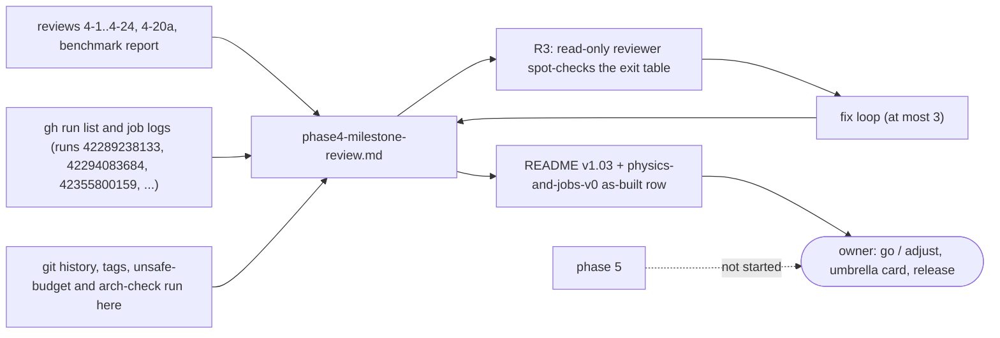

# Review 4-25: phase 4 exit record and milestone review (documentation)

Task: 4-25. Class 1 (wiki and review files only; no protected path, no governance file; the classifier is run in the PR text). One PR into `develop`. Size: standard (documentation, many facts to trace). Out of scope: starting phase 5, closing the phase 4 umbrella card (the owner decides), any solver or CI change, the 4-26 public-visibility card.
TDD: documentation change (TDD exception); the "tests" are the independent check of every number and verdict against the repository, the pull requests and the hosted runs, and the wiki lint.

## What changes

- New page `wiki/spikes/phase4-milestone-review.md`: exit criteria item by item (met / partly met / not met / not measured) with the owner decision each needs, cards 4-1 to 4-24 with PR, class, fix loops and release status, plan against actual, per-card against whole-phase metrics, hosted CI runs, open findings with proposed decisions or cards, process lessons, ADR and option status, recommendation (done with named exceptions) and seven decisions for the owner.
- `wiki/README.md`: v1.03 changelog entry, status line, index row 39.
- `wiki/architecture/physics-and-jobs-v0.md`: card table row 4-25 marked done, one as-built paragraph for card 4-25.
- `reviews/4-25.md`: this file.
- Not changed: `wiki/open-questions-and-risks.md` (stale Q20 and the risk register notes are listed as proposals), `docs/budgets/*` (W1 wording, O9, is the owner's), the digest, every file under `gates/`, `.github/`, `tools/`, `engine/`.

## Mermaid views (documentation change rule, clean-code-and-review section 7)

The page carries three views: the evidence flow, the exit criteria by verdict (with the two events that will change them), and the release status of the cards. The flow of this card:

## Evidence

- Measured here: file and line counts (script over `*.rs`), `unsafe_budget.py` (84 unsafe of 40,092 code lines, 0.21%, 0 violations), `arch_check.py` (22 crates, 0 violations), `git rev-list --count` (develop 20 ahead of main, main 0 ahead), tags v0.6.0 to v0.6.8, `git ls-tree` of `origin/main` (only `engine/physics/clippy.toml`), `gh run list` and job conclusions of runs 42289238133, 42294083684, 42299121077, 42355800159, the job logs of the D2, ARM64, build/test and main-run physics jobs (steps that ran, test counts of the `determinism` and `stability` targets, the `not run` notices), the stale-text checks (`world.rs:469`, Q20, digest section 7).
- Recorded in the cards, **not re-run**: tests, coverage, mutation, Miri, benchmarks (this machine has little free memory).
- Wiki lint: `python tools/wiki-lint/wiki_lint.py --config gates/wiki-lint.toml --gates gates/gates.toml`: OK, 57 pages, 0 violations (after one fix: a "70%" threshold-like number was reworded as a vision-page target).

## Independent review (R3)

One read-only reviewer (fresh context) spot-checked more than 20 claims against git, tags, `gh` runs and logs, the reviews and the benchmark report: 0 blocker, 2 major, 5 minor, 1 nit. Loop 1 of 3, all applied:

- Major 1: the chain-stability row said "met" while the summary, the diagram and the design-note paragraph said "partly" and 4-17 lists F3, F3b and F5 as missed bounds. Row, summary and paragraph now agree: partly met (chains up to about 30 links).
- Major 2: the 4-7 mutation score (152 of 155) hid that 86 kills are timeouts. Caveat added in the deliverables row and the metrics table.
- Minor: efficiency 0.21 corrected to 0.22 (scalar, 6 workers); W1 median stated as 2.258 / 2.232 ms and about 13% over; test-time range now includes the 174 to 236 s earlier figure; the parallel solve moved from "met" to "partly met" in the summary; the owner's sample approval hedged in section 9 as coming from the task brief; Q20 is struck through and marked RESOLVED in the register (the page says the text is stale, which stays true of its content).
- Verified OK by the reviewer: PR numbers and tags, the 20-commit gap, runs 42289238133 / 42294083684 / 42299121077 / 42355800159 and their jobs, red and cancelled counts, unsafe budget and arch-check outputs, W1 and 4-17/4-18/4-20a figures, mutation and coverage figures of ten reviews, stale-text claims, worktree and branch counts, no governance file touched, no closing of the phase or the umbrella card.
- Not re-checked by a second pass: the fixes were checked by the author and the wiki lint.

## Checklist (R1-R8)

| Step | Result |
|---|---|
| R1 self | every figure traced to a review file, the benchmark report, a log or a command run here; estimates and not-run items labelled "recorded, not re-run" or "not verified" |
| R2 automated | wiki lint OK; local gates: see the PR text |
| R3 independent | see above |
| R4 QA | claims spot-checked against git, tags, `gh` runs and logs; no engine test was run (memory), stated on the page |
| R5 architecture | no code change; `arch_check.py`: 22 crates, 0 violations |
| R6 security | no secret; only files inside the repository were read, plus hosted job logs through `gh`; no tool installed |
| R7 performance | none claimed; the page reports the recorded W1 and scaling figures as recorded, on a machine that is not the reference protocol |
| R8 product fit | answers the roadmap's milestone-review list and the exit record of the design note; the verdicts are not spun (full W1 pyramid does not stand, parallel slower than serial, 70 percent target not met); the go/adjust decision and the umbrella card stay with the owner |

## Not verified

- No test, coverage, mutation, Miri or benchmark was repeated.
- Trello card states; the owner's approval of the sample (taken from the task brief); rate-limit and resumed-agent counts (not in the repository).
- The Windows `build, test` log of run 42289238133 and the integration targets of the ARM64 job.
- The `cargo doc` warning for `Tree::structure_hash` (read from the source and review 4-12).
- Mermaid rendering (no renderer offline).

## For the owner to read

- Sections 1 (summary), 2.2 (exit criteria), 6 (findings) and 9 (recommendation and the seven decisions) of `wiki/spikes/phase4-milestone-review.md`.
