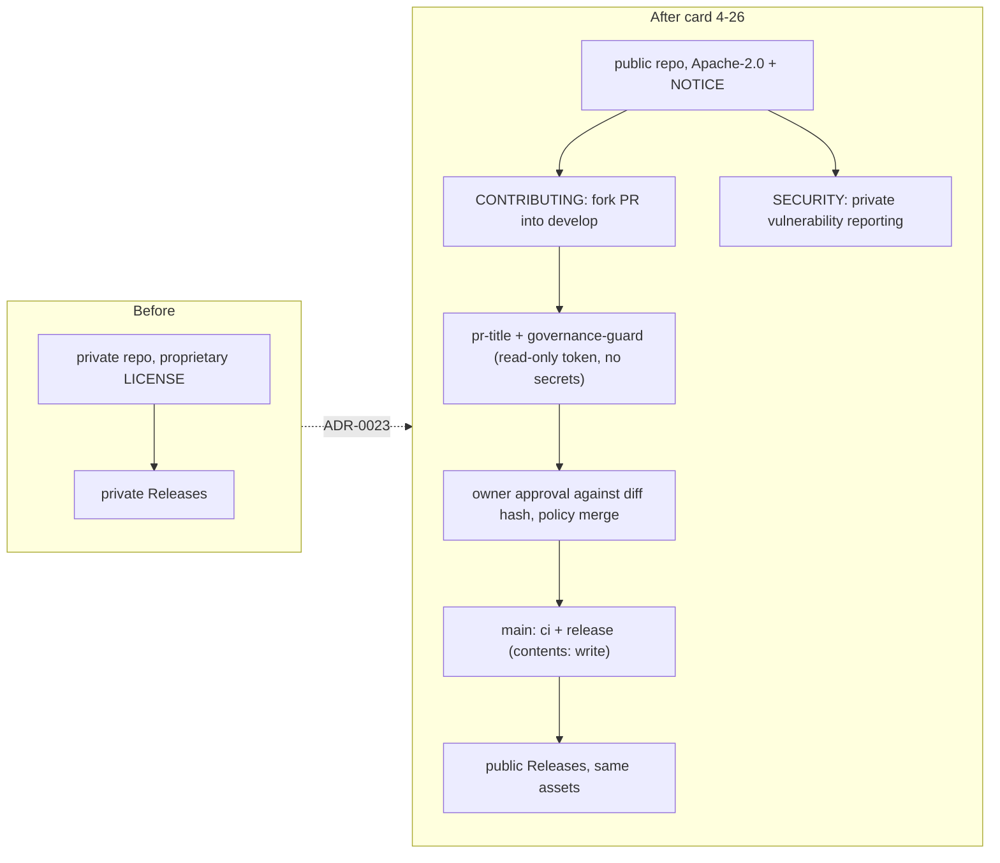

# Review 4-26: prepare the repository for public visibility (governance)

Task: 4-26. Loops: 1 of 3 used. Author: implementer; Reviewer: a separate read-only subagent (no session links or identifiers are recorded, owner decision of this card). Class 3 (governance task declared by the owner: `.github/`, `CLAUDE.md`, `wiki/rules-digest.md`, `wiki/decisions/`, `THIRD_PARTY.md`, `deny.toml`, `tools/release/`, `tools/templates/`, `gates/` untouched).

Delivers: Apache-2.0 `LICENSE` (standard text) and `NOTICE`; `README.md`, `CONTRIBUTING.md`, `SECURITY.md`, `.github/PULL_REQUEST_TEMPLATE.md`; `license = "Apache-2.0"` in the workspace and the crate manifests (`license-file` kept so crates on `develop` that inherit it still build; `publish = false` kept); ADR-0023 (supersedes ADR-0016); wording corrected (CLAUDE.md, digest sections 1, 9, 10 and status line, delivery, tooling, CI, plan-findings, board, roadmap, risks, docs/gates, THIRD_PARTY exit plan, START-HERE banner); plan-findings gets a public-repository update and the section "Public repository: settings the owner keeps"; no session identifiers in the review template (test first); new test class `PublicRepositorySafety`; `.gitignore` additions; changelog v1.04.

## Documentation view (UML)

## Summary verdict

ready, once the PR is open and the owner approves. 0 open blocker/major after loop 1. Things the owner must do in the GitHub UI are listed in the PR description and in the wiki section "Public repository: settings the owner keeps" (secret scanning, push protection, private vulnerability reporting, Issues decision, Workflows scope).

## Checklist

- Measurable rules: n/a (no engine code); Python test code is small functions. pass
- TDD: the review-template change and the new workflow invariants have tests (`test_templates.py` fails on the old template, passes on the new; `PublicRepositorySafety` has bad fixtures for each rule and runs on all five real workflows). The helper tests were written together with the helper, so the red run of the fixtures was not recorded separately: stated, not hidden. pass with that note
- Architecture: ADR-0023, no layer or port change, release behaviour unchanged (the only `release.yml` change is a comment). pass
- Security: no secret or private path introduced; fork-PR trust boundary documented and pinned by tests; no self-hosted runner allowed. pass
- Performance: n/a
- Product fit: owner decisions 1, 2, 4, 5, 6, 8, 9, 11, 12 applied; decision 7 (secret-file names, `run_claude.bat`) left as is; history untouched. pass

## Findings

Severity: blocker (must fix), major (must fix), minor (fix, or list with a reason). status: fixed | accepted with reason | open.

| id | severity | location | description | status |
|---|---|---|---|---|
| F1 | major | open-questions Q18 | still listed IP assignment and "licence only if open-sourcing" as standing rules | fixed (marked superseded) |
| F2 | minor | plan-findings diagram, CONTRIBUTING | `trusted-pr-gates` runs only on PRs into `main` | fixed |
| F3 | minor | digest status line | said section 10 updated | fixed (section 10 now carries the rule) |
| F4 | minor | CLAUDE.md vs digest | trailer rule not mirrored | fixed (digest section 10) |
| F5 | minor | SECURITY.md, CONTRIBUTING | depend on owner enabling private reporting and Issues | accepted: owner list in the PR description |
| F6 | minor | ADR-0023, plan-findings | Workflows scope drop stated as done | fixed (owner to-do, [K]) |
| F7 | minor | plan-findings section 5 | workflow token vs agent token | fixed |
| F8 | minor | plan-findings section 5 | job durations unsupported | fixed (source named, [K]) |
| F9 | minor | delivery, tooling, R-24 | "runners free" unmarked | accepted: sourced to the docs read in plan-findings section 5, arm64 marked [K] there |
| F10 | minor | tooling-and-ci section 6 | "rulesets" as a protection | fixed |
| F11 | minor | `public_repo_violations` | matrix labels not read; "secrets." in comments | accepted: limits stated in the docstring |
| F12 | minor | PR template | governance and release PRs go to `main` | fixed |
| F13 | minor | `develop` crates | physics crates get no `license.workspace` line | accepted: follow-up on `develop`, they build through `license-file.workspace` |
| F14 | minor | wiki/README changelog | v1.04 will conflict with v1.02/v1.03 in the merge of `main` into `develop` | accepted: manual resolution, said in the PR |

## Not verified

GitHub UI facts and settings (private vulnerability reporting, Issues, Workflows scope, fork-approval value), hosted-runner pricing beyond the docs read in the audit, the legal adequacy of Apache-2.0 and `NOTICE` for the company policy, the merge of `main` into `develop` (compared by hand, not run), the hand-run `ci` result (see the PR). History rewrite, a new repository and the external secret scan are out of scope.

## Metrics snapshot

Local gates (`local_gates.py --base origin/main`): fmt, clippy, build, test, architecture, unsafe budget, wiki lint, digest, diff hash and all tool test suites pass. Mutation, coverage, Miri, benchmarks and cargo-deny not run locally (no Rust source changed).
