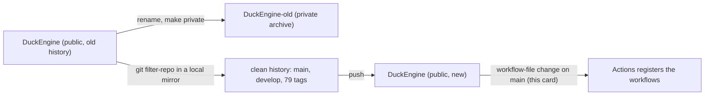

# Review 4-27: migrate the repository to a clean history (governance)

Task: 4-27
SHA reviewed: see the pull request head
Class: 3
Classifier verdict: Class 3 (workflow file `.github/workflows/ci.yml` is a protected path)
Loops: 1 (maximum 3)
Author: implementer
Reviewer: a separate read-only reviewer

Delivers: one comment line in `ci.yml` (no behaviour change), a wiki section "Repository migration to a clean history (card 4-27)" in `wiki/workflow/github-plan-findings.md`, changelog v1.05 in `wiki/README.md`. The history rewrite itself happened outside git, in a local mirror, by owner decision D2 of card 4-26.

## Documentation view (UML)

## Summary verdict

ready, once the owner approves the diff hash. 0 open blocker/major after loop 1.

## Checklist

- Measurable rules: n/a (comment, wiki). pass
- TDD: documentation and comment-only workflow change, TDD exception; the existing workflow tests (79) pass unchanged. pass
- Architecture: no layer, port or ADR change. pass
- Security: no email, token or session identifier in the diff; the untracked `ONBOARDING.md` (personal usage statistics) is excluded locally and not committed. pass
- Performance: n/a
- Product fit: owner decisions D2, "strip them", "no exports" applied. pass

## Findings

| id | severity | location | description | status |
|---|---|---|---|---|
| F1 | major | `ONBOARDING.md` (untracked) | contains personal usage statistics; must not enter the public history | fixed (added to `.git/info/exclude`, not committed) |
| F2 | minor | plan-findings new section | "latest release only" in `SECURITY.md` has no Release until the next one; 79 tags vs 77 Releases | fixed (stated, SECURITY refers to the latest tag) |
| F3 | minor | plan-findings | "section above" unnamed | fixed |
| F4 | minor | plan-findings | registration fix stated as fact before it is observed | fixed (stated as expected, verified after the push) |
| F5 | minor | plan-findings | "byte-identical" true only before this card | fixed |

## Not verified

That Actions registers the workflows after this change: it can only be observed after the merge to `main`. The result is added to the PR before the owner's approval is acted on only if it is observable; otherwise it is reported after the merge. The state of the old repository `DuckEngine-old` after deletion is the owner's.

## Metrics snapshot

n/a: no code. Wiki lint 58 pages, 0 violations; `tools.release.test_workflows` 79 tests OK.
