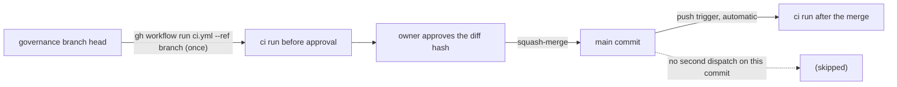

# Review 4-28: remove CI redundancy (governance)

Task: 4-28
SHA reviewed: see the pull request head
Class: 3
Classifier verdict: Class 3 (`.github/workflows/ci.yml` is a protected path)
Loops: 1 (maximum 3)
Author: implementer
Reviewer: a separate read-only reviewer

Delivers: rule 2a in `wiki/workflow/delivery-pipeline.md` (one `ci` run per commit: no second dispatch on a `main` commit that has its push run), the Windows `cargo-deny` leg dropped from `ci.yml` (one Linux leg; `deny.toml` `[graph].targets` names both triples), a workflow test that pins it, `ci-diagrams.md` label, changelog v1.06. Not done on purpose: `tsan` / `physics_icount` opt-in (would lower a gate, owner decision), Windows `g1` and `d2_determinism` legs, any threshold, and the other repositories named in the source note (outside this repository).

## Documentation view (UML)

## Summary verdict

ready, once the owner approves the diff hash. 0 open blocker/major after loop 1.

## Checklist

- Measurable rules: n/a (workflow YAML, one Python test). pass
- TDD: `test_cargo_deny_runs_once_on_linux_because_the_graph_names_both_targets` failed on the old workflow (red evidence: Windows entry found in the job), passes after the change. pass
- Architecture: no layer, port or ADR change. pass
- Security: no secret, address or session identifier in the diff; same pinned cargo-deny binary and checksum on the remaining leg. pass
- Performance: one Windows runner job fewer per `ci` run (about 2 minutes of wall clock). Minutes are free for a public repository, so no billing claim is made. pass
- Product fit: the owner's "fix only what concerns DuckEngine" applied; the gate-lowering item left to the owner. pass

## Findings

| id | severity | location | description | status |
|---|---|---|---|---|
| F1 | minor | rule 2a | "a commit without a push run" vague | fixed (example given) |
| F2 | minor | `ci.yml` deny job | matrix has one entry now | accepted: keeps the job name `cargo-deny (ubuntu-latest)` and the diff small |
| F3 | minor | digest, CLAUDE.md | do not mention the no-second-dispatch rule | accepted: they only describe the pre-approval run, which stays; the rule lives in the pipeline page |

## Not verified

The wall-clock saving was not measured (no before/after run timings recorded); the equivalence of one Linux leg rests on `deny.toml` naming both targets and `--locked`, confirmed by reading, and is confirmed in practice by the hand-run on the branch.

## Metrics snapshot

n/a: no engine code. Wiki lint 0 violations; `tools.release.test_workflows` 80 tests OK.
