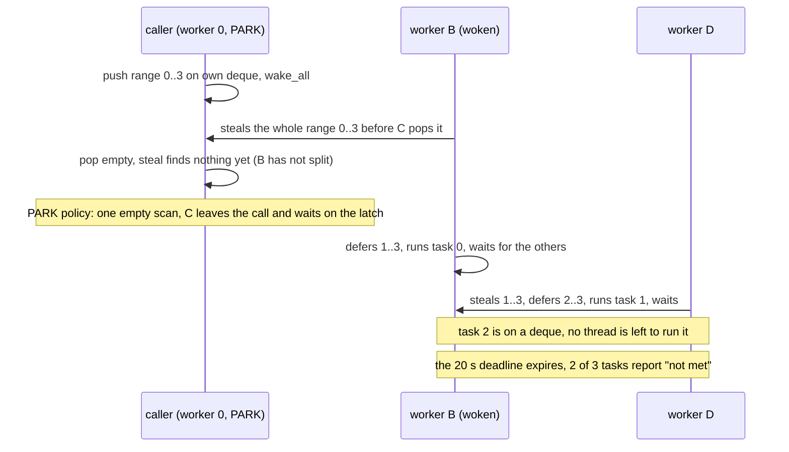

# Review 4-29: the flaky `jobs` rendezvous test

Task: 4-29 (cleanup before phase 5; ordinary card, one PR into `develop`). Class 2 expected, the classifier decides at the PR (concurrency code under test; no engine code changes). The change is one test in `engine/jobs/src/pool/tests.rs`: no `unsafe`, no `#[allow]`, no new dependency, no governance file.

## Root cause

`pool::tests::as_many_tasks_as_threads_run_at_the_same_time` made N tasks wait for each other, so it passed only if N different threads each took one task. It failed once in `tsan` of CI run 42319403165 (card 4-23) and passed on rerun.

The pool promises that a call completes and that every item runs; it does not promise that N items run at the same time. The caller (worker 0) scans with `WaitPolicy::PARK`, so once its scan finds no range it joins the latch even when another thread holds a range it has not yet split. For items that do not wait for each other this costs only parallelism; for the test it left N tasks with N-1 threads.

## Red evidence (reproduction)

A temporary experiment (not committed) repeated the old call on one pool and counted calls where not all tasks met:

| deadline per call | workers | `PARK` | `DEFAULT` | yield for 5 s before parking |
|---|---|---|---|---|
| 100 ms, 300 calls | 3 | 114 | 25 | 36 |
| 100 ms, 300 calls | 4 | 94 | 40 | 25 |
| 2 s, 60 calls | 3 | not run | 7 | 11 |
| 2 s, 60 calls | 4 | not run | 12 | 7 |

Misses stay at a 2 s deadline, so they are stuck calls, not slow wake-ups. The independent review confirmed it for `PARK` too: 40 calls at 500 ms missed 13 (3 workers) and 17 (4 workers). The old single-call form passed 300 of 300 serial runs and 60 of 60 full-suite runs under 30 busy loops on this 20-core Windows machine, because a fresh pool almost always lets the caller pop its range first; the CI failure is the rare other order.

## Fix

The test now asserts what the pool can do: for 2, 3 and 4 workers, some call among `ROUNDS` (40) has all its tasks meet (round deadline 500 ms; a working pool usually passes in the first round and, in the reused-pool form, misses 30 to 40 percent of single rounds, which 40 rounds make negligible; worst case 60 s over the three sizes, typical well under 1 s). The test was not removed, skipped, shortened in what it checks about threads, or given a retry that hides a hang: a pool that never wakes its workers still fails it.

- Mutation check: with `wake_all` disabled in `Shared::run` (temporary edit, reverted) the test fails with "2 workers: no call in 40 ran all tasks at once".
- Repeats of the new test: 200 of 200 passed on Windows under 30 busy loops, 100 of 100 on Linux (WSL Ubuntu). The `jobs` unit tests: 92 passed on Windows and on Linux.
- Still ignored under Miri for the reason it was before (real-time deadline).

## Decisions

- The test was reformulated from "always" to "can". This changes what the test claims and is reported here on purpose: the old claim was never part of the pool contract, and a scheduler change to make it true is outside this card.
- No change to the pool. A candidate is for card 4-30 (F-SCALE): the caller leaves the call after one empty scan (`Worker::new(self, 0, WaitPolicy::PARK)` in `Shared::run`), so work split off later by a thread that stole the whole range is not helped by the caller. Not measured here.

## Findings

| # | Severity | Where | Finding | Status |
|---|---|---|---|---|
| F1 | minor | `Shared::run` | the caller scans with `PARK`, so it can leave a call early | reported to 4-30, not changed |

## Not verified

- `tsan` and ARM64 were not run (CI runs only on `main`); the flake was seen in `tsan`. Reasoning only: the cause above does not depend on TSan, which only widens the gap between the caller's push and pop.
- Miri, coverage, mutation and benchmarks are not run locally (see the local gates summary).

## Metrics snapshot

Local gates: all pass (fmt, clippy, build, test, architecture, unsafe budget, wiki lint, digest, diff hash, tool tests). `jobs`: 92 tests, 0 skipped on the desktop run. No engine code changed, so no coverage or `unsafe` count change.
