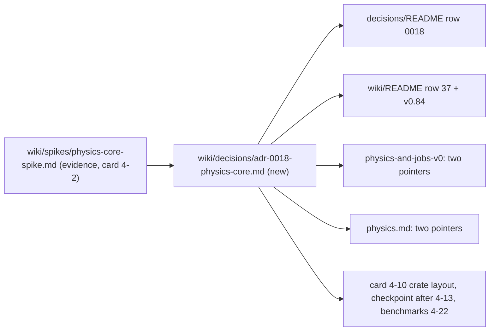

# Review 4-3: ADR-0018 physics core

Task: 4-3. Class 3 (governance): the owner declared it a governance task by picking the card in the session of 2026-11-04. Documentation only, no code. Loops: see the end. Open blocker/major: see the end.

Delivers: `wiki/decisions/adr-0018-physics-core.md` (new), ADR index row 0018 updated, `wiki/README.md` (one index row 37, status line and changelog v0.84), pointer fixes in `wiki/architecture/physics-and-jobs-v0.md` (two places) and `wiki/architecture/physics.md` (two places).

## UML view (documentation change, clean-code-and-review section 7)

The ADR carries two Mermaid views: a class view of the three options with the `Dim` trait, the `D2`/`D3` instances and the one-crate layout, and a decision flow of the fallback trigger. The change itself:

## Decisions

- Recommendation of the spike taken as written: B with a narrow `Dim` trait; C recorded fallback; A not taken. Status line says the owner has not yet accepted the recommendation.
- No new number: each figure in the ADR is copied from the spike page (sections 1, 3.1, 3.3, 3.4, 4, 5, 7, 8). The spike sets no numeric threshold for the fallback; the ADR lists the spike's three conditions and two judgements from its evidence (frictions, benchmark vs the measured 3 to 5%) and says the weight is the owner's call.
- ADR-0012 is unchanged (the result does not touch the solver); the design note's "if it changes, ADR-0012" is answered in decision point 8.
- Version v0.84, not v0.83: `develop` already has v0.83 (card 4-8); another governance PR may also choose a number, so a README conflict is possible.

## Evidence

- Numbers traced against the spike page by an independent read-only reviewer (see Loops).
- Local gates and wiki lint: see the PR.

## Not verified

Everything in the ADR section 6 (which restates spike section 8): one machine, Windows only, unexplained all-in-one slowdown, no real 3D narrowphase or tree, no soft-step solver, no full-engine compile time. Also: the fallback thresholds are not measured.

## Loops

See the end of the PR description.
