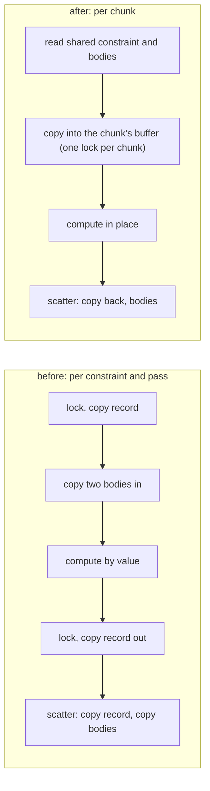

# Review 4-30: F-SCALE, why the parallel colour solve was slower than the serial one

Task: 4-30 (cleanup before phase 5; ordinary card, one PR into `develop`). Class 2 (concurrency and hot-path performance in `physics`). Changed: `engine/physics/src/d2/solver/stage.rs` (rewritten), `engine/physics/src/d2/solver/mod.rs`, one determinism self-test, wiki. No new `unsafe`, no `#[allow]`, no new dependency, no gate file.

## Diagnosis

Single thread, release build, 990-box pyramid (44 rows), per step, temporary timers (removed):

| part | serial scalar | staged, inline scheduler |
|---|---|---|
| solve loop | 1.29 ms | 3.75 ms (colour jobs 3.49, scatter 0.24) |
| prepare + finish | 0.20 ms | 0.20 ms |
| whole step | 2.40 ms | 4.83 ms |

The staged path cost 2.7 times the whole serial solve loop **with no scheduler at all**, so the scheduler was not the cause. Chunk size did not matter either (16 to 1024 gave 4.7 to 5.0 ms at one worker). A throw-away experiment (`UnsafeCell` instead of the `Mutex`, not kept) took the colour jobs from 3.49 to 2.73 ms: the per-constraint lock was about a third of the extra cost; the rest was copying a 330-byte record (constraint and two bodies) in, out, into the arrays of four of the lane code and again in the scatter, about 9 360 constraint passes per step.

## Fix

The shared constraint and body arrays are read only during a pass; each chunk builds its work in its own pre-sized `Mutex<ChunkOut>` (locked once per chunk, never contended) and the serial scatter writes the buffers back in chunk order, which is the canonical member order. Per constraint the arithmetic, the lane grouping bits, the cut into chunks and the order of the write-back are the same, so all hashes are unchanged. The buffers are made in `set_execution` (not in a step): a step allocates nothing (`parallel_allocation` test passes).

## Measurements

Windows laptop, release, interleaved rounds so that drift hits every row alike, ratio to the serial scalar solve in the same run. The absolute times are **not** comparable: the first runs were taken on battery in energy-saving mode (serial 13 to 15 ms per step, discarded), the last ones plugged in but still noisy (serial 4.6 to 5.0 ms against 2.4 ms in the clean first run). Two pairs, old code against new code, 44 rows:

| configuration | old, run 1 / 2 | new, run 1 / 2 |
|---|---|---|
| 1 worker, chunk 32 | 2.23 / 1.93 | 1.17 / 1.60 |
| 2 workers, chunk 32 | 1.54 / 1.44 | 0.83 / 1.01 |
| 4 workers, chunk 32 | 0.97 / 0.89 | 0.73 / 0.91 |
| 6 workers, chunk 32 | 1.04 / 0.90 | 1.04 / 1.29 |

New code, larger scenes (one run each, chunk 32): 80 rows (3240 boxes): 1 worker 1.02, 2 workers 0.62, 4 workers 0.42, 6 workers 0.48 of serial (parallel efficiency against one worker 0.82 at 2 and 0.60 at 4 workers). 60 rows: 1.47, 1.00, 0.84, 1.14. 30 rows: 1.27, 1.60, 1.51, 1.60.

Reading: the staging overhead is much lower (one worker 1.2 to 1.6 times serial instead of 1.8 to 2.7); the pool wins clearly once a colour has enough work (80 rows); on the 990-box scene it is about equal to serial at 2 and 4 workers and still up to 1.3 times slower at 6 workers (with 120 constraints per colour there are 4 chunks, so 6 workers cannot all work, and the laptop has 6 performance and 8 efficiency cores). The acceptance criterion "parallel not slower than serial at the scaling scene's sizes" is therefore **met for 2 and 4 workers on the 990-box scene within the noise, not met at 6 workers there, and met with a wide margin at 3240 boxes**. The 70 percent efficiency target of the vision page is met at 2 workers and not at 4 (0.60) on the 80-row scene.

## Decisions

- No automatic switch to the serial path below a colour size was added: the application knows its scene and chooses whether to pass a scheduler; a rule in the solver would be a new behaviour to specify and measure. The crossover (a few hundred constraints per colour, pyramids of about 60 rows and more) is documented in `physics-and-jobs-v0`. **Open for the owner:** build the automatic switch (a later card) or keep the choice with the application.
- A chunk run twice is now harmless (idempotent). The determinism self-test `every_faulty_scheduler_is_seen_...` listed `RunsFirstChunkTwice` among the faults the replay must see; that fault no longer changes any bit, so the test now excludes it from "must be seen" and a new test `a_chunk_that_runs_twice_changes_nothing` asserts the new fact on three scenes. The other four faults are still required to be seen. This changes what a test claims and is reported on purpose.
- A constraint with a missing body is skipped and not written back (it is not reachable: the world only passes valid bodies); before, its stale copies were scattered.
- `reviews/4-29.md` suspected that the caller leaving a call after one empty scan (`PARK` for worker 0) contributes. **Not measured and not changed** (card 4-29 is a test fix; changing the pool is a separate decision): the 80-row result shows the pool scales without it.

## Findings

| # | Severity | Where | Finding | Status |
|---|---|---|---|---|
| F1 | minor | scaling at 6 workers on the 990-box scene | still up to 1.3 times serial | open: documented, owner decision on automatic switch |
| F2 | minor | lane path | not re-measured | open |

## Not verified

- The numbers come from one laptop in an unstable power and memory state; the reference-machine protocol was not followed (card 4-22 says the same for its numbers). The ratios agree across two pairs but vary by 20 to 30 percent.
- Not run locally: Miri, coverage, mutation score, `tsan`, ARM64, the instruction-count gate (the serial path is the plain loop over a `Vec<Staged>` instead of `Vec<Slot>`, an expected small drop, not measured), the D2 golden job on Windows and Linux (hashes are unchanged in the local determinism tests, which compare against the serial reference).

## Metrics snapshot

Local gates: all steps pass (clippy and the unit tests of every tool included); the only FAIL lines are the four known deliberate failures of the tool self-tests. `cargo test -p physics` with the feature `cross-platform-determinism`: all pass on Windows; `cargo test -p physics -p jobs` with the feature: all pass on Linux (WSL Ubuntu), including the 21 determinism tests and the pinned hashes (92 `jobs` tests, 291 `physics` unit tests). Clippy needed three small refactors after the first version (nesting limit 3, `needless_for_each`, a by-reference argument); done.
