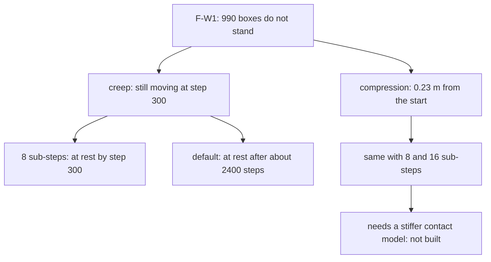

# Review 4-31: F-W1, why the 990-box pyramid does not stand

Task: 4-31 (cleanup before phase 5; ordinary card, one PR into `develop`). Class 1 (the classifier says so: tests and documentation only). Changed: `engine/physics/tests/stability/{scene,findings}.rs`, wiki. **No solver code, no golden file, no gate file changed.** Owner decision on the approach (asked in the session): keep the default solver, record the limit.

## Red evidence

Test `the_w1_pyramid_is_at_rest_after_300_steps` (44 rows, default solver, `final speed < 0.02 m/s`) failed first: `W1 pyramid 44 rows: final speed (m/s) 0.037005253 is not below 0.02`. It was then replaced by the two tests below, which state what is true and measured (the pattern of the other findings of card 4-17). No existing test was weakened or deleted.

## Diagnosis

Release build, 44 rows (990 boxes), sleeping off, 300 steps unless stated. "settled" = largest displacement between step 100 and the end (or `steps - 200`).

| configuration | max drift from start | settled | final speed |
|---|---|---|---|
| default (4 sub-steps, 1 relax) | 0.2473 | 0.1492 | 0.0370 |
| 8 sub-steps | 0.2300 | 0.0090 | 0.0092 |
| 16 sub-steps | 0.2220 | 0.0013 | 0.0001 |
| 4 sub-steps, 2 relax | 0.2245 | 0.1062 | 0.0156 |
| 4 sub-steps, 4 relax | 0.2438 | 0.0475 | 0.0207 |
| contact 15 Hz | 0.7558 | 0.0716 | 0.0130 |
| contact 60 Hz | 0.5139 | 0.2971 | 0.1731 |
| default, 600 / 1200 / 2400 steps | 0.34 / 0.45 / 0.45 | 0.080 / 0.033 / 0.0016 | 0.035 / 0.022 / 0.0015 |
| 8 sub-steps, 600 / 1200 steps | 0.2300 | 0.0037 / 0.0001 | 0.0000 / 0.0001 |

The finding mixes two things:

- **Creep (fixable by tuning).** The default solver is still moving at step 300 and needs about 2400 steps to rest; 8 sub-steps rest by step 300.
- **Compression (not removed by any setting that rests).** 43 rows squeeze the soft contacts of the bottom rows by about 0.23 m, with 8 or 16 sub-steps as well. The absolute bound of workload W1 (no box more than 0.05 m from its start) cannot be met by tuning sub-steps; it would need a stiffer contact model, which is a design change (60 Hz contacts were worse). 4-17 F1 notes (not re-verified here) that measured "from the settled position" the bound would be met at 20 rows.

## Decision (owner, asked in the session)

Keep the default 4 sub-steps; record the limit. Raising the default to 8 would roughly double the solve time (W1 step about 2.4 ms before, over the provisional 2.0 ms budget; this estimate was not measured) and change every pinned hash and the D2 golden file (a protected path, a governance task). Not done.

## What changed

- `scene.rs`: `pyramid_with(rows, half, sleep, solver)`; `pyramid` calls it with the default (same scenes, same bits as before).
- `findings.rs`: `finding_the_w1_pyramid_is_still_settling_after_300_steps_with_the_default_solver` (bound exceeded and envelope, envelopes fixed after the measurement: 0.30 m, 0.20 m, 0.05 m/s) and `the_w1_pyramid_is_at_rest_after_300_steps_with_eight_sub_steps` (settled and at rest, and the compression stated: above 0.05, below the 0.30 envelope).
- Wiki: paragraph "As built in card 4-31" with a Mermaid view, README v1.09.

## Findings

| # | Severity | Finding | Status |
|---|---|---|---|
| F1 | minor (documented limit) | the absolute 0.05 m bound at W1 scale is not met by any setting; it needs a stiffer contact model or a re-definition from the settled position | accepted by the owner's decision above (limit recorded in tests and wiki); a solver change would be a new card |
| F2 | minor | default creep takes about 2400 steps to rest at W1 scale | open: documented rule of thumb (8 sub-steps) |
| F3 | nit | the cost of 8 sub-steps at W1 was estimated, not measured | open |
| F4 | nit | duplicated floor literal in `pyramid_with` and the position loop in `w1_pyramid_run` (test code) | open |

Independent review (fresh agent): no blocker; its one major (F1 listed as an open major) was re-classed as above.

## Not verified

- Linux (WSL), Miri, coverage, mutation, `tsan`, ARM64: not run; only tests and docs changed.
- Numbers come from one laptop; they are simulation results (not timings), so they do not depend on machine load, but the D2 feature was not enabled for the sweep (the physics here is the default float path).
- Debug-build run of the stability binary: 36 tests pass in about 12 s.

## Metrics snapshot

`cargo clippy -p physics --all-targets -- -D warnings` clean. `cargo test -p physics --test stability`: 36 pass in the debug build (about 12 s) and in the release build (about 1 s).
