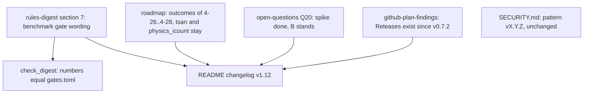

# Review 4-32: governance wording after the repository move

Task: 4-32. Class 3 (governance task declared by the owner, 2026-11-08: `wiki/rules-digest.md` is protected). Documentation only; no threshold, gate configuration or workflow changes.

## What changed and why

| Item | Change | Evidence |
|---|---|---|
| Q20 | "the spike still decides before phase 4" replaced by the outcome (spike 4-2, ADR-0018 accepted in 4-3, B stands) | `wiki/decisions/adr-0018-physics-core.md` |
| Digest section 7 | "PR benchmark gate on instruction counts" becomes "benchmark gate on the release PR, measured in instruction counts"; the phrase `instruction counts (warn 5%, fail 10%)` that `tools/gate-check` reads is kept | `python tools/gate-check/check_digest.py ...` prints "agree"; the gate runs on `main` and by hand (delivery-pipeline rule 2a) |
| Roadmap | new section with the outcomes of 4-26, 4-27, 4-28 and the decision not to make `tsan` and `physics_icount` opt-in (a gate would be lowered; owner's decision, recommendation no) | `wiki/workflow/github-plan-findings.md`, README v1.06 |
| github-plan-findings | the sentence that `SECURITY.md` refers to tag v0.7.0 is updated: Releases exist since v0.7.2 | `gh release list`: v0.7.2, v0.7.3, v0.7.4 |
| SECURITY.md | not changed: it says "the newest tag `vX.Y.Z`", a pattern, so it names no tag that could be missing | read |

Left on purpose: `wiki/architecture/physics-and-jobs-v0.md` line 803 and `docs/budgets` still say "PR benchmark gate" (a design note and a dated budget report; the page is also edited on `develop`, a merge conflict for a wording change).

## Reviews

Self-review of the diff, local gates (wiki lint, digest check, architecture, classifier = class 3). No code, no test change, so no independent code review was started; a documentation diff of five files was read by the author against the sources above. Open blocker/major: 0.
