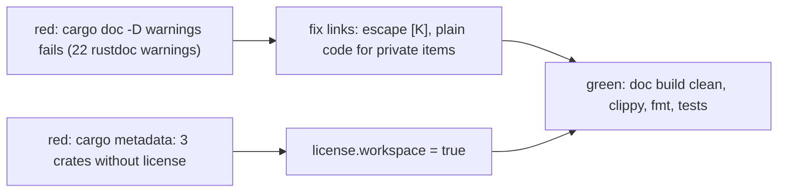

# Review 4-33: rustdoc warnings and licence metadata

Task: 4-33. Class 1, ordinary card into `develop`. Documentation comments and three manifest lines; no behaviour change.

## Evidence

- Red 1: `RUSTDOCFLAGS="-D warnings" cargo doc --workspace --no-deps --keep-going` reported 22 rustdoc warnings, not only the `Tree::structure_hash` link of the card: `**[K]**` read as an unresolved link in 17 places (`physics/src/core/{colouring,joint,sleep,solver}.rs`), a redundant link target and an unresolved `self::validate` (`render/src/null.rs`), links to private items (`SIZE_WAIT`, `JointTable::new`, `Api::load`), and `Tree::structure_hash` (`world.rs`). Green: the same command prints no rustdoc warning.
- Red 2: `cargo metadata` showed `license` empty for `physics`, `tools_physics_bench` and `app_physics_sample`. Green: all 23 packages say Apache-2.0.
- fmt check, `clippy --workspace --all-targets -D warnings` clean.

## Not changed, reported

Cargo prints `only one of license or license-file is necessary` for every crate that carries both fields (20 before, 23 now), because ADR-0023 and card 4-26 put both in the manifests and the card asks for `license`. It is a cosmetic warning (`publish = false`). Removing it means dropping `license-file` from all crates: a decision for the owner, no card created.

Open blocker/major: 0. No independent code review: the diff is comments and three manifest lines.
