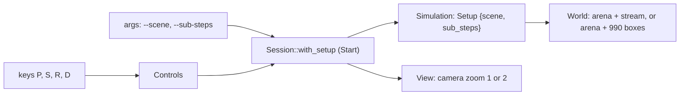

# Review 4-34: the pyramid scene in app_physics_sample

Task: 4-34 (owner request after card 4-31; ordinary card, one PR into `develop`). Changed: application code of `engine/app_physics_sample` (layer 4) and the wiki. **No physics or solver code, no gate file, no dependency changed.**

## What it does

- `--scene stream|pyramid` and `--sub-steps N` (1 to 16) on the command line; keys P (switch scene), S (switch between 4 and 8 sub-steps), R (restart the current setup), D (debug drawing).
- The pyramid scene is the 44 rows / 990 boxes of workload W1 (0.5 m boxes) on the arena floor, never sleeping (as in the stability tests of 4-17), no stream; clicks still drop a body.
- Drawn zoomed out (the camera shows twice as much world: 10 pixels to the metre) so that the 22 m pyramid fits the 800x450 window; debug drawing off by default there (the sprite capacity went from 8192 to 16384 so that turning it on does not drop most lines; sprites past the capacity are still counted).
- Changing the scene or the sub-steps rebuilds the world (the sub-steps are fixed at world build) and starts from step zero.

## Tests (written before the code; the first run failed to compile on the missing `Setup`, `PYRAMID_HALF`, `FINE_SUB_STEPS`)

- `simulation`: the pyramid scene has 990 boxes on the floor inside the arena, drops no stream and never sleeps; the sub-steps change the run and are deterministic; the default setup gives the same state hash as `Simulation::new`; toggles restart from step zero and `reset` keeps the setup; zoom and debug defaults per scene.
- `args`: scene and sub-steps parse, bad and missing values are refused with a message that names the cause, `--sub-steps` is checked at both ends (1 and 16).
- `controls`: the two new keys ask once per press; a click is placed correctly when zoomed out; the debug drawing can be set.
- `session` (Null device): P shows the pyramid with 993 sprites (no debug), S switches to 8 sub-steps and restarts, D adds debug sprites without error, P goes back; a session can start in the pyramid.
- `binary`: `--null` runs of the pyramid with 4 and 8 sub-steps have their own stable hashes, differ from the stream, and the stream hash is unchanged by `--scene stream`; bad flags exit 2.
- Existing tests unchanged apart from two struct literals of `Args` that gained `..Args::default()`.

## Findings

| # | Severity | Finding | Status |
|---|---|---|---|
| F1 | minor | the window itself was **not run**: GLFW is not found on this machine (`not run: device not set up (GLFW: not found)`), so the picture, the zoom and the keys were verified on the Null device only | open: the owner needs `glfw3.dll` (or `DUCK_GLFW_LIB`) to look at it |
| F2 | minor | the effect is subtle on screen: the 0.25 m sag is about 3 pixels at this zoom and the creep is slow; there is no text on screen (the status line goes to stderr) | open: a speed tint or a reference line would be a later card |
| F3 | nit | frame time of the 990-box scene with the sprite path was not measured | open |
| F4 | process | while looking for the GLFW library I listed the parent folder and searched sibling project folders for a file name (outside `DuckEngine/`); nothing was read, copied or changed, and the search was stopped | disclosed |

## Not verified

- The OpenGL window (see F1). Linux, Miri, mutation, coverage, `tsan`: not run.
- The no-allocation test of the sample passes; the larger sprite buffers are allocated once at start.

## Metrics snapshot

`cargo test -p app_physics_sample`: 57 unit + 6 + 11 + 1 tests pass; `cargo clippy -p app_physics_sample --all-targets -- -D warnings` clean (two findings fixed on the way: more than 3 bools in `Controls`, a function with 6 arguments).
