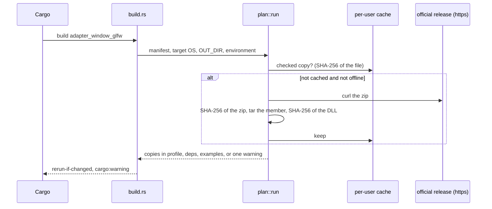

# Review 4-35: runtime libraries come with the build

Task: 4-35. Class 3 (governance task declared by the owner: `THIRD_PARTY.md`, `gates/architecture.toml`) on top of Class 2 content (new crate, build script that downloads and runs tools). Goal from the owner: a build that uses a library needed at run time (GLFW, for OpenGL) brings it into the folder of the executable; no more "GLFW: not found" after a plain `cargo build`.

Delivers: crate `engine/adapter_runtime_libs` (layer 3, std only: SHA-256, manifest parser, download/check/cache/copy, one planning function), `engine/adapter_window_glfw/build.rs` and `runtime-lib.txt`, `adapter_window_glfw::explain` (the "not found" message names where the library was looked for and the fix), a test that ties the manifest to `THIRD_PARTY.md`, the architecture edge `adapter_window_glfw -> adapter_runtime_libs`, wiki section 2 of `architecture/examples.md` (with a flowchart) and the changelog entry v1.11.

## TDD

Test list first (`src/tests.rs`), red (unresolved imports), then the implementations. Later red-first steps: the member/file that starts with `-` (reviewer finding, refused by the manifest), and "a failed fetch watches nothing" (reviewer finding 1). Standard SHA-256 vectors (empty, "abc", two blocks, one million `a`) pin the hash; the network is behind the `Tools` trait, so no test needs one. The real download was done by hand and by the build itself: both hashes match `THIRD_PARTY.md`.

## Reviews R1-R8

- R1 self, R2 automated: `cargo fmt`, `clippy -D warnings` (workspace, all targets), tests of the new crate (23) and of the manifest/register test; local gates: only the four known self-test lines fail.
- R3 independent (fresh-context reviewer, 14 findings, no blocker). Fixed: major 1 (a missing file was watched, so a failed download repeated on every build; now nothing is watched on failure, curl has a 15 s connect and 120 s total timeout); curl `-q` and `--proto-redir`; `--` before the archive member; `fs::copy` fallback removed (rename only, no half-written file); cache folder chosen by the build machine, not the target; more environment variables watched; broken line continuations in `explain`; `-` prefix refused. Left as they are, on purpose: re-hash of the cache file between check and copy (the cache is the user's own folder; the copy is checked by size and bytes on the next run), stale `.work-<pid>` folders after a kill (small, in the cache, removed when the same id comes back), glob characters in `member` (the manifest is in the repository and read by the owner), `build.build-dir` (documented limit: binaries run from another folder need `DUCK_GLFW_LIB`), cross-building to Windows from Linux (a warning, not a failure).
- R4 QA: the test list covers hashes, manifest refusals, cache hit, damaged cache, offline, bad hashes, failed download, missing member, copy, repair, idempotence, other OS, override variable, warnings.
- R5 architecture: one new layer-3 crate used by one adapter, a declared edge; no engine code depends on it (a build dependency and a dev dependency).
- R6 security: https only, hash of the archive before unpacking and of the file after, the cache re-checked before use, a damaged file removed, no shell (arguments, not a command string), member and file names cannot leave their folder or start with `-`, no secrets, the tools come from `System32` on Windows. The pinned hashes are in the repository and in `THIRD_PARTY.md`; the test keeps both in step.
- R7 performance: the build script runs only when its inputs change; a cache hit costs one hash of a 230 KB file.
- R8 product fit: the owner's wish is met; the failure mode is a warning, never a failed build.

## Not caused by this change, found by it

With the DLL present, `adapter_window_glfw` test `the_framebuffer_matches_the_size_times_the_scale` fails on the owner's machine (display scale 125%: framebuffer equals the window size, only the content scale differs). It fails identically on `main` with the DLL. It was never run before because the library was missing. Not weakened, not skipped: card 4-36 asks the owner what `WindowInfo.scale` means. The local gates were run with `DUCK_GLFW_LIB` pointing nowhere, so the GLFW tests report "not run" as they did before; this is stated here because it is the one deviation from a plain run.

Open blocker/major: 0.
