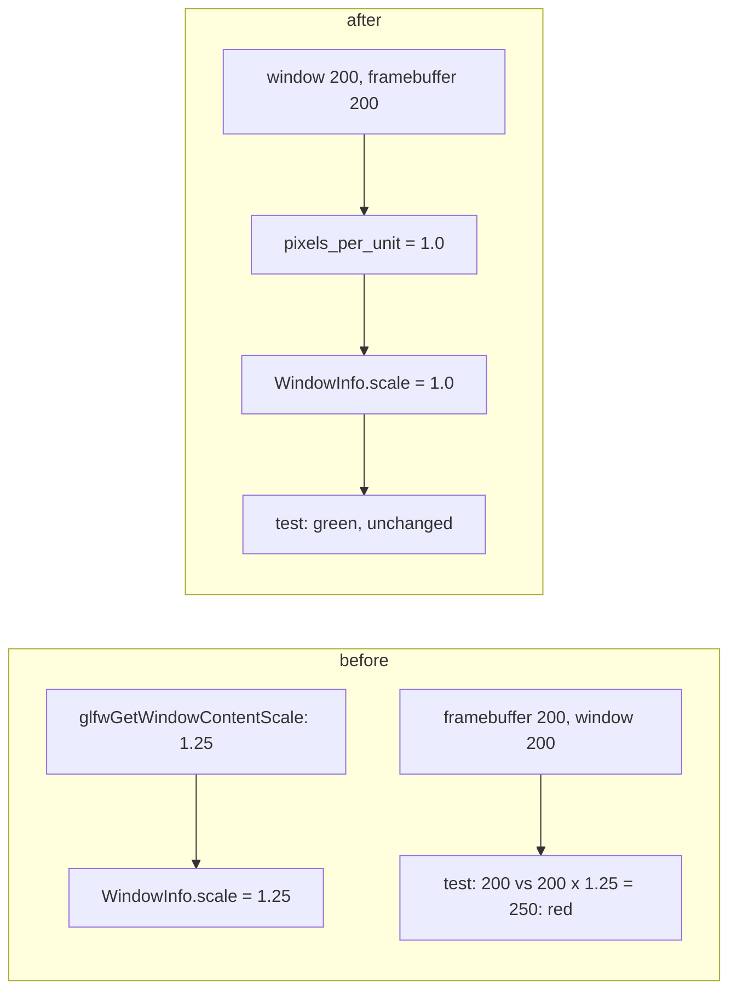

# Review 4-36: the window scale means pixels per screen unit

Task: 4-36. Class 2 by the classifier (module root of `adapter_window_glfw`); ordinary card into `develop`, no governance file.

## Finding and decision

The port documents `WindowInfo::scale` as "Pixels per screen unit" next to `framebuffer_width` in pixels. The adapter returned GLFW's display content scale instead. On Windows the process is DPI aware, so screen units are already pixels (window 200, framebuffer 200) while the content scale is 1.25 with 125% display scaling. The existing test `the_framebuffer_matches_the_size_times_the_scale`, which states the documented relation, was red on the owner's machine as soon as the DLL was present (card 4-35 made it present). The contract was right and the adapter wrong, so the adapter changed and the test did not: no test was weakened or skipped, and no port type changed.

## Change

- `pixels_per_unit(width, framebuffer_width)` in `adapter_window_glfw/src/lib.rs`, used by `window_info`; zero width gives 1.
- The now unused `get_content_scale` field, its symbol load and the `scale` method (one `unsafe` block) were removed from `glfw.rs`.

## Evidence

Red: a unit test of `pixels_per_unit` did not compile before the function existed; the real-window test failed with `scale: 1.25` on the owner's Windows machine (card 4-36). Green: both pass; the whole `adapter_window_glfw` test target passes with the real DLL on this machine (framebuffer test included), fmt and `clippy --workspace --all-targets -D warnings` clean, `-D warnings` doc build clean.

## Not done, reported

A separate display content scale (for sizing interface elements) is not exposed any more. No code uses it; a future UI card should add its own field to the port, which is a port change and so an owner decision.

Open blocker/major: 0. No independent reviewer: the diff is one small function and a removal.
