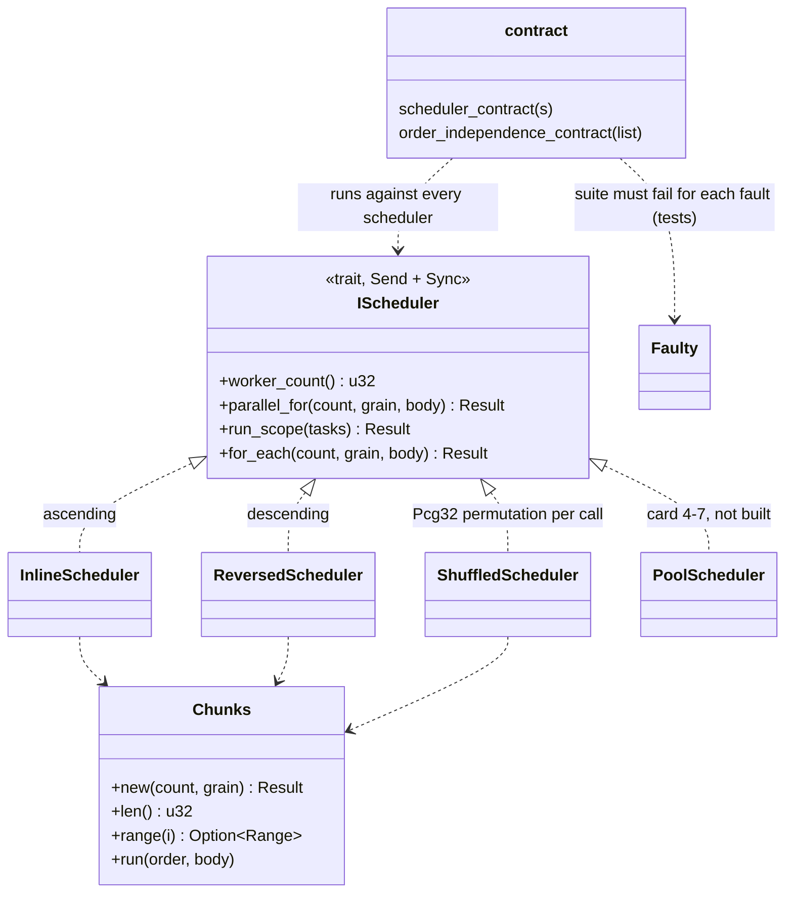

# Review 4-4: `jobs` crate v0, `IScheduler`, inline and test schedulers

Task: 4-4. Class 2 (new module and public API; no protected path touched, no architecture row needed). Loops: 1 of 3 (see the end). Open blocker/major: see the end.

Delivers: crate `engine/jobs` (workspace member line in `Cargo.toml`, matching `Cargo.lock` entry): `error` (`JobError`), `scheduler` (`IScheduler`, `Chunks`, `run_tasks`, `RangeBody`, `Task`), `inline` (`InlineScheduler`), `reversed` (`ReversedScheduler`), `shuffled` (`ShuffledScheduler`), `contract` (suite, feature `contract-tests`), a test-only `faulty` module, integration tests `no_allocation` and `shared_across_threads`; as-built paragraph in `wiki/architecture/core-runtime.md` section 3, pointer in `wiki/architecture/physics-and-jobs-v0.md` section 2, `wiki/README.md` changelog v0.79.

## Decisions and deviations

- **Where the port lives.** `IScheduler` is declared in `jobs` (layer 1), the module that provides and tests it; `physics` (layer 2) and later `ecs`, `render` may depend on `jobs` (edges exist in `gates/architecture.toml`). `jobs` depends on `base` only (`Pcg32`); it does not yet use `platform` (no threads). Arch-check passes with the new crate and no governance edit: `jobs = 1` is in the layer table.
- **API shape vs the design-note sketch.** `parallel_for(count, grain, body: &(dyn Fn(Range<u32>) + Sync))` as sketched. `run_scope` is `run_scope(&[&(dyn Fn() + Sync)])`, a slice of independent borrowed tasks, not a closure that spawns: a spawning scope needs a place to store the spawned closures (a `Box` per task, or `unsafe` lifetime erasure), and a slice needs neither. `for_each` (provided method) is the per-index convenience. `u32` indices and counts, as handles are `u32`.
- **Join semantics.** A call is fork-join: it returns only after every job finished, and writes the jobs made to disjoint slots are visible afterwards. For the inline scheduler the join is immediate, but the contract suite checks visibility after return for every scheduler, so the pool cannot cheat. There is no separate `wait` call in v0: a handle-returning submit would need task storage; the design note keeps the counter and `wait_help` internal.
- **Chunking.** All three schedulers use chunks of exactly `grain` indices (the last may be shorter). The port only promises "disjoint, non-empty, cover `0..count`, all but the chunk ending at `count` have at least `grain`", so a pool may merge chunks; the suite asserts only that.
- **Ordering contract (documented on the trait).** The port promises no order and no thread; bodies must be pure functions of their range and of data no other chunk writes. The inline scheduler is ascending (slice order for tasks), the reversed one descending, the shuffled one a fresh seeded permutation per call (same seed and same call sequence give the same orders). `order_independence_contract` compares a pure loop under several schedulers.
- **Errors as values.** `JobError::{InvalidGrain, TooManyChunks{max}, Busy}`; a refused call runs no job (the suite checks it with a faulty scheduler that violates this). No panic crosses the port; jobs themselves return nothing, and with `panic = abort` a panic in a job ends the process. Test and contract helpers panic by design (documented `# Panics`, as the platform suite).
- **Shuffled scheduler details.** The permutation buffer is allocated once in `new(seed, max_chunks)`; a call with more chunks is refused (`TooManyChunks`), never grows the buffer. The state is behind a `Mutex` taken with `try_lock` for the duration of the call, so the scheduler is `Sync` and a nested call from a job returns `Busy` instead of deadlocking. Fisher-Yates uses `Pcg32::below` (unbiased); a test shows all six orders of three chunks occur over 200 seeds. No `HashMap`, no external crate.
- **Faulty schedulers** (`faulty.rs`, test only) implement eight deliberate faults (skips a chunk, runs a chunk twice, accepts a zero grain, cuts chunks below the grain, overruns the range, skips a task, runs a task twice, runs a job while refusing) plus a no-fault control; each fault must fail the suite with its own message (lesson of R-23).
- **Allocation.** No call allocates after construction: the integration test `no_allocation` uses the per-thread counting allocator, a warm-up frame, 100 frames of `parallel_for` + `for_each` + `run_scope`, asserts 0 allocator calls for the three schedulers, and has a guard test that the counter does see an allocation. The design is heap-free, so this test passed on its first run (no red evidence, as for 3-5); the guard test shows it cannot pass silently because the allocator is missing.
- **Clean-code limits.** The `excessive_nesting` limit (3) forced the shared loops into `Chunks::run` and `run_tasks`, and the faulty scheduler into small helpers; no `#[allow]`.

### `Send` and `Sync` and the later pool (explicit reasoning)

The pool (card 4-7) must be addable without changing the port. What it needs, and what v0 already fixes:

1. **The scheduler is shared.** Systems hold `&dyn IScheduler` and call it from the calling thread; a pool has queues and worker handles. So `IScheduler: Send + Sync` is on the trait (a pool can satisfy it with atomics and locks inside). A `&mut self` method would make a shared pool impossible, so every method takes `&self`; the shuffled scheduler shows the pattern (interior state behind a lock).
2. **The body runs on other threads.** A body is `&(dyn Fn(Range<u32>) + Sync)`: `&F` is `Send` exactly when `F: Sync`, so a worker may hold the reference and call it. `Fn` (not `FnMut`/`FnOnce`) is required because several workers call the same body at once. `Send` on the closure itself is not needed: it is never moved, only borrowed.
3. **Borrowed, not `'static`.** The closure borrows the caller's frame data. A worker can use it only because the call blocks until all workers are done; erasing the lifetime for the worker queue is the one `unsafe` the pool needs (design note section 8), and it stays inside the pool because the port already guarantees the join. Had the port taken `'static` or boxed closures, the zero-allocation rule would be broken.
4. **Disjoint results.** Jobs return nothing; results go to slots the caller owns. A body can write them through atomics or a `Sync` wrapper; a safe `&mut [T]` split API (chunked mutable slices) is deliberately not in v0 because it needs `unsafe` or a pool-side splitter; it can be added as a provided method later without breaking the trait.
5. **Not decided here:** nested calls from a job (the shuffled scheduler returns `Busy`; a pool will need wait-help to support them), cancellation, priorities, and `run_scope` over more tasks than a fixed queue holds (`TooManyChunks` is the existing way to report it).

`tests/shared_across_threads.rs` checks `Send + Sync` of every scheduler and of `&dyn IScheduler`/`Box<dyn IScheduler>` at compile time, and runs each scheduler from another thread with a borrowing body.

## Test list (written first)

Chunks: zero grain refused; zero count makes no chunk; short last chunk; grain larger than count; `u32::MAX` count without overflow. Inline: passes the suite; ascending chunk and task order. Reversed: passes the suite; descending orders; same result as inline. Shuffled: passes the suite; permutation, neither ascending nor descending; same seed same orders, different seed different orders, fresh permutation per call; tasks shuffled; all six orders of three chunks reachable; too many chunks refused and nothing runs (and the boundary count works); nested call is `Busy`; empty call; same result as inline over 20 seeds. Suite: control passes; each of eight faults fails with its message; order independence notices a different result; pure loop result pinned to the hash values. Integration: no allocation (3 schedulers + guard); `Send + Sync`, use from another thread.

## Evidence

- **Red evidence per cycle.** Chunks: 4 of 6 tests failed against a stub (`len` 0, grain not checked). Inline: with a stub that ran nothing, the suite and ordering tests failed (2 failed, 16 other tests passed). Reversed: against an ascending implementation 2 order tests failed with `left: [0, 3, 6, 9]`, `right: [9, 6, 3, 0]` and `[0, 1, 2, 3]` vs `[3, 2, 1, 0]`. Shuffled: against an unshuffled permutation 4 tests failed. Faulty schedulers: each `should_panic` test has its expected message, and the control test shows a fault-free copy passes.
- `cargo test -p jobs`: 34 unit tests, 4 allocation tests, 2 thread tests pass. `cargo test --workspace --locked`: 1066 passed, 0 failed.
- Clippy `-D warnings` workspace and `-p jobs --all-targets` (also with `--features contract-tests`): clean on Windows; `-p jobs --target x86_64-unknown-linux-gnu`: clean. rustfmt clean.
- Mutation (cargo-mutants 27.1.0, `-p jobs`): first run 76 mutants, 60 caught, 11 unviable, 5 missed (`Chunks::is_empty -> true`, four in the test hash `mix`); closed by asserting `!is_empty()` for a non-empty loop and by pinning `pure_loop_result` to literal hash values; second run: 65 caught, 11 unviable, 0 missed. After the R3 fixes (dead `is_empty` removed) a third run: 73 mutants, 62 caught, 11 unviable, 0 missed.
- Line coverage (cargo-llvm-cov, lines): total 99.20% (4 uncovered lines of 499), per file 97.9% to 100%; branch coverage needs a nightly compiler and was not run. 
- Headless graph check: no `adapter_*` or `app_*` crate in the tree. Local gates: see the PR (architecture, unsafe budget, wiki lint pass; `jobs` adds no `unsafe`).

## R1-R8

| Phase | Result |
|---|---|
| R1 self | Re-read the diff: no debug code, no `unwrap`/`expect`, no `#[allow]`, docs on all public items. |
| R2 automated | fmt, Clippy (pedantic, nesting limit) on both targets, workspace tests, local gates, mutation 0 missed, coverage 99.2% lines. |
| R3 independent | See "Review loops". |
| R4 QA | Edge cases covered: zero count, zero grain, grain above count, `u32::MAX`, capacity boundary, nested call, repeated calls (50 rounds), faults of the suite itself. |
| R5 architecture | Layer 1 crate, depends on `base` only, port declared by the provider module as the design note says, no new arch row, no layer violation; thread creation rule untouched (tests spawn scoped threads, allowed in `jobs`). |
| R6 security | No `unsafe`, no I/O, no new dependency. Resource safety: buffer sized once, a too large call is refused, `try_lock` avoids deadlock. Integer overflow: chunk arithmetic cannot overflow (tested at `u32::MAX`). |
| R7 performance | Zero allocations per call after construction (counted per thread). One virtual call per loop. No benchmark in this card (the pool card measures scheduler overhead); the chunk loop is a plain iterator over indices. |
| R8 product fit | Meets the card: port, inline scheduler, two order-changing test schedulers, contract suite, no threads, no `unsafe`. The first consumer is physics (4-10 and following). |

## Not verified

Behaviour on Linux at run time (only compiled and linted for `x86_64-unknown-linux-gnu`; CI runs the tests); branch coverage; Miri (no `unsafe` here); the pool, its scaling and TSan (cards 4-5 to 4-7); that physics code will find the borrowed-closure API convenient (first use in 4-10 onwards); a safe split-slice helper for disjoint mutable output is not provided.

## Review loops

R3 (independent, read-only agent), loop 1 of 3: no blocker; 2 major, 6 minor, 2 nit. Fixed:

- M1 (the doc said "pure function of its range" gives D1, but a pool may regroup chunks and a per-chunk reduction would then change): the trait contract now says the effect must equal calling the body index by index in any order and grouping, names per-chunk reductions as D1-breaking, and a test scheduler that merges everything into one chunk passes the suite and the order-independence check.
- M2 (the Busy case also covers calls from another thread, inline schedulers accept nesting): the trait contract has a "No nesting" rule, `Busy` is documented for both cases.
- m1 `JobError` is `#[non_exhaustive]`; m2 a task slice longer than `u32::MAX` is `TooManyChunks`; m3 comment on the unreachable `below` fallback; m4 `Chunks` and `run_tasks` are `pub(crate)`; n1 class diagram of the design note says `run_scope(tasks)`.
- Not changed: m5 (join visibility is shown with atomics and cannot prove the happens-before edge; the TSan run of the pool card 4-7 is the proof, section 6 of the design note); m6 (empty call takes the lock in the shuffled scheduler, follows from the Busy rule); the name `TooManyChunks` also covers tasks (kept to avoid a second variant); n2 (`Caps::has_threads` wiring is the composition root's job, later).

Loops used: 1 of 3. Open blocker/major: 0 (the fixes were checked by the author and the full suite, no second independent pass).
